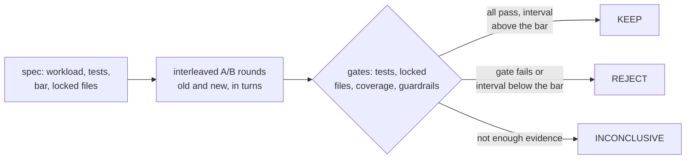

# perfproof

Evals and guardrails that stop a coding agent from making false claims,
with performance as the proving ground.

Ask an agent to make your code faster and it will often tell you it did.
Benchmarks are noisy, so a single before-and-after run can show a win
that is only the machine moving. I built perfproof so the agent can't
say "it's faster" until something exact has said so.

It is two parts. The `perfproof` CLI is the exact core: statistics,
gates and run records. The `/perfproof` skill is how an agent drives it
to look for slow code, try changes and prove them. The skill does the
judgement. The CLI does anything that has to be right.



*Every change goes through the same loop, and only KEEP is allowed to
be called a speedup.*

I don't have a measured false-claim rate against an agent working alone
yet. The held-out evaluation that produces one has not run (see
[evidence](#evidence)). Until it does, this README makes no such claim.

## What KEEP means

KEEP means three things held at once, in the run's own record:

- **The speedup interval sits above the bar.** The default bar is 3%.
  The interval is sequential, at 99.58% confidence per look on the
  Python schedule, with alpha 0.05.
- **Every gate passed.** Your tests, the locked files, changed-line
  coverage, and guardrails on memory and tail latency.
- **The project is inside the calibrated domain.** The class is
  confirmed, the workload is confirmed, and the run used that class's
  own schedule.

Outside that domain perfproof still runs and reports, but it withholds
KEEP and says why. The rule is in [docs/method.md](docs/method.md).

The published limits:

- **GPU kernels have no KEEP at all.** There are no real GPU traces yet.
- **Calibration is on recorded noise, not on every machine.** Each class
  rests on a small number of traces, from the table below.
- **An absolute cap such as "memory stays under X" is scoped "in these
  runs, on the machine as it was".** A loaded machine can move it
  ([scope of the claim](docs/method.md)).
- **Runs from different hosts or sessions don't compare.** One identical
  config moved 16% between sessions
  ([vLLM case study](docs/case-studies/vllm-prefix-caching.md)).

## Install

perfproof is not on PyPI yet. PyPI is coming; until then you install
from this repository. You need [uv](https://docs.astral.sh/uv/) and git.
uv fetches Python 3.12 itself.

Claude Code, as a plugin:

```bash
claude plugin marketplace add https://github.com/siddiquifaras/perfproof.git
claude plugin install perfproof@perfproof
```

Then say `/perfproof` in a repository, or "make this faster". I ran
both lines in a fresh, empty home directory, and the plugin showed as
installed and enabled. I used the full HTTPS URL on purpose: the
`siddiquifaras/perfproof` shorthand clones over SSH, so it needs a
GitHub SSH key.

The CLI on its own, with no install:

```bash
uvx --python 3.12 --from git+https://github.com/siddiquifaras/perfproof perfproof doctor
```

On a cold uv cache that took 43 s on my Mac, and `doctor` reported the
host and what it could not find. Codex and other agents:
[docs/install.md](docs/install.md). Codex installs the skill, but I have
not run a Codex model through it, so treat that as untested.

## What is supported

"Supported" means the loop has a recorded run behind it. "Experimental"
means the code exists and I have run it, but no recorded run backs a
KEEP. Every row says where the evidence is, or that there is none.

| Target | Status | Evidence |
|---|---|---|
| Python, the prove path | **supported** | [6 of 6 verdicts right on planted examples](results/prove-examples/summary.md); 210 calibration cells, 0 failing |
| Node and TypeScript | experimental | 105 calibration cells, wall metric only; no KEEP in any run ([r10-node](eval/skill/runs/r10-node/report.md)) |
| C and C++ | experimental | 42 cells from 2 traces of one program; no KEEP on a native project ([r10-native](eval/skill/runs/r10-native/report.md)) |
| Rust | experimental | no Rust trace of its own, no KEEP ([r10-rust](eval/skill/runs/r10-rust/report.md)) |
| Go | experimental | no class of its own, no KEEP ([r10-go](eval/skill/runs/r10-go/report.md)) |
| Java | experimental | 63 cells, wall only; no KEEP ([r10-java](eval/skill/runs/r10-java/report.md)) |
| Ruby, C# and .NET | experimental | no trace of their own; INCONCLUSIVE in the reports, which ran before calibration ([r10-ruby](eval/skill/runs/r10-ruby/report.md), [r10-dotnet](eval/skill/runs/r10-dotnet/report.md)) |
| Web services, agentic apps | experimental | cells pass, but `perfproof load` and `perfproof replay` are not built; no run yet |
| LLM serving | experimental | calibrated on 2 CPU Ollama traces only; no run of perfproof on vLLM or SGLang yet |
| GPU kernels | **limit** | no real traces, so no KEEP; no run yet |
| `perfproof find` (discovery) | experimental | no recorded run of the shipped version; earlier discovery was weak, see below |

The r10 reports ran before calibration was switched on, so no KEEP was
possible in them. They show the skill ran on those languages, not that
it proves anything there.

## Evidence

Only numbers with a committed source. Transcripts and scripts are not
committed; the harness reports and verdict records are, under
`results/`. The mixed-language run-4 explanation rests on a committed excerpt
of the transcript.

**Calibration.** I resampled recorded A/A noise (the same code run
against itself) to count false KEEPs, 4,000 replications per cell. The
run of record is seed 8268209547887630561, 2,520 cells per procedure.
All 630 in-class cells pass. A cell fails at 84 false KEEPs of 4,000;
the worst in-class cell has 37.
[method.md "Real noise"](docs/method.md#real-noise),
[results CSV](tests/calibration/results/real-seed-8268209547887630561.csv).
Six off-class cells fail, running one class's traces under another's
schedule, and they are published as limits.

| Class | Real traces | In-class cells | Failing |
|---|---|---|---|
| python_cpu | 10 | 210 | 0 |
| native | 2 | 42 | 0 |
| node | 5 | 105 | 0 |
| jvm | 3 | 63 | 0 |
| web_service | 4 | 84 | 0 |
| agentic | 4 | 84 | 0 |
| llm_serving | 2 | 42 | 0 |

A fresh seed resamples the same traces. It tests the procedure on them
again, not on new workloads. I chose to count each class's own traces
after I had seen results, and the
[decision is on record](docs/method.md#real-noise) (see "The real-trace
unit").

**Prove loop on planted examples.** 6 of 6 verdicts were right: two real
fixes KEEP, two wrong-output changes REJECT, two edits to a locked
benchmark REJECT. Each case ran once, on bottlenecks I planted, so this
shows the loop works, not that it generalises.
[Summary and verdict records](results/prove-examples/summary.md). The
membership KEEP is 491x on the timed section and about 3x end to end,
on an example with a planted bottleneck; the summary explains both.

**Mixed-language repositories.** On 5 Python-over-native tasks, with
detailed prompts, the skill found the known function in 4, 4 and 3 of
5 runs against 3 of 5 for Claude Code alone. One KEEP in the last
run was for a different real bug than the task's hidden one, so the
harness's timing of the task's own bottleneck read 1.00x; the task
scored "not found" ([details](results/mixed-stack/summary.md)). On vague prompts it found 2, 2 and 0 of 5
(the last run only ran 4), against 1 of 5 alone. It also cost several
times more per task.
[Summary](results/mixed-stack/summary.md).

**Discovery on code held out from tuning.** The known bottleneck of a
real merged fix was found in 2 of 8 tasks, and 0 of 8 passed in full,
at `light` depth only, not the default medium
([heldout-1](eval/skill/runs/heldout-1/report.md),
[heldout-2](eval/skill/runs/heldout-2/report.md)). Those tasks have
since been used for tuning, so they no longer count as held out.

**Held-out evaluation: coming.** About 30 tasks, perfproof against the
same agent alone, scored by the rules in
[docs/evaluation.md](docs/evaluation.md), reported with intervals
whatever they show. No results exist yet and there are no placeholder
numbers here.

## What a run does

`/perfproof` takes a depth word: `light`, medium (the default) or
`deep`. It ends with what was slow and why, what changed, the evidence,
and what was not checked. A kept change goes on a `perfproof/<name>`
branch for you to merge. perfproof also writes `.perfproof/`, which it
excludes through `.git/info/exclude`, and baseline snapshots under
`.git/worktrees/` ([docs/install.md](docs/install.md)).

## How it works

- [The CLI and its `--json` output](docs/cli.md)
- [The decision rule, gates and metrics](docs/method.md)
- [Discovery, and the `find` command](docs/discovery.md)
- [What each target class needs](docs/targets.md)
- [Which failure each part stops](docs/failure-modes.md)
- [How I evaluate it](docs/evaluation.md)
- [Architecture](docs/architecture.md)

## Limits

- Counter metrics need Linux. macOS has no `perf`.
- No number here is a speedup to expect on your code. Only a KEEP from
  your own run is a measurement.
- A KEEP from a day when your machine was busy is wider, not
  disqualified. The record says how busy it was.
- The skill is not free. The mixed-language runs cost several times
  what the agent alone did.

## Licence

[Apache-2.0](LICENSE)
