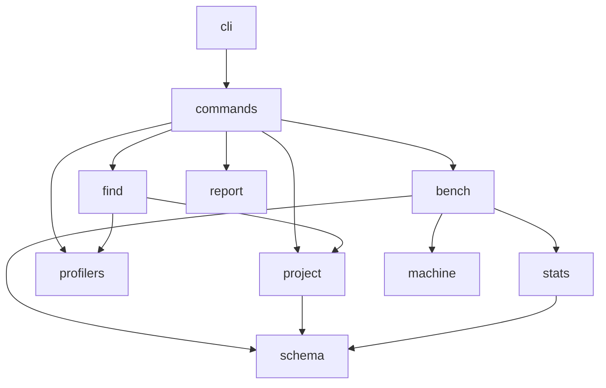

# Architecture

A small exact core and the Markdown skills that drive it. Why each part
exists: [failure-modes.md](failure-modes.md). Interface: [cli.md](cli.md).
Prove: [method.md](method.md). Understand and discover:
[discovery.md](discovery.md).

## Shape

- **The CLI** owns what must be exact: state, measurement, statistics,
  gates, undo and records. Agents call it with `--json`, and long
  comparisons with `--detach` and `status`.
- **The skills** own judgment: what to look at, hypotheses, candidates. If
  the agent skips a step, the gates still stand between it and a kept change.
- **Local only.** Remote runners (SSH, Modal) aren't built.

## Packages

| Package | Job |
|---|---|
| `perfproof.schema` | Pydantic models for every record: spec, sample, gate, verdict, guardrail, project model, hypothesis |
| `perfproof.stats` | Intervals, sequential looks, decision rule, guardrails, noise simulation. Pure functions on NumPy arrays |
| `perfproof.bench` | Spec and lock, snapshots, runner, correctness, differential checks, coverage, side-effect guard, compare |
| `perfproof.machine` | Fingerprint and warnings |
| `perfproof.project` | The project model: proposal, confirmation, staleness, history |
| `perfproof.hypotheses`, `perfproof.profilers` | The append-only hypothesis log; run a profiler and summarise folded stacks to the top frames |
| `perfproof.find` | `perfproof find`: map the app, probe, rank, plan (see [find.md](find.md)) |
| `perfproof.report` | Renders a record. Computes nothing new |
| `perfproof.commands`, `perfproof.cli` | One module per CLI command plus shared helpers; argument parsing and dispatch |

## Module boundaries

The intended direction is one way, from the CLI down to the maths.



*Arrows are allowed imports. `stats` takes arrays and never imports `bench`.*

Three edges go the wrong way today and are being fixed separately:

- **`profilers` imports `commands`** for `JsonValue`
  (`profilers/growth.py:73`, `summary.py:30`, `rank.py:45`).
- **`find` imports private `commands` helpers** (`find/mapping.py:21-22`,
  `find/probes.py:25`, `find/engine.py:17`).
- **`bench` and `project` import each other** (`bench/compare.py:243-246`,
  `project/store.py:29`).

## On disk

perfproof keeps its state in `.perfproof/` inside the user's
repository, which it adds to `.git/info/exclude`:

```
.perfproof/
  project.json                 targets, workloads, goals, constraints
  project.history.jsonl        every earlier version of every entry
  benchmarks/<name>/
    <spec-hash>.json           one spec version and its lock manifest
  hypotheses/<workload>.jsonl  every hypothesis event, append-only
  worktrees/<name>/            baseline and candidate checkouts
  harness/                     benchmark files perfproof owns; copied into
                               both trees before every run, all locked
  runs/<run-id>/
    logs/setup/                output of each tree's setup commands
    progress.json, pid         a detached compare's progress and process
    samples.jsonl              one line per completed round, for resume
    record.json                the full machine-readable result
    report.md                  the readable report
    samples.npz                raw per-round samples
    profiles/                  profiler outputs, untouched
```

A benchmark's name is how people and agents refer to it. Its spec hash
identifies one exact version: changing any spec field gives a new hash
and a new file beside the old one, never an overwrite.

## What perfproof reuses and what it adds

Checked against each tool's own documentation.

| Tool | What it already does well | What it doesn't do |
|---|---|---|
| [hyperfine](https://github.com/sharkdp/hyperfine) | Warmup, a per-run prepare hook, shell-startup correction, outlier warnings, JSON export | Runs each command's batch separately, not interleaved; no significance test or verdict |
| [pyperf](https://pyperf.readthedocs.io/en/latest/analyze.html) | Worker processes, loop calibration, `system tune` to cut jitter, a t-test in `compare_to` | Unpaired comparison; no minimum effect, no INCONCLUSIVE, no correctness gate |
| [Criterion](https://bheisler.github.io/criterion.rs/book/analysis.html) | Bootstrap intervals, Tukey outlier classification, comparison with a saved baseline, a noise threshold | Compares against a stored earlier run rather than interleaving; Rust only |
| Google Benchmark | Automatic iteration counts, repetitions, a comparison script | Same as above, C++ only |
| [Bencher](https://bencher.dev/docs/explanation/thresholds) | CI thresholds with a t-test or z-score against history, alerts | Compares against history, not a paired run; no correctness gate |
| CodSpeed | Low-noise CI measurement through CPU simulation | A hosted CI service; no correctness gate or agent loop |

perfproof reuses their lessons: warmup, calibrated inner loops for `reported`
timing, outlier reporting, tuning advice in `doctor`, and instruction counts
on Linux. What none of them does:

- old and new interleaved in random pairs on one machine;
- a verdict with a minimum effect, an honest INCONCLUSIVE and calibrated
  error rates under sequential looks;
- gates that make "faster but wrong" and "faster by cheating" a REJECT;
- choose-then-confirm when many candidates are tried;
- an agent loop that finds what to try.
