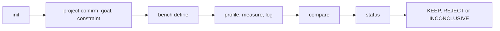
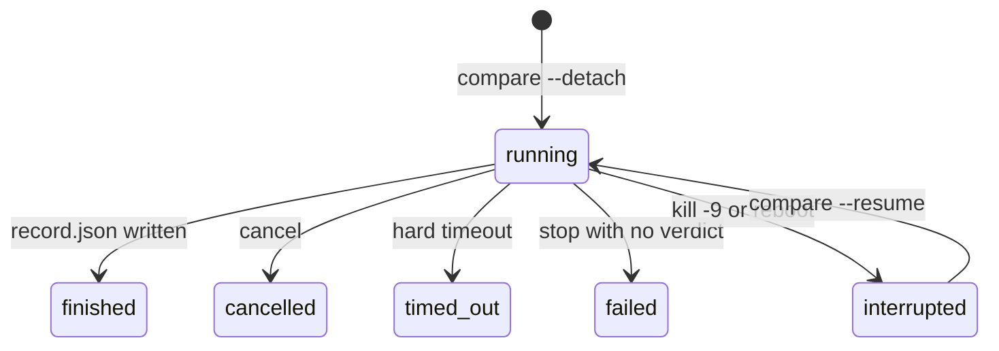

# The CLI

This is the interface the agent and the developer see. I wrote it before the code, so parts of it
were ahead of what existed. The body now documents only what `perfproof --help` shows on 0.1.0.
What's missing is listed at the end under [Not built yet](#not-built-yet).

Every number in the examples is illustrative, not a measurement.

Status: the Python prove path is supported. `find` is built and experimental. Labels per class are
in [targets.md](targets.md).

## Commands

```
perfproof: find where code can get faster, and keep only the changes
that really are.
```

| Group | Command | What it does |
|---|---|---|
| Understand | `init` | Create `.perfproof/` and propose a project model from the repository: target classes, candidate workloads, build and run commands, each with its evidence |
| | `project` | Show the model (`show`, `history`); `add-workload`, `confirm`, `goal`, `constraint add`, `retire`; `check` which entries are stale |
| Discover | `find` | Run the mechanical discovery steps: tooling, probes, a map, leads, one question and the next steps |
| | `profile` | Run a profiler on a benchmark and summarise the top frames with `file:line` and share of time |
| | `measure` | Measure one version: scaling runs (`--sizes`), one function replayed from captured calls (`--stub`), or one setting changed (`--set`) |
| | `log` | Record a hypothesis, its cheap test, its candidate and its outcome (`add`, `show`, `anchor`) |
| Prove | `bench` | Define and lock a benchmark spec (`define`, `list`, `show`) |
| | `compare` | Prove a candidate against a baseline: gates, interleaved rounds, guardrails, verdict, record |
| | `status` | State and progress of a detached compare |
| | `cancel` | Stop a detached compare and its whole process tree |
| Helpers | `doctor` | Check this machine, its noise sources and the tools perfproof can use here |
| | `install-skills` | Install or remove the `/perfproof` skill for Claude Code or Codex (`--client`, `--uninstall`, `--force`) |

Options that exist today:

- **Every command:** `--json` for machine-readable output. Most also take `--repo REPO`, any path in
  the repository (default `.`).
- **`compare` only:** `--detach`, `--resume RUN`, `--timeout SECONDS`.
- **`find` only:** `--depth`.

Every verdict is KEEP, REJECT or INCONCLUSIVE, with a reason. A gate that isn't available on this
target blocks KEEP. It never passes.



*The usual order. `find` wraps the middle for you.*

## Saved profiles

Every `profile` run keeps its result in `.perfproof/profiles/<name>/<id>/result.json`. It's the
`--json` `result` object, written whether or not `--json` was passed. It goes to a temporary file
and is then renamed, so it's whole or absent.

An agent that lost its context reads that file instead of profiling again. Keys are only ever added.
A failed write is `state_write_failed`.

On top of `profile --json`'s `result`, the file has:

| Key | Meaning |
|---|---|
| `run_id`, `finished_at` | The directory's name, and the write time (UTC, `YYYY-MM-DDTHH:MM:SS.ffffffZ`) |
| `project_frames_above_bar` | The project's own frames (`is_library` false, never a harness frame) whose total share is at least `min_effect`, ranked by total, as `Hotspot` objects. Cut at 50, not at `--top`. Synthetic and entry frames, and frames on every stack above where stacks first differ, are not in it |
| `next_step` | `null`, or `{"code", "message"}` exactly when `project_frames_above_bar` is empty (below) |
| `min_effect` | The spec's bar as a fraction, which the list was cut at |
| `own_modules` | The `--own-module` values the run got, so `profile show` classifies frames the same way |
| `size` | Only in a `profile --sizes` run: `kind`, `name`, `base`, `factor`, `value` and the `group` the sizes share |

Results saved before `next_step` existed lack it, and readers treat a missing key as `null`. The
text output prints the message as one line.

`next_step` is decided over every sampled stack, not the printed lists:

- **`no_project_frame_above_bar`:** some frame was the project's and none is at the bar. Profile a
  second workload that enters the project another way before choosing an idea.
- **`project_frames_unknown`:** no frame was the project's at all. Frames written `` module`symbol
  `` with no source file (native, Rust, .NET without sources) are the project's only when
  `--own-module` names their binary, so the message says to rerun with `--own-module <name>`. Frames
  with source paths (Python, Node, Java, Go, Ruby) are classified by the project root, which
  `--own-module` can't change. The message then names the root and says to check `--repo` and that
  the workload calls the project's code, not only an installed copy.

### Looking a function up: `profile show`

```
perfproof profile show <name> [<run-id>] --function <pattern> [--json]
```

It reads the saved run and answers for the functions that match `<pattern>` from the run's folded
stacks, streamed once. Nothing is profiled again. It's for the function the agent suspects from
reading the code and the printed lists don't show.

- **Run id:** a directory name or a unique prefix. The latest run when omitted.
- **Argument order:** `--function` goes after the names. A benchmark named `show` is profiled as
  usual unless `--function` or a second name follows.
- **Matching** follows the skill eval (`perfproof.profilers.names`): the last component of the
  printed name must equal the pattern's, and an owner in the pattern (`Echo.ServeHTTP`, `Foo::bar`)
  must end the printed owner. Arguments, generics, import paths and Rust hashes are ignored. A name
  that only shares a suffix (`sum` for `slow_sum`) never matches. Entry and synthetic frames are
  searched too.

`--json` result:

| Field | Meaning |
|---|---|
| `name`, `run_id`, `directory`, `folded`, `profiler`, `basis`, `weight_unit` | The run, as saved |
| `pattern`, `samples` | The pattern, and all samples of the profile (the denominator) |
| `found`, `reason`, `match`, `note` | Whether it was seen, why not, how it matched |
| `functions`, `functions_omitted` | Matches by total share, then self share, at most 50 |
| `min_effect`, `labels` | The run's bar (`null` if it saved none), and labels |

Each entry of `functions` has `function`, `file`, `line`, `frame_kind`, `is_library`, `is_harness`,
`self_fraction`, `total_fraction`, `self_samples`, `total_samples`, `seen` and `cap`. The cap is `1
/ (1 - total_fraction)`: a bound, never a measured effect, and `null` when the function is the whole
profile. When the bar is known there's also `cap_above_bar` (`true` for a `null` cap). Two functions
of the same name in different files are two entries.

`match` is `exact`, or, for a pattern with an owner no printed frame carries (`kernels.fib` where
the frame prints as `fib (app/kernels.py:12)`), `file` (the owner is the file's stem) and then
`bare_name` (the name alone). `note` says which. A function present under its bare name is never
reported absent. Eval scoring keeps the strict rule.

A function with no sample is not an error. `found` is `false` and `functions` holds one entry with
zero shares and counts, `cap` 1.0 and `seen` false. Its `reason` says `not seen in this profile`,
with the two causes that can hide a function the workload runs: inlined, or unsymbolised.

Errors: `not_a_repository`, `invalid_name`, `invalid_argument` (no `--function`, a wrong number of
names, a run id that isn't a directory name), `invalid_pattern`, `not_found` (no saved run, or none
with that id), `ambiguous_run`, `invalid_record` (`result.json` isn't a profile result),
`state_read_failed` and `invalid_profile`.

### Profiles at several sizes: `profile --sizes`

```
perfproof profile <name> --sizes 1,2,4 (--size-arg=--n=1000 | --size-env N=1000)
                  [--profiler ...] [--json]
```

It profiles the benchmark once per size, with the mechanism of `measure --sizes`.

- **`--size-arg=FLAG=BASE`** appends `FLAG <size>` to the spec's command.
- **`--size-env NAME=BASE`** sets the variable.
- **Sizes** are `BASE` times each multiplier of the list: at least three distinct, and an `x` suffix
  is allowed.

Each size is an ordinary profile run with its own directory and `result.json`, plus the `size` key.
The runs go back to back with nothing between them. Summaries, evidence, saved results and fits are
made after the last run, so perfproof's own work never sits between two runs.

A failure at one size ends the command with that run's error, naming the size (`details.size`). The
directories and raw profiler output of sizes already profiled stay, but no result is saved for any
size, so `profile show` and `--rank` don't see them.

Then it fits how each project function's **cost** grows with size:

- **Cost** at a size is the function's total share of that size's profile times the unprofiled run's
  wall time there, in seconds. It's an estimate: two separate runs.
- **Exponent `e`** of `cost ~ size ** e` is the slope of a least-squares line on the logs
  (`perfproof.bench.estimates.fit_exponent`), with its 95% interval, `r_squared` and `n`, the number
  of sizes that saw the function. The workload's own exponent is fitted the same way to the wall
  times.
- **`evidence`** per function: `shown` when the lower end of its interval is above the upper end of
  the workload's; `lead` when not, but its exponent is at least 0.25 above the workload's (intervals
  overlap, so a place to look, with the note `interval_overlaps_workload`; 0.25 is an arbitrary
  display margin that keeps near-ties out); `none` otherwise; `null` without a fit or a workload
  fit.

Only `shown` is ever worded as "faster than the workload" or "its ceiling rises". The method and
limits are in `perfproof.profilers.growth`.

`--json` result:

| Field | Meaning |
|---|---|
| `name`, `spec_hash`, `size_group`, `knob`, `sizes` | `spec_hash` is the benchmark's, not the size-modified command's |
| `runs` | Per size: `factor`, `size`, `run_id`, `directory`, `wall_seconds`, `profiled_wall_seconds` |
| `workload` | `exponent`, `low`, `high`, `r_squared`, `n`; `null` below three sizes |
| `functions` | Every project function seen at any size, by exponent descending |
| `faster_than_workload` | Those with `evidence` `shown` or `lead`, or that appear only at larger sizes |
| `growth_file`, `labels` | Where the same document is saved: `.perfproof/profiles/<name>/growth-<group>.json` |

Each function has `function`, `file`, `line`, `frame_kind`, `costs`, `total_fractions` and `samples`
(one per size, `null` where unseen), `fit` (`null` when fewer than three sizes saw it), `evidence`,
`appears_at_larger_sizes` and `notes`.

`notes` say when to distrust a fit:

| Note | When |
|---|---|
| `few_points` | Fewer than four sizes. Three give an interval with one degree of freedom, which is very wide |
| `noisy` | `r_squared` below 0.9 or an interval wider than 1 |
| `few_samples` | Under 30 samples at some size, counting a pyinstrument millisecond as a sample |
| `missing_sizes` | Seen at only some sizes. Fitted from those, and not at all below three (`no_fit`) |

Limits:

- One profile per size, so fits rest on 3 or 4 points.
- A wall time with start-up in it pulls the workload's exponent toward 0 and flags more functions.
- A function that dominates the workload has the workload's own exponent and isn't flagged. Its cap
  at the largest size, in `profile show --rank`, shows it.
- A knob that changes no work gives exponents near 0.
- Functions match across sizes by kind, file and name, not line.

Errors beyond `profile`'s: `invalid_argument` (`--sizes` without `--size-arg` or `--size-env`, or
the reverse, or a malformed knob). Fewer than three distinct sizes is a usage error (exit 2).

### Ranking across saved profiles: `profile show --rank`

```
perfproof profile show --rank [<name>...] [--top N] [--json]
```

It reads every saved run of the named benchmarks (every benchmark with saved profiles when none is
named) and ranks the project's functions across all of them. It profiles nothing. Each run's folded
stacks are streamed once, so many large profiles take as long as reading them.

- **`--rank` replaces `--function`.** A benchmark named `show` is still profiled unless `--rank`,
  `--function` or a second name follows.
- **Run directories** are named by their UTC start to the microsecond, rising with each one a
  process creates. So the latest run, which `profile show` reads by default, is the last created,
  also within one `--sizes` run.
- **Stale profiles:** delete old runs under `.perfproof/profiles/` when the code has changed. The
  ranking has no notion of a stale profile.
- **Harness frames:** a frame whose file is under the project's `.perfproof/` directory (the driver
  an agent keeps in `.perfproof/harness/`) is `is_library` true and `is_harness` true. It's never
  ranked, never in `project_frames_above_bar` or a growth fit, never a project frame for
  `next_step`, and its file is never counted as sampled. It stays in `hotspots` and
  `frames_by_total` so an agent can see its driver's cost.

The rule is fixed: **cap at the largest size measured, descending.**

- Within each benchmark, take the profile at its largest measured size (a plain profile is its own
  largest) and the function's cap there, `1 / (1 - p)` for its total share `p`. Across benchmarks,
  take the largest.
- A function that is a whole profile has no finite cap and comes first.
- A function not sampled at a benchmark's largest size has an unknown cap there, not a small one. If
  that holds for every benchmark that saw it, its cap is unknown and it comes last, saying so.
- Ties go to the function seen in more profiles, then file, line and name.
- Real inputs are at least the test size, so a function that's costly only at small sizes doesn't
  outrank one that dominates at the largest. Nothing is projected beyond the measured sizes.
- The highest cap in any profile stays in each row as `best_any_size`, labelled informational and
  never used to rank.
- A **wrapper** (`wrapper` true: a known cap that isn't finite, and no time of its own, such as
  `main`) keeps its place in the JSON, flagged. The text output lists wrappers after the real
  candidates and says so.

`--json` result: `benchmarks`, `runs` (`benchmark`, `run_id`, `size`, `factor`, `samples`,
`wall_seconds`), `skipped_runs` (a run that can't be read, with the `reason`; it never fails the
ranking), `order`, `functions`, `coverage` and `labels`.

Each function row:

| Field | Meaning |
|---|---|
| `function`, `file`, `line`, `frame_kind`, `wrapper` | Identity |
| `cap`, `cap_known` | The ranking cap; `null` when not finite or unknown |
| `total_fraction`, `self_fraction` | In the profile of that cap; `null` when unknown |
| `cap_above_bar` | That run's bar |
| `ranked_in` | Benchmark, `run_id`, `size` of that profile |
| `at_largest` | Per benchmark that saw it: the largest `size`, `seen`, `run_id`, `total_fraction`, `cap` (the last three `null` when not seen there) |
| `best_any_size` | `cap`, `total_fraction`, benchmark, `run_id`, `size`, `label` |
| `seen_in` | Benchmark, `run_id`, `size`, `factor`, total share and cap in each profile that saw it |
| `growth` | The fit of the most-pointed `--sizes` run of the benchmark that saw it: `exponent`, `low`, `high`, `n`, `workload_exponent`, `evidence`, `appears_at_larger_sizes`, `notes`; `null` when no scaling run saw it |
| `ceiling_rises_with_size` | `true` only when the growth is `shown`; `false` when the evidence is `none`; `null` for a lead, for a function seen only at larger sizes, and for one no scaling run saw (`growth` tells these apart) |

A `true` with `few_points` or `noisy` in `notes` still rests on few, scattered points. The text
output is the top `--top` rows in words, then the never-sampled files.

**Never sampled.** `coverage` lists the project's source files that no function of any saved profile
sampled: `source_files`, `sampled`, `never_sampled` (the count), `never_sampled_by_suffix`, `files`
(all of them, at most 5000), `suffixes`, `suffix_source`, `walk_truncated` and `excluded`.

It isn't line or branch coverage. A file listed was never run by the saved workloads, or only for
too little time to be sampled.

- **Source files** are those of the walk `init` uses (VCS, virtualenv, build and cache directories
  skipped; depth and file count bounded), with a suffix of a language the project has, minus test
  files (a `test` or `tests` directory, `test_*`, `*_test.*`, `conftest.py`).
- **Suffixes:** the project model records target classes, not languages. So they're a fixed table
  per class (Python for every class but `native`, whose C, C++, Rust and Go suffixes stand in for
  it; `.cu` and `.cuh` for `gpu_kernel`), plus the suffix of every project file a profile did
  sample. With no project model, the sampled files' suffixes alone.

Errors: `not_a_repository`, `invalid_name`, `not_found` (no readable saved profile) and
`state_read_failed`.

## `perfproof find`

```
perfproof find [--depth light|medium|deep] [--budget SECONDS]
               [--size-arg WORKLOAD:FLAG=BASE | --size-env WORKLOAD:NAME=BASE]...
               [--no-tests] [--test-timeout SECONDS] [--confirm-tests PART]...
               [--test-command PART=JSON]...
               [--waive CODE=REASON]... [--json] [--repo REPO]
```

Experimental. It runs the mechanical discovery steps and says where they stand. The design is
[find.md](find.md), and this is the interface.

Each call advances one plan as far as the budget allows. Calling it again resumes from
`.perfproof/find/state.json`, written to a temporary file and renamed. `find` writes only under
`.perfproof/`, apart from what the profiled commands themselves do.

| Option | What it does |
|---|---|
| `--depth` | Default `medium`. Light runs no probes. Medium and deep run each part's test command, its existing benchmarks and every user workload. The native recorder runs on parts with native code (at medium also when a leaf frame reaches `min_effect`) |
| `--budget` | Wall-clock seconds for probes in this call: 300 light, 900 medium, 2400 deep |
| `--test-timeout` | Per test run, 300 s by default |
| `--size-arg`, `--size-env` | Store the size knob of a defined workload (`not_found` when it isn't defined). A workload with a knob is profiled with `--sizes 1,2,4` under the key `<name>@sizes` |
| `--test-command PART=JSON` | A part's test command as a JSON array of strings, when none was detected. Kept in `.perfproof/find/test-commands.json`, and still run only after `--confirm-tests` for that argv |
| `--confirm-tests PART` | Records the user's yes to that part's test command, with the argv. Tests run only after it, and a changed argv needs a new confirmation |
| `--no-tests` | Run no tests |
| `--waive CODE=REASON` | Why `define_workloads`, `add_size_knob` or `reach_lead` can't be met. `done` accepts it |

A probe's time limit, per run, is the smaller of what's left of the budget and its own:
`--test-timeout` for tests, 300 s for benchmarks, the spec's for a workload. `profile` runs the
command twice, so a probe can take up to twice that. A probe the budget ended isn't recorded and
stays pending.

`find` runs `init` when there's no project model, otherwise its stale check. `--json` result: the
`FindResult` of [find.md](find.md): `done`, `depth`, `parts`, `question`, `next_steps`, `map`,
`leads`, `not_reached`, `skipped` and `budget`, plus `profilers`, each part's `--profiler-command`
template (an empty list means the default profiler).

- **Probes**, in order: each part's tests (`find-tests-<part>`), then its native re-profile
  (`@native`); the existing benchmarks (`find-bench-<part>-<name>`); then every user workload. A
  probe is current when its spec hash and the `tree_id` match, and a stale probe's old runs are
  deleted before it runs again. A failed or timed-out probe leaves no profile and goes in `skipped`
  with the reason and the log tail.
- **Tree check:** `git status --porcelain` before and after every probe. Entries the probe added
  make it `tree_modified` (reason `tests_modified_tree: <paths>`). Its profile is deleted and it
  never runs again. The other probes go on.
- **Map:** `profile show --rank` over the user workloads' names (none means `map` is empty). At most
  50 rows, wrappers such as `main` left out.
- **Leads:** functions the `find-*` probes reached that no user workload did (test files excluded,
  at most 20), then files the probes sampled that no user workload did. `via_test` is
  `<file>::<function>` of the heaviest test frame above the lead. `not_reached` is the files no
  saved profile sampled.
- **`question`:** confirm each unconfirmed class and each test command, and install each missing
  coverage tool that could lead to a KEEP.
- **`next_steps`**, in order: `install_or_confirm`, `define_workloads`, `add_size_knob`,
  `reach_lead`, `continue_find`. `reach_lead` is advice, and `done` doesn't wait for it.
- **`done`** is true when the depth's probes are done or waived (by `no_tests`,
  `recorder_unavailable`, `tests_modified_tree`, `timeout` or `failed`), the workload and size-knob
  asks are met or waived, and no question or pending probe is left.

`compare` refuses a `find-*` spec with `find_spec_not_comparable`. Exit status is 0 whether or not
`done`. Errors are in the error-code table below.

## Long runs

`compare` runs in the foreground by default. When it may outlast the caller's command timeout, the
agent adds `--detach`. There's no daemon, queue or job service: a detached compare is one process in
its own session, and its run directory is the only state.

| Piece | What it is |
|---|---|
| `runs/<id>/job.json` | What to run: spec, trees, order seed, timeout and deadline, and when each resume happened |
| `runs/<id>/progress.json` | Replaced after each completed round, outside the timed region: phase (`gates` or `rounds`), rounds done, looks, round budget |
| `runs/<id>/samples.jsonl` | One line per completed round, appended after it's written. Not fsynced, so no flush burst before the next round |
| `runs/<id>/machine.json` | The machine fingerprint taken before anything ran, and the start time. A resume needs it |
| `runs/<id>/trees.json` | A manifest of both trees' files at the start. A resume needs it |
| `runs/<id>/run.lock` | Held while a resume decides and spawns |
| `runs/<id>/pid` | Process ID and its start time, so a reused PID isn't mistaken for the run |
| `runs/<id>/cancelled`, `timed_out`, `failed.json` | Written by `cancel`, by the timeout, and by a stop with no verdict (`code`, `message`) |
| `runs/<id>/detached.log` | The process's stdout and stderr |

A resume without `machine.json` or `trees.json` is `not_resumable`. `status <id>`, `cancel <id>` and
`compare --resume <id>` take a run id or a unique prefix of it or of its random part.

### Job states

`status` reports exactly one state, decided in this order. First match wins.

| State | Meaning |
|---|---|
| `finished` | `record.json` exists. Nothing else decides this. The `status` result then carries the verdict |
| `cancelled` | The `cancelled` marker exists and there's no record. No verdict |
| `timed_out` | The `timed_out` marker exists and there's no record: the hard timeout fired. No verdict |
| `failed` | The compare stopped with no verdict (`broken_baseline`, `harness_fault`, `unsupported_spec`, `internal_fault` for a fault in perfproof, or a resume-time refusal the new process finds, such as `machine_changed` or `invalid_job`). `failed.json` has the code and message. No resume can help |
| `running` | The process in `pid` exists, isn't a zombie and has the start time written in `pid` |
| `interrupted` | None of the above: the process is gone and left no record, as after `kill -9` or a reboot. The only state `--resume` accepts |
| `unknown` | The process table couldn't be read, so whether the process lives isn't known. Never resumable: a failed read isn't "gone" |

A reused PID is never taken for the run. A process counts only when its start time equals the one in
`pid`.



*`finished`, `cancelled`, `timed_out` and `failed` are terminal. Only `interrupted` resumes.*

### Commands

| Command | Behaviour |
|---|---|
| `compare --detach` | Does everything that can be refused (spec, revisions, trees), then starts the comparison in a process of its own session and returns at once with the run id. `--timeout SECONDS` is its hard total timeout |
| `status <id>` | Reads the run directory and checks the process. Changes nothing |
| `cancel <id> [--grace SECONDS]` | Marks the run `cancelled`, then ends its process and every descendant: SIGTERM to the run's process group, then SIGKILL for everything still alive, found by parent and by process group. `--grace` (default 10 s) is the longest it waits for the run's process to exit. The SIGKILL sweep starts as soon as it has, at once for an `interrupted` run. No verdict. An already `cancelled`, `timed_out` or `failed` run keeps its state but its processes are still ended. A `finished` run is refused |
| `compare --resume <id>` | Continues an `interrupted` run from its completed rounds. Always detached: it returns at once with the run id and the same `--json` shape as `--detach`. `--baseline` and `--detach` are accepted and ignored |

`--resume` takes no benchmark name, `--candidate`, `--spec-hash` or `--timeout`: they're the run's.
Before anything starts it checks that:

- **State:** the run is `interrupted`.
- **Journal:** it's whole. A torn last line is cut and that round runs again. Only a complete line
  that isn't the next round makes the journal invalid.
- **Trees:** both hold the files they held when the run began.
- **Deadline:** the hard timeout hasn't passed.
- **Machine:** it's the one the run began on (the probes that identify a machine, not load or
  temperature).

It then ends any process of the run left by a `kill -9`, and the new process checks every gate again
and continues from the journal. Two resumes at once are serialised by a lock, and the second finds
the first running and is refused. The record marks where it resumed.

### Timeout

`--timeout SECONDS` applies to `--detach` only. With a foreground `compare` it's a `usage` error. It
must be above 0 and at most 2147483647, and is rounded up to whole seconds with a minimum of 1 s.

The default is twice the spec's `budget.max_seconds` plus 3600 seconds. The default's factor and
floor and the 10 s kill grace are chosen allowances, not measured values. The deadline is fixed when
the run starts, so it covers the whole run including resumes.

- **A clean end.** The run ends itself first when it can. Before it starts a round that couldn't
  finish, with the 10 s grace, before the deadline, it takes its final look on the rounds it has and
  writes its record with a `time_limit_reached` warning. That's the state `finished`, with the
  verdict that look gives (INCONCLUSIVE unless its interval clears or falls below the bar).
- **A hard stop.** When the deadline hits with no such end (the run is inside a round or the gates),
  the run's process and everything it started are killed: SIGALRM in the run's process, then SIGKILL
  of the tree if unwinding takes longer than 10 seconds. The `timed_out` marker is written, the
  state is `timed_out`, and there's no verdict. A `timed_out` run can't be resumed.

### Results

`compare --detach` and `compare --resume`, with `--json`:

```json
{"run_id": "str", "run_dir": "str", "state": "running", "pid": 0}
```

`compare` in the foreground, with `--json`:

| Field | Type | |
|---|---|---|
| `run_id`, `run_dir`, `record_path`, `report_path` | string | Absolute paths |
| `verdict` | object | The record's verdict: `outcome`, `reason`, `rule`, `gate`, `estimate`, `interval`, `rounds`, `looks`, `procedure`, `diagnostics` and the rest |
| `gates` | array | `{"gate", "status"}` in the record's order |
| `warnings` | array | `{"code", "message"}` for every warning in the record |
| `not_verified` | array | What withholds a KEEP, in plain terms for the skill: gates `not_available` with their reasons, guardrails `not_declared`, `unmeasurable` or `not_established`, and the warnings `counter_unavailable`, `resolution_unknown`, `schedule_uncalibrated`, `schedule_not_class_own`, `metric_not_calibrated`, `target_class_unknown`, `target_class_unverified` and `workload_not_confirmed`. Each is `{"kind", "name", "status", "reason"}`. Empty when nothing was left unverified |
| `measured_metric` | object or null | The metric actually measured when it isn't the spec's: a `counter` that fell back to wall time in seconds. Null otherwise |

#### When a verdict is calibrated

`verdict.calibration` is `calibrated` exactly when all of these hold:

- **Class declared:** the spec has a `target_class` (one of `python_cpu`, `native`, `node`, `jvm`,
  `web_service`, `llm_serving`, `gpu_kernel`, `agentic`).
- **Class confirmed:** the project model (`.perfproof/project.json` of the main checkout) has a
  target of that class in state `confirmed` and not stale by `perfproof project check`. `proposed`,
  `stale` and `retired` don't count, nor does a changed evidence file or no model.
- **Schedule:** the look schedule is that class's own default, `alpha` is 0.05, and that schedule is
  calibrated (`gpu_kernel` isn't yet: no real traces).
- **Metric:** for `node` and `jvm`, or when the runtime gate identified a Node or Java runtime in
  either tree (`runtime_family` of the recorded environment), the primary metric's kind is `wall`.

Then `verdict.target_class` is the class and `verdict.calibration_conditions` names the procedure,
schedule, `alpha` and the seed of the run of record. Otherwise it's `uncalibrated` and a KEEP is
withheld (INCONCLUSIVE, `insufficient_evidence`) with one warning naming why:

| Warning | Meaning |
|---|---|
| `target_class_unknown` | No class declared |
| `schedule_not_class_own` | The schedule is another class's |
| `metric_not_calibrated` | `node` or `jvm`, or an identified Node or Java runtime, on a primary metric that isn't `wall` |
| `target_class_unverified` | The project model doesn't confirm the class |
| `schedule_uncalibrated` | `alpha` or schedule outside the domain, including `gpu_kernel` |

A REJECT on evidence is decided the same either way. "The calibrated domain" in
[method.md](method.md) has the rule.

#### A confirmed workload

A KEEP also needs the benchmark's workload confirmed in the project model: a workload named like the
spec, with its target, goal and every constraint `confirmed` and unchanged, on this machine, frozen
at this spec's hash. `compare` always measures. When that doesn't hold it withholds the KEEP
(INCONCLUSIVE, `insufficient_evidence`) with the warning `workload_not_confirmed`, whose message
lists each problem.

It doesn't change `calibration`, and it changes nothing but a final KEEP. Every other verdict, the
stopping round, the estimate and the interval are those of a confirmed workload. Three checks are
part of "confirmed":

- **Goal agreement.** The confirmed goal's metric name, direction and unit must equal the spec's
  (`objective`, or `wall_time` or `cpu_time` for a `wall` or `cpu` metric with none;
  `metric.direction`; `metric.unit`). Each that differs is named.
- **Spec binding.** The workload must be bound to a spec (`spec_hash`), and to this one. `project
  confirm` binds a confirmed workload to the stored spec of its name, and `add-workload` binds it at
  registration. So after `bench define`, run `project confirm ID [--spec-hash HASH]` again, even for
  a confirmed workload.
  - A workload confirmed before its benchmark existed withholds the KEEP ("confirmed before its
    benchmark was defined: confirm again with `perfproof project confirm ID [--spec-hash HASH]`"),
    as does a bound hash that differs from the spec's.
  - A benchmark with several stored specs needs `--spec-hash`. Without it `project confirm` refuses
    (`ambiguous_hash`, listing the hashes) and writes nothing. A benchmark with no stored spec has
    nothing to bind.
  - `project confirm ID --spec-hash B` for a workload already bound to another spec A refuses with
    `spec_already_bound` (naming A and B) and writes nothing. The remedy is `project add-workload
    NAME --target ID --spec-hash B --replace`, then `confirm`. The same hash is a quiet success.
- **Class link.** The spec's `target_class` must equal the class of the confirmed workload's target.
  The warning names both.

Fix it with `project add-workload`, `project confirm` and `project goal --confirm`, then define the
spec again if it changed.

#### Which interval procedure decided

`verdict.procedure` is `hac_lf` or `t_log_ratio_batch_means`. `compare` picks it from the spec's
look schedule before any round, never from data.

| Procedure | Schedules (`n0`, `k`, `max_looks`, `max_rounds`) |
|---|---|
| `hac_lf` | The three defaults: Python and native, 10, 10, 6, 60. Web service and agentic, 10, 10, 3, 30. LLM serving, 10, 6, 3, 22 |
| `t_log_ratio_batch_means` (batch means with the diagnostic gate) | GPU kernels, 20, 20, 6, 120, and any other schedule |

A spec that edits its schedule therefore gets the gated procedure, the fail-closed choice, and so
does any `alpha` other than 0.05. Under `hac_lf` the diagnostics `autocorrelated_rounds` and
`outlier_rounds` are null, because it has no gate. [method.md](method.md), "The T1.11 decision", is
the rule.

#### Guardrail standing

A guardrail with absolute limits adds `standing` to its result in the record (`record.json`,
`guardrails[]`): one entry per limit in the spec's order, for every outcome of a guardrail that was
evaluated. The fields are additive. A reader that doesn't know `standing` or the spec's optional
`limit_quantile` loses nothing, and a spec that sets no `limit_quantile` hashes as before.

| Field | Type | |
|---|---|---|
| `label`, `limit` | string, number | The limit's label and cap, in the guardrail's unit |
| `quantile` | number | The statistic the cap is on: 0.5 (the median) unless the spec declares `limit_quantile` (such as 0.99; only the median is calibrated) |
| `typical` | number | The sample's own value of that statistic |
| `reliable_value` | number or null | The one-sided bound in the cap's direction, in these runs: the upper bound for a cap, the lower for a floor. Its design confidence holds only for rounds that behave like a stable machine, and isn't claimed for drift or another machine. Null while too few rounds give a bound, and for a guardrail recorded `unmeasurable` |
| `gap` | number or null | `reliable_value - limit`, signed; null with `reliable_value`. For a cap, at most 0 is met. For a floor, at least 0 |
| `rounds_over`, `rounds` | integers | Rounds beyond the cap, of the rounds the figures use |

`reliable_value` is information, never a verdict. The status is read off the recorded interval, and
the figure never by itself causes a KEEP. The report prints one line per limit, for example: `Limit
memory: median 498 MB; in these runs it stayed under 512 MB (cap 500 MB, 12 MB short); 4 of 40
rounds over the cap. On a busier or quieter machine this number can move`. The figures describe the
session, on the machine as it was. [method.md](method.md), "Absolute limits", is the rule.

#### Unverified changed lines

When changed lines ran under no check, the `coverage` gate is `not_available` and its `not_verified`
reason names them by file (`work.py lines 12-14 never ran`). The JSON fields are unchanged, and the
run record's `coverage` gate carries the same lines in `unverified`. `status` carries the same
`not_verified` and `warnings` in its `verdict` object for a finished detached run.

### Coverage for other languages

`compare` measures Python coverage itself. For any other language, the spec declares an optional
`correctness.coverage_command` (an argv list, with `correctness.coverage_timeout_seconds`, required
with it and only with it) that writes a standard coverage report. It's backward compatible: absent
by default, a spec without it keeps its hash, and `schema_version` stays 4.

When non-Python files changed and the command is declared, `compare` runs it once in the candidate
tree (in `correctness.cwd`) with the environment variable `PERFPROOF_COVERAGE_REPORT` set to a file
path that doesn't exist. It reads lcov (`SF:`, `DA:`, `end_of_record`), Cobertura XML or JaCoCo XML
from there. With no command declared nothing extra runs, and those changes are `not_available` ("no
coverage command declared").

- **Paths** in the report are relative to `correctness.cwd` (Cobertura: to each `<source>` first;
  JaCoCo: package path plus source file name under `src/main/java` and the other source roots), or
  absolute inside the tree.
- **A changed line** listed with zero hits is unverified (gate `not_available`, lines named). A line
  not listed isn't executable.

The full contract is "Coverage reports" in [method.md](method.md).

### `status` and `cancel` output

`status`, with `--json`:

| Field | Type | |
|---|---|---|
| `run_id` | string | The full run id |
| `state` | string | One of the states above |
| `rounds_done` | integer | Completed rounds, counted in `samples.jsonl` |
| `max_rounds`, `looks` | integer or null | From `progress.json`. Null before it was written |
| `phase` | string or null | `gates` or `rounds`. Null before `progress.json` was written |
| `verdict` | object | Only when `finished`: `outcome`, `reason`, `rule`, `gate`, `rounds`, `looks`, `estimate`, `interval` (`[lower, upper]` or null), `record_path`. The rest is in the record |
| `error` | object | Only when `failed`: `code` and `message` strings |

`cancel`, with `--json`: `{"run_id": "str", "state": "cancelled"}` when the run was cancelled. For a
run that had already `timed_out` or `failed`, `state` is that state.

### Error codes

| Code | Command | When |
|---|---|---|
| `not_a_repository` | all three | `--repo` is in no git working tree |
| `not_found` | `status`, `cancel`, `--resume` | No run, or more than one run, matches the id |
| `not_found` | `compare` | No such benchmark, no spec matches (including a `--spec-hash` that isn't hex), or `--candidate` is an existing path that isn't a directory |
| `invalid_record` | `status` | The record of a `finished` run doesn't read back |
| `invalid_record` | `compare` | The spec directory can't be read or a spec doesn't load, foreground or `--detach` |
| `ambiguous_hash` | `compare` | More than one spec of the benchmark matches |
| `find_spec_not_comparable` | `compare` | The name starts with `find-`: a probe spec of `perfproof find`, profile-only |
| `unknown_part` | `find` | `--confirm-tests` or `--test-command` names no part |
| `no_test_command` | `find` | `--confirm-tests` names a part with no test command |
| `not_found` | `find` | `--size-arg` or `--size-env` names a workload that isn't defined |
| `tree_check_failed` | `find` | The version control state couldn't be read for `tree_id` or the before/after status |
| `state_read_failed`, `state_write_failed` | `find` | `.perfproof/find/state.json` can't be read, isn't a valid state, or can't be written |
| `invalid_revision` | `compare` | A revision names no commit, or a worktree can't be made |
| `already_finished` | `cancel` | The run has a record |
| `cancel_incomplete` | `cancel` | A process of the run survived SIGKILL (`details.pids`), or the marker or process table couldn't be written or read |
| `usage` | `cancel` | `--grace` is negative or not finite |
| `usage` | `compare` | `--timeout` without `--detach`, or not above 0 or above 2147483647; a name or `--candidate` missing (both are required without `--resume`); `--resume` with a name, `--candidate`, `--spec-hash` or `--timeout` |
| `not_resumable` | `--resume` | The state isn't `interrupted` (`details.state`); the files a resume needs are missing; a tree is gone or its files changed since the run began; the hard timeout has passed |
| `machine_changed` | `--resume` | The machine's identifying probes differ from the ones the run began on (`details.differs`). Rounds from two machines are never mixed, so start a new compare. Also written to `failed.json` if the new process finds it |
| `invalid_journal` | `--resume` | A complete line of `samples.jsonl` isn't the next round, or is damaged. A torn last line isn't this: it's cut and re-run |
| `invalid_job` | `--resume` | `job.json` is missing or doesn't read back |
| `orphan_running` | `--resume` | A process of the run left by a `kill -9` couldn't be ended. perfproof doesn't resume beside it (`details.pids`) |
| `state_unknown` | `--resume` | The process table couldn't be read, so leftover processes can't be ruled out |
| `spawn_failed` | `--detach`, `--resume` | The detached process didn't start or couldn't be identified (`details.run_dir`; the message has the log tail) |

- **Before the run starts:** `invalid_revision`, `ambiguous_hash`, `not_found` and `invalid_record`
  are raised first, so `--detach` returns them directly.
- **After it starts:** `broken_baseline`, `harness_fault`, `unsupported_spec` and `internal_fault`
  come from the foreground compare (with `details.run_dir`) or sit in `failed.json` of a detached
  run.
- **Never a stop:** a thing perfproof merely can't verify, a launcher that may download code
  included. It's a gate `not_available` or a guardrail `not_declared` in the record, and the verdict
  is INCONCLUSIVE naming it.
- **A resume that would change units:** one that would measure another metric kind than the first
  attempt (perf usable in one and not the other) is stopped with `not_resumable` in `failed.json`,
  with a plain reason, because the rounds already taken would mix units.

A run that's killed before it finishes never yields a verdict.

## What a benchmark prints

A `reported` metric, and every guardrail the runner can't measure itself, comes from one line the
benchmark prints on stdout, once per execution:

```
PERFPROOF {"value": 12.500000, "p99_latency": 41.250000}
```

The line is `PERFPROOF`, a space and one JSON object. perfproof reads this line and no other output,
with one parser, for the objective and for the guardrails.

| Key | When | Meaning |
|---|---|---|
| `value` | The spec's metric is `reported` (required then; with no `reported` metric it isn't allowed) | The primary metric, in the metric's unit |
| a guardrail's `metric` name, such as `p99_latency`, `throughput` or a project's own | Every applicable guardrail except `peak_memory`, which perfproof measures from `wait4` | That guardrail's value for this execution, in the guardrail's unit |

- **When it reads:** if the spec reports at least one value (a `reported` metric or an applicable
  reported guardrail), perfproof reads the line. Otherwise it reads no output.
- **What fails an execution** (with `cause: output`): a string, `null`, `NaN`, `0`, a negative
  number, a repeated key, a key the spec doesn't ask for (including a guardrail marked not
  applicable), or two `PERFPROOF` lines in one execution. Values are positive, finite JSON numbers,
  and 0 is refused for a guardrail as for `value`.
- **Guardrail values** are whatever the benchmark computes for that execution, such as the 99th
  percentile of its own request latencies. perfproof takes them as given. It pairs the baseline's
  and the candidate's values by round, as it pairs peak memory, and records them per round in
  `samples.npz` (column `reported_<metric>`, NaN where unknown) and, for a detached run, in
  `samples.jsonl`.
- **Decimals:** print a fixed number (`%.6f`). The resolution of each value, which widens its
  interval, is the place of its last printed digit, as for `value` ([method.md](method.md),
  "Resolution").
- **A guardrail the line leaves out is unknown for that execution**, never a default. A missing line
  is the same when the metric isn't `reported`. A round with the value unknown in either arm makes
  the guardrail `unmeasurable`, with the count of executions in its reason ([method.md](method.md),
  "Guardrails", "Missing values"), so the comparison can't KEEP. perfproof doesn't measure it on the
  rounds that have it.
- **Quantiles near 1:** a cap on one has no rank bound at the default budgets
  ([method.md](method.md), "The owner's decision on limits"). Where the values come from doesn't
  change that.

A worked example. A web benchmark times the work and reports its 99th percentile latency in seconds,
with throughput as the primary:

```python
import time

latencies = []
start = time.perf_counter()
for request in requests:
    t = time.perf_counter()
    handle(request)
    latencies.append(time.perf_counter() - t)
elapsed = time.perf_counter() - start

latencies.sort()
p99 = latencies[int(0.99 * (len(latencies) - 1))]
print(
    'PERFPROOF {"value": %.3f, "p99_latency": %.6f}'
    % (len(requests) / elapsed, p99)
)
```

With these in its spec (`direction` and `unit` as declared there):

```json
{"metric": {"kind": "reported", "direction": "higher_is_better",
            "unit": "requests/s"},
 "objective": "throughput",
 "guardrails": [{"metric": "p99_latency", "direction": "lower_is_better",
                 "unit": "s", "allowance": 0.05,
                 "allowance_source": "default"}]}
```

Each execution prints a line like `PERFPROOF {"value": 812.400, "p99_latency": 0.041250}`. The
comparison then checks, round by round, that the candidate's p99 isn't worse than the baseline's by
more than 5%.

- **A breach** of that allowance is a `guardrail` REJECT when the primary shows the change faster
  ([method.md](method.md), "Decision"). Otherwise the primary's own outcome stands, with the breach
  recorded.
- **A p99 shown within it** no longer blocks a KEEP.
- **A p99 the benchmark didn't print**, or printed too coarsely (fewer distinct values than half the
  rounds in either arm), makes the guardrail `unmeasurable`, which does block it.

## `init` targets

`init` proposes a target per class it finds evidence for, each with its evidence lines in
`result.targets[].evidence`. A class with no runnable workload evidence gets a question, never an
invented command.

| `target_class` | Proposed when |
|---|---|
| `python_cpu` | A Python manifest or Python files |
| `native` | A C, C++ or Rust build manifest with sources |
| `node` | A `package.json` with no web framework dependency, and JavaScript or TypeScript source files that are more than half of all source files ([targets.md](targets.md) has the counting rule; a truncated walk proposes neither) |
| `jvm` | A `pom.xml`, `build.gradle` or `build.gradle.kts`, and Java, Kotlin, Scala or Groovy source files that are more than half of all source files |
| `web_service` | Python routes or dependencies; Node `express`, `fastify`, `@nestjs/core`, `koa`, `@hapi/hapi` or `next`; Go `gin`, `echo` or `fiber` in `go.mod`, or `http.ListenAndServe` in a non-test `.go` file; Ruby `rails`, `sinatra` or `roda` in a `Gemfile` |
| `llm_serving`, `gpu_kernel`, `agentic` | Serving configs, CUDA or Triton code, model client dependencies |

`node` and `jvm` use the `(10, 10, 6, 60)` schedule and are calibrated on a `wall` primary metric
only. Another kind withholds a KEEP with `metric_not_calibrated` (the owner's decision of
2026-10-29, "Which traces are in which class" in [method.md](method.md)).

A Go, .NET or Ruby library that isn't a web service gets no class, so a KEEP there isn't calibrated.

Flags (from `--help`): `--dry-run` shows the proposal and writes nothing, `--slow-tests` runs the
project's pytest once to find the slowest tests (with `--python PATH`, default `.venv/bin/python`,
and `--test-timeout SECONDS`, default 600), and `--repo REPO`.

## `project add-workload`

```
perfproof project add-workload NAME --target TARGET_ID
    [--evidence TEXT] [--spec-hash HASH] [--replace] --json
```

It registers a benchmark the agent wrote (`bench define NAME`) as a workload in the project model,
so the developer can confirm it.

- **The entry** is `proposed`, `source` `agent_defined`. Its `command`, `cwd` and `spec_hash` come
  from the stored spec, and `TARGET_ID` must be a live target (`not_found` or `retired_entry`
  otherwise).
- **`--evidence`** is recorded in the history line's note (default: "defined by the agent from spec
  ... of NAME").
- **`--spec-hash`** picks a version when the benchmark has several.
- **Repeats:** the same spec for the same target again changes nothing. Another spec or target under
  an existing name, or a retired workload, is refused with `duplicate` unless `--replace` is given.
  A replacement is a new version that makes a confirmed goal of the workload stale.

Then `project confirm TARGET_ID NAME` and `project goal NAME --metric ... --confirm` work as for a
workload `init` found. The result is that of `project confirm`: `{"action", "records", "entries"}`.

A workload the agent added has no recorded files, so only the spec hash guards it. Define a changed
spec and `compare` withholds the KEEP until `add-workload --replace` and a new confirmation.

## A session

A developer types `/perfproof` on a Python library they've maintained for three years.

```
● perfproof init --json
  target python, workload bench-tile (existing benchmark), goal unknown
  Which workload is real use, and what matters most?
> bench-tile. Wall time. Don't change the public API.

● perfproof project confirm target-python_cpu bench-tile --json
● perfproof project goal bench-tile --metric wall --confirm --json
● perfproof bench define bench-tile --spec spec.json --json
● perfproof profile bench-tile --profiler py-spy --json
  38%  tilekit/resample.py:88   _bilinear_row
  21%  tilekit/io.py:140        TileWriter.write   (waiting: CPU 4%)
● perfproof measure bench-tile --stub tilekit.io:TileWriter.write --json
  1.51 s with that call replayed (was 1.92 s)
● perfproof compare bench-tile --candidate .perfproof/worktrees/h1 --detach --json
  Started run 7a2e.
● perfproof status 7a2e --json
  KEEP  performance  speedup 1.34x  interval 1.29x to 1.40x  40 rounds
● perfproof compare bench-tile --candidate .perfproof/worktrees/h2 --json
  INCONCLUSIVE  insufficient_evidence  gate coverage not available
  Changed lines tilekit/io.py:152-158 never ran under any check.
```

*Illustrative, not a recording: the commands are real, the numbers aren't.*

What it pins down:

- `init` proposes and asks. It never fills the goal by default.
- `profile`, `measure --sizes` and `measure --stub` are the discovery primitives. The hypotheses are
  the agent's, recorded by `log add`.
- A gate that can't be satisfied stops the attempt and goes back to the developer with the exact
  lines. perfproof doesn't edit locked tests to get a KEEP.
- INCONCLUSIVE comes with what would settle it.

## Not built yet

`perfproof --help` on 0.1.0 ends with "Not built yet in perfproof 0.1.0: check, confirm, report,
load, replay." Each exits with an error saying so. None is a spec I can promise yet.

| Name | What it's meant to do |
|---|---|
| `check` | Run the correctness gates only: tests, output comparison, captured-call replay, coverage |
| `confirm` | Choose the best of several candidates, then confirm it with a fresh, independent compare |
| `report` | Render a run record as readable text |
| `load` | Drive an HTTP service at a constant request rate and record latency percentiles and throughput |
| `replay` | Record an app's model and tool calls, or replay them |
| `--host HOST` | Run on `ssh://user@host` or `modal:<image>` instead of here (not accepted) |
| `--depth` on `compare` and `measure` | Depth presets (only `find` has it) |
| `--brief` on every command | Token-thrift output (only `log` has it) |
