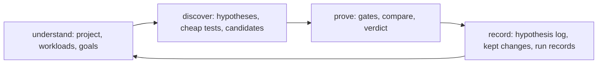

# Understand and discover

perfproof has three parts. This page specs the first two: **understand**
the project and **discover** what could make it faster. The third,
**prove**, decides whether a change is kept, and lives in
[method.md](method.md). `.claude/plan.md` tracks what isn't built.

Status: experimental. `perfproof find` runs the mechanical steps
([find.md](find.md)), but discovery on unseen code is weak. On held-out
repositories it named the hidden bottleneck in 2 of 8 tasks.

*The cycle repeats after a kept change, a code change, a new workload or a new goal.*

## Understand

Discovery is only as good as perfproof's picture of the project. A
developer who has worked on a codebase for years knows what no profiler
shows: which workloads matter, what "faster" means here, and what must
not change. perfproof records that in `.perfproof/project.json` and
keeps it between sessions.

| Part | What it holds |
|---|---|
| Targets | The kinds of code present (Python, native, web service, LLM serving, GPU kernels, agentic app), each with the evidence it was detected from |
| Workloads | Named benchmarks, each with its origin (an existing benchmark, a slow test, an entry point, a route list, recorded traffic, a recorded agent run) and whether the developer confirmed it represents real use |
| Goals | Per workload: the metric (wall time, CPU time, p50 or p99 latency, throughput, peak memory, startup time, cost per token), its direction, the bar, and the guardrails |
| Constraints | Public APIs that must not change, numeric tolerance, target hardware, off-limits dependencies, files perfproof must not edit |
| How to run | Build and setup commands, services the workload needs, the reset command between rounds |

### Project model contract

**Persistence**

- **Files:** `project.json` is the current model. `project.history.jsonl`
  holds every earlier version of every entry, append-only. An entry that
  no longer applies is retired with a reason, never deleted.
- **Atomic writes:** the file carries a schema version and is written
  via a temporary file and a rename, so a crash never leaves half a model.
- **Provenance:** every entry has an ID, a status, the files it came from
  with content hashes, the commands that produced it, the perfproof
  version, and when. A confirmed entry also records who confirmed it, in
  which session, and when.

**Status.** Each entry is in exactly one state:

| Status | Meaning |
|---|---|
| `proposed` | perfproof derived it; nobody has confirmed it |
| `confirmed` | The developer confirmed it |
| `stale` | Something it depends on changed; the trigger is recorded |
| `retired` | No longer applies; the reason is recorded |

**Invalidation.** An entry becomes `stale`, never silently updated, when:

- any file it was derived from changes content;
- the command that defines a workload fails, or its output changes shape;
- a dependency lockfile its workload runs under changes;
- the machine differs from the one a hardware-bound goal or limit was set for;
- the developer edits a goal or constraint it depends on;
- a perfproof upgrade changes how that kind of entry is derived.

**Revalidation.** Before a session uses an entry, and before anything
is measured:

1. Every stale entry the session needs is derived again.
2. If the result is identical, the entry returns to its previous status
   and the revalidation is recorded.
3. If it differs, the new version is `proposed`. A confirmed workload,
   goal or constraint needs the developer's confirmation again.
4. A measurement never runs against a `proposed`, `stale` or `retired`
   workload, goal or constraint.

Unknowns stay unknown. A field perfproof can't establish from evidence
is left empty and asked about, never filled with a plausible default.
Switching goals reuses every entry the new goal doesn't depend on.

**Rules the implementation fixes.** The schema leaves these open.
`src/perfproof/project/` decides them, and tests pin each one.

| Rule | What it says |
|---|---|
| History lines | One line per revision, holding the entry as it became. `created` and `edited` lines carry `proposed` entries only, so editing a confirmed entry sends it back to `proposed`. Nothing becomes `confirmed` except through a `confirmed` line. A change writes history first, then the model by rename. A crash between leaves the previous model whole and an orphan history line, which is kept. `project history` marks a line as an orphan when it is newer than the model's `updated_at`, so that is exact only for a crash with no later successful write |
| Version | An entry's claim is every field except provenance, version and the status fields. `version` bumps exactly when the claim changes (an edit, a differing re-derivation, a changed output shape) and when a workload is re-proposed because its own files changed. Confirming, going stale, revalidating unchanged, retiring and a refreshed provenance don't bump it |
| Dependencies | A workload depends on its target. A goal and a workload-bound how-to-run depend on their workload. A workload with a frozen spec (`spec_hash`) depends on its goals and on every constraint, except one the agent defined (source `agent_defined`, registered by `project add-workload`): its spec exists before its goal and doesn't change with it, and `compare` checks its `spec_hash` against the spec it measures. A claim change makes confirmed dependents `stale` with `dependency_edited`. A frozen spec is carried through revalidation except for that trigger, where the re-derived workload has none and so differs. `dependency_edited` clears only when every dependency is `confirmed`. A goal may be confirmed while its workload waits on that goal |
| Own files | A stale workload whose own benchmark or lock files changed is always re-proposed (version +1) and needs confirming again, even with the same command, because the confirmation covered different code. Probes never run such a workload, nor a proposed one. A change to a target's or how-to-run's files that re-derives identically returns it to its previous status |
| Caveats | A command whose interpreter was guessed (bare `python` without a `uv.lock`, a console script assumed on `PATH`) or whose arguments are unknown carries a caveat, shown by `init` and written as the note of its `created` line |
| Consistency | A live goal or how-to-run has a live workload, and a live workload a live target. Retiring needs `--cascade` and retires dependents with a reason naming the entry, so a confirmed goal on a retired workload can't exist. A workload has at most one live goal, and a goal never guards its own metric. A goal can be confirmed only while its workload is confirmed. A confirmed goal whose workload later goes stale stays as it is and is refused at use until the workload is revalidated |
| Goals | Unknown fields stay `None` with a reason. A known metric fixes its direction and, for time and memory, its unit. `throughput` and `cost_per_token` leave the unit unknown. When the metric is known and no guardrails are, the class's default guardrails (`method.md`) are filled with source `default` and shown with the goal. A goal with an unknown metric, direction, unit or guardrails can't be confirmed |
| Default bar | A goal's `bar` stays `None` until the developer states one. A report that finds `None` names the spec's `min_effect` the **default bar** (`default bar (min_effect 0.03)`). A stated bar is the **goal bar**. The default is never written into the goal. A KEEP doesn't depend on the bar. It rests on `min_effect` and the spec's guardrails (`method.md`), and the bar is what a result is reported against |
| Triggers | `file_changed`: a provenance file's hash differs or the file is gone. `lockfile_changed`: only a dependency lockfile (`uv.lock`, `poetry.lock`, `Cargo.lock`, ...) differs. If both, `file_changed` is recorded and the detail names the other. `command_failed` and `output_shape_changed` are seen only by `project check --probe`, which runs each confirmed workload's command once. The shape is the output with digit runs masked, hashed, and the baseline lives in `.perfproof/project.probes.json`. A proposed workload is never run. `machine_differs`: an entry's `host_id` isn't this machine's, and an unidentifiable machine is reported as unknown, never as a pass. `perfproof_upgraded`: the entry was derived by a version older than the kind's current derivation revision |
| Refusal | `compare` and `measure` will call `perfproof.project.require_confirmed` (wired after T3.6). It refuses (`not_confirmed`) a workload, its target, its goal or a constraint that isn't `confirmed`, a workload with no live goal, an entry whose recorded files changed on disk even if `project check` hasn't run, an entry bound to another machine, and a frozen spec other than the one being measured. It lists every problem found |

## Discover

### Hypotheses

The unit of discovery is a hypothesis, not a code change. Experts look
at evidence, form a belief about the mechanism, try to kill it cheaply,
and only then write and prove the change. perfproof records every one
of those steps.

**The chain.** A hypothesis links six steps, and none may be skipped
without a recorded reason:

| Step | What is recorded |
|---|---|
| Observation | The evidence: measurements, profiles, captured calls, each by path and content hash so it can be re-read later |
| Mechanism | Why the cost exists and why a change would remove it, as a claim that could be false |
| Prediction | The gain cap with its derivation, and what the cheap test should show if the mechanism is right and if it is wrong |
| Falsification | The cheap test that was run and its result: `supported`, `refuted` or `inconclusive` |
| Implementation | The candidate: its diff hash, its worktree, and the approach in the agent's words |
| Outcome | The prove verdict, its run record, and the measured effect next to the prediction |

A hypothesis the cheap test refuted isn't implemented. One with no
possible cheap test may be implemented, but the record says why no test
was possible. Comparing predictions with outcomes over time shows how
well the agent's reasoning holds up on this codebase, and the report
says so.

| Aspect | Rule |
|---|---|
| Persistence | `.perfproof/hypotheses/<workload>.jsonl` is append-only. A hypothesis is a sequence of events, one per step and status change, each with a schema version and timestamp. A correction is a new event naming the one it corrects. A line that can't be read is skipped with a warning and kept, never dropped |
| Anchors | Each hypothesis is anchored to the code (file, qualified name, and a hash of the source at observation time), the workload's spec hash, and the project-model entries it used |
| Invalidation | It becomes stale when any anchor changes. Its history is kept and it is shown as "on older code" or "on an older workload" |
| Revalidation | A stale conclusion isn't used to rank or skip anything until its evidence is produced again on the current code: the observation measured again, and the cheap test rerun if the result depended on it. A hypothesis refuted on older code may be tried again, and the agent must say what differs. A kept change is a commit, so it stays kept. If the code it touched changes again, the hypothesis records that its outcome describes an earlier version |

### Where hypotheses come from

**Measurement angles.** The CLI makes the measurements. Which angles to
try, and in what order, is the playbook's checklist.

| Angle | What it finds | Evidence | Seen in classified diffs (counts, not rates) |
|---|---|---|---|
| CPU hotspots | Functions that dominate CPU time | `perfproof profile` on folded stacks | n 22 (draw 13): 14 landed, 4 reverted, 1 regression. Kinds: codegen 11 (native 8, gpu 3), cheaper primitive 7, per-element loop 4 |
| Waiting, not computing | Time lost to I/O, locks, the GIL or network calls | Gap between wall and CPU time; off-CPU profiles. CPU time is summed over every thread, so an idle thread pool that spins (OpenBLAS under NumPy on Linux) can push it above wall time and hide the gap. Check the off-CPU profile when CPU exceeds wall | n 8 (draw 2): 4 landed, 2 reverted, 1 regression. serialized 5, repeated I/O 3, lock contention 0 |
| Repeated identical work | The same call with the same arguments, again and again | Calls captured by the differential checks | n 19 (draw 7): 13 landed, 5 reverted, 1 regression |
| Skippable work | Work the path doesn't use, or that a fast path, early exit, pushdown or lazy branch could skip | The "what if this were free?" cheap test: workload time with the stage stubbed out; rows scanned against rows returned; share of calls whose result is discarded | n 16 (draw 8): 9 landed, 6 reverted, 1 regression. 2 of the 6 reverts were for broken behaviour and 4 give no reason. Needs an edge-case oracle |
| Growth with input size | Code that gets worse than linear as inputs grow | `perfproof measure --sizes` | n 6 (draw 4): 5 landed, 1 reverted. quadratic 3, wrong data structure or algorithm family 3 |
| Startup and imports | Slow starts and cold paths | `python -X importtime`, startup timing | n 4 (draw 4): 4 landed. All lazy imports |
| Allocation churn | Objects created and thrown away in hot paths | Allocation profiles | n 10 (draw 2): 5 landed, 3 regression, 2 not submitted. 3 of the 8 regressions in the sample were copies or GC cost; 2 agent attempts here gained nothing or lost (T3.11) |
| Database patterns | N+1 queries, missing batching | Queries counted per request | n 6 (draw 2): 3 landed, 1 reverted, 2 not submitted. Fewer queries wasn't faster in one agent run (T3.11 X3) |
| Serialization | Time spent encoding and decoding | Stage timing in service workloads | n 0 as a primary kind. 2 parser changes (serde_json `\u` escapes, pandas integer parsing) were filed under codegen and cheaper primitive |
| GPU idle time | Data loading, tiny kernels, host-to-device copies | GPU timelines | n 11 (draw 4): 7 landed, 3 reverted, 1 not submitted. Fusion and launch overhead; serving 6, gpu 4, python 1 |
| Bandwidth against peak (thin evidence) | Kernels and loops that move bytes slower than the device or memcpy can | Achieved bytes per second over device peak; sectors per request and L2 hit rate (Nsight Compute); roofline position | n 4 (draw 4): 4 landed. Thin: vector or coalesced loads, loop order, L2 locality |
| Settings | Batch sizes, thread counts, flags, backends | `perfproof measure --set`, then `perfproof confirm` across settings | n 11 (draw 3): 8 landed, 2 reverted, 1 regression. settings and backend selection 7, serial where parallel 4 |

The counts come from 126 real performance changes classified in
`studies/agent-inefficiencies/`. One reader classified them. Landed
changes are a random draw plus a keyword supplement, and reverted ones
are the full population. So they show which mechanisms occur, not how
often an angle pays off.

**Code reasoning** is the agent's, guided by the target's playbook:
expensive abstractions, redundant work, algorithmic alternatives,
batching, caching, data layout, concurrency. **History** is the
hypotheses log and the record of kept and rejected changes.

### Cheap tests

A cheap test checks a hypothesis before any real change is written:

- time one stage of the workload;
- count queries, calls or allocations;
- microbenchmark an alternative implementation in isolation;
- bound a component's cost by stubbing it out ("what if this were free?");
- toggle one setting.

A cheap test is evidence for what to try next, never a verdict. Only
`compare` on the confirmed workload, through every gate, decides
whether a change is kept.

### Ranking

Opportunities are ranked by their cap. The agent may reorder them, but
must say why, and the reason is recorded. A cap is an upper bound from a
model of the workload. For a hotspot it's Amdahl's law: a share `p` of
runtime caps the speedup at `1 / (1 - p)`. It's always labelled a bound
and never shown as a speedup.

### Many candidates, one claim

Many candidates for one hypothesis, or many settings in a search, give
many chances to be fooled by noise. So candidates are measured one at a
time, the best KEEP is chosen, and a fresh, independent `compare`
against the baseline confirms it. Only the confirmation run's verdict is
claimed.

## Targets

Each target class has its own workload, discovery angles and playbook.
The loop is the same, and every class implements one shared target
interface, so the six can't drift apart.

A class's release case study runs the whole cycle on a real repository:
understand, discover with at least one falsification test, prove. It
also includes negative cases (a candidate that gives wrong results, one
that is slower, one that can't be validated), all refused for the right
reason. One case study is evidence the cycle works on that repository,
not proof every codebase of that class is supported.

| Target | Workload and metrics | Typical hypotheses | Release case study |
|---|---|---|---|
| Python | Benchmarks, slow tests, entry points; wall or CPU time | Vectorization, algorithm choice, caching, allocations, imports | frames2py |
| Native (C, C++, Rust) | Benchmark binaries; wall time, instruction counts on Linux | Memory layout, SIMD, allocation, branches | picolm |
| Web and CRUD services | Server started, health-checked, driven at a constant request rate; p50, p99, throughput; database reset between rounds | N+1 queries, serialization, connection pools, caching | open question |
| LLM serving | `vllm bench serve`, SGLang bench, server metrics; throughput, latency | Batching, scheduling, KV-cache pressure, prefix caching, attention backend, quantization, settings | vLLM |
| GPU kernels and PyTorch | CUDA-event timing, Nsight Systems and Compute, torch.profiler | Occupancy, memory coalescing, launch overhead, fusion, `torch.compile`, data types | open question |
| Agentic and LLM apps | A recorded run of the app's model and tool calls, replayed; end-to-end time, calls, tokens | Wasted calls, sequential calls that could run in parallel, prompt caching, payload size, retries | open question |

## What discovery never does

- Present a cap, a cheap test or a candidate's selection-stage result as
  a speedup.
- Keep a change that hasn't been through prove.
- Retry a refuted idea on the same code without saying what changed.
- Treat a generated workload as representative before the developer
  confirms it.
