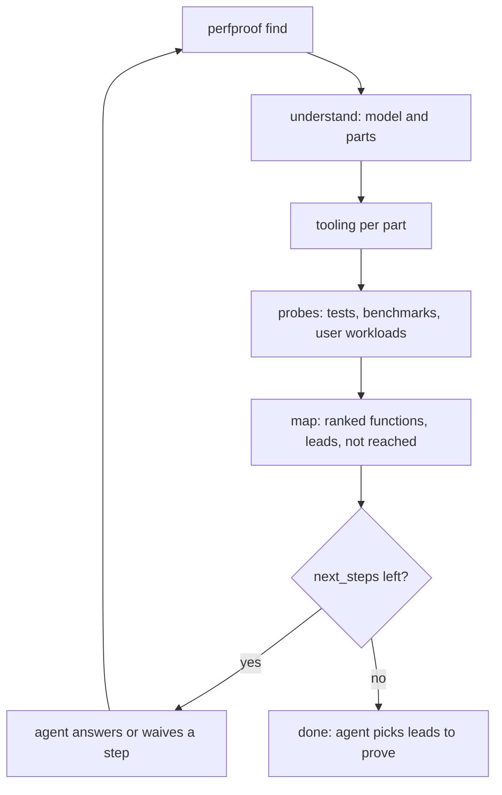

# `perfproof find`: discovery the CLI runs

Status: built (the CLI, #142, and the skill loop, #140) and **experimental**.
No agent eval run of the shipped `find` exists yet. The evidence before it is
weak: on repositories held out from tuning, discovery named the hidden
bottleneck in 2 of 8 tasks (`eval/README.md`).

## Why

I measured bare `/perfproof` on mixed-language repositories
(`eval/skill/tasks-mixed.json`, runs mixed1, mixed3 and mixed4). It found the
slow code no more often than a plain agent asked "make the app faster", at 5
to 8 times the cost. The diagnoses agree: the skill said what to do and the
agent skipped it.

- **Workloads:** one where medium asks for three.
- **Combined workloads:** used instead of separate ones.
- **Size scaling:** none.
- **Test-suite probe:** skipped in 0 of 10 runs that should have had it.
- **Native recorder:** not used on C extensions.
- **Coverage tool:** never set up, so a 35x change ended INCONCLUSIVE.

These steps are mechanical. Code owns mechanical work and the model owns
judgment, so `perfproof find` runs them. The agent still decides which
workloads represent real use, what to change, and how to fix it. The failure
it stops is in `docs/failure-modes.md`: *the agent skips a mechanical
discovery step that the method requires.*

## The loop



*Each call advances one plan and returns where it stands, so calling it again resumes.*

## Command

```
perfproof find [--depth light|medium|deep] [--budget SECONDS]
               [--size-arg WORKLOAD:FLAG=BASE | --size-env WORKLOAD:NAME=BASE]...
               [--no-tests] [--test-timeout SECONDS] [--confirm-tests PART]...
               [--test-command PART=JSON]...
               [--waive CODE=REASON]... [--json]
```

- `--depth`: `medium` by default, matching bare `/perfproof`.
- `--budget`: wall-clock seconds for probes **in this call**. The defaults are
  300 at light, 900 at medium and 2400 at deep. A probe's timeout is
  `min(remaining budget, the probe's own timeout)`. Note that `profile` runs
  the command twice (unprofiled, then profiled), and a native re-profile runs
  it twice more.
- `--size-arg` / `--size-env`: declare the size knob of a user workload. It is
  parsed with `parse_knob` and stored in the find state as a `SizeKnobSpec`, not in
  the `BenchmarkSpec`, because the knob is not a proving input and spec hashes
  must not change.
- `--no-tests`: never run test suites. `--test-timeout`: the cap per test
  probe, 300 s by default.
- `--test-command PART=JSON`: the part's test command as a JSON array of
  strings, for when none was detected (a compound npm script). It is kept
  in `.perfproof/find/test-commands.json`, replaces the detected command, and
  is still run only after `--confirm-tests` for exactly that argv.
- `--confirm-tests PART`: record the user's yes to running that part's test
  command. It is stored in `FindState.confirmed_tests`, keyed by `Part.id`, with
  the argv confirmed. A changed argv needs a new confirmation.
- `--waive CODE=REASON`: record why one `next_steps` code can't be met (for
  example `define_workloads=only one kind of operation exists`). It is stored
  in the state, and `done` accepts it.
- Each call advances one plan and returns where it stands. Calling it again
  resumes.
- `find` writes only under `.perfproof/`, with one exception: the profiled
  commands themselves (see Safety).

## Depth

| Step | light | medium | deep |
|---|---|---|---|
| Understand, tooling | yes | yes | yes |
| Test probe per part | no | yes | yes |
| Native recorder on tests / workloads | no | for a part with native code; for a Python part, also when a builtin or extension leaf in the workload's first profile is ≥ `min_effect` | always for parts with native code |
| Existing benchmarks | no | yes | yes |
| User workloads asked for | 1 | 3, covering ≥ min(2, detected entry points) entry points; with fewer than 2 detected, ≥2 distinct functions at the top of the workloads' rankings | 1 per entry point |
| Size knob asked for | no | 1 workload | every workload with a size |

## What one call does

1. **Understand.** Run `init` if there is no project model; otherwise reuse it
   and run its stale check. Then `perfproof.project.parts.detect_parts(root,
   model)` builds `parts[]` (models below). Each part is one directory holding
   a build or test manifest, with its language by the source-file majority
   inside that part, and the `target_id` of the project-model target it maps
   to. Anything not established is an `Established` holding a value of `None`
   and a reason, never a guess.
2. **Tooling.** For each part:
   - `profiler`: a template from `find`'s **profiler table**, the single place
     that maps a language to a `--profiler-command`:
     - py-spy or pyinstrument for Python. Pyinstrument needs `python -m
       pytest`, not a `pytest` shim, so the test command is normalised to that
       form;
     - the Node CPU profiler for JS/TS;
     - JFR for the JVM;
     - Go pprof;
     - the native recorder for native code, as `["python","-m",
       "perfproof.profilers.native","record","--output","{output}","--root",
       ".","--","{command}"]` with `--own-module` from `NativeCode.own_module`.
   - `native_recorder`: whether it can run here; if not, the reason, for
     example `perf_event_open` refused.
   - `coverage`: `not_needed` for Python; otherwise `present`, or `missing` with
     the playbook's install command. For C/C++ built by a Python package, the
     `native.md` recipe applies.
3. **Probes.** These run in this order, each recorded as a `ProbeRecord`:
   1. **Tests**, only after the test command is confirmed (see Safety). For
      each part, define a spec `find-tests-<part>` and profile it once.
      Re-profile it with the native recorder when the depth table says so.
      The leaf test uses `frame_kind` (`builtin`, `extension`) on the hotspots,
      at `min_effect`.
   2. **Existing benchmarks**, as `find-bench-<name>`.
   3. **User workloads**: every spec not named `find-*` that has no current
      profile. Run it with `--sizes 1,2,4` when a `SizeKnob` is stored for it.

   A probe is current when its `spec_hash` and the `tree_id` both match the
   state. `tree_id` is the sha256 of `git rev-parse HEAD`, `git diff HEAD` and
   the sorted `git ls-files -o --exclude-standard` with each file's content hash,
   excluding `.perfproof/`. A stale probe's old profile runs are deleted before
   it is re-profiled, because `rank` reads every run of a name.

   A failed or timed-out probe leaves no partial profile. It goes to
   `skipped[]` with the reason and the log tail, and never stops the others.
4. **Map.** `profile show --rank` with the **explicit list of user-workload
   names**, so no `find-*` run is included. With no user workload, there is no
   rank call: `map` is empty and every `find-*` function is a lead. The rows are `MapRow`s, each with
   its part and layer: the top 50 by cap, with wrapper rows dropped as `rank`
   lists them last.
   - **Function leads:** the result of `--rank` over the `find-*` names,
     minus any function that has a `seen_in` row in the user ranking. Test
     files (as `coverage` excludes them) and harness frames are excluded. Order
     by cap and cut at 20. `profile show --function` per lead is never used,
     because it is quadratic.
   - **File leads:** files sampled by `find-*` runs that are in the user
     ranking's never-sampled list.
   - **`not_reached`:** never-sampled over all names.

## Safety

- **Tests run in the working tree.** The confirmed test command runs as the
  project's own tests would. It may use the network or build tools that fetch
  packages, as running the project's tests always does. `find` installs no
  tool of its own.
- **The test command is confirmed before its first run.** It is part of
  `question` ("perfproof will run `<argv>` under a profiler, for up to N s:
  ok?"). It runs only after the confirmation is recorded in the state.
  `--no-tests` skips it, and its next steps are then waived with the reason
  `no_tests`.
- **Tree check.** `git status --porcelain` is taken before and after every
  probe, with ignored paths and `.perfproof/` excluded. Tool caches are not counted when new and untracked:
  `__pycache__`, `.pytest_cache`, `.mypy_cache` and `.ruff_cache` anywhere,
  plus `*.pyc`; `.coverage*` and `htmlcov/` at a part root; `target/` at a
  Cargo part root; `.gradle/` at a Gradle part root; `node_modules/.cache/`.
  Python probes also run with `PYTHONDONTWRITEBYTECODE=1`. Lines **added** by the
  probe (a tracked file modified or deleted, or a new non-ignored file) count,
  and lines already present before the probe don't. If any count, `find`
  records `tests_modified_tree` with those paths, never runs that probe again,
  and goes on with the other probes.
- **Specs.** `find-*` specs are profile-only, and `compare` refuses them with
  `find_spec_not_comparable`. Their constants are under "Derivations" in the
  Contract.

## Output (`FindResult`)

```json
{
  "done": false,
  "depth": "medium",
  "parts": [...],
  "question": "<one question, or null>",
  "next_steps": [{"code": "...", "message": "...", "command": [...]}],
  "map": [...],
  "leads": [...],
  "not_reached": [...],
  "skipped": [...],
  "budget": {"spent_seconds": 0, "limit_seconds": 900, "exhausted": false}
}
```

### `question`

`question` gathers everything only the user can answer into one sentence:

1. confirm each proposed class (`target_id`);
2. confirm the test command per part;
3. install each missing coverage tool, but only for parts where `target_class` is not `gpu_kernel` and
   `schema.metric_in_calibrated_domain(target_class, "wall")` is true, so that
   the install can lead to a KEEP.

It is `null` once all are settled. The agent records the answers with:

- `project confirm <target_id>` for each class;
- `perfproof find --confirm-tests <part>` for each test command;
- the install command for each tool.

### `next_steps`

In priority order:

- `install_or_confirm`: `question` is unanswered.
- `define_workloads`: fewer user workloads than the depth asks for. The step
  names the entry points that have no workload yet, and the leads that would
  justify one.
- `add_size_knob`: no stored size knob as the depth asks. The step gives the
  `--size-arg` form.
- `reach_lead`: the top lead is not reached by any user workload. The step
  names the test that reaches it, whose inputs show the shape.
- `continue_find`: the budget ran out with probes still pending. Call `find`
  again.

### `done`

`done` is true when every requirement in the depth table is met, **or**:

- waived by `find` itself, with one of the mechanical reasons `no_tests`,
  `recorder_unavailable`, `tests_modified_tree` or `timeout`; **or**
- waived by the agent through `--waive CODE=REASON`.

It is never true while `continue_find` or `install_or_confirm` is pending.

## Contract (`perfproof.schema`; added in its own PR, first)

All models are frozen `_Model`s. "Opt" below means `Established[T]`: `value`
and `reason`, with exactly one of them set.

**Names.** `Part.id` is the part's root relative to the repository, with `/`
replaced by `.`; the root itself is `root`. Characters outside `[A-Za-z0-9._-]`
become `-`, and an id that doesn't start with a letter or digit (`.github`, `_internal`) gets the prefix `p`, so it matches `Name`. When two roots map to the same id, the later
one in sorted order gets `-2`, `-3`, and so on. Spec names:

- `find-tests-<part.id>`
- `find-bench-<part.id>-<benchmark.name>`

User workloads are every other spec name.

**Enums**

| Field | Values |
|---|---|
| `Part.language` | `python`, `javascript`, `typescript`, `rust`, `go`, `java`, `kotlin`, `c`, `cpp`, `csharp`, `ruby`, `other` |
| `Part.target_class` | Opt[`TargetClass`], from the part's `target_id` in the project model |
| `NativeCode.kind` | `setuptools_ext`, `pyo3`, `maturin`, `node_gyp`, `cgo`, `cmake`, `cargo_cdylib` |
| `ExistingBenchmark.kind` | `pytest_benchmark`, `asv`, `cargo_bench`, `go_bench`, `script` |
| `EntryPoint.kind` | `console_script`, `bin`, `main_package`, `route`, `public_module` |
| `PartTooling.coverage` | `not_needed`, `present`, `missing` |
| `ProbeRecord.status` | `pending`, `done`, `failed`, `timeout`, `skipped_unconfirmed`, `skipped_no_tests`, `tree_modified` |
| `NextStep.code` | `install_or_confirm`, `define_workloads`, `add_size_knob`, `reach_lead`, `continue_find` |
| `MapRow.layer` | `Literal["python", "native", "gpu", "javascript", "typescript", "rust", "go", "java", "kotlin", "csharp", "ruby", "other"]`. From `Hotspot.frame_kind`: `python` → `python`, `gpu_kernel` → `gpu`. A `native` frame takes its part's `language` when that is `rust` or `go`, and otherwise `native`. A JS or JVM frame takes its part's `language`. It is `other` when `part` is `None` |

**Models**

| Model | Fields |
|---|---|
| `Part` | `id`, `root`, `manifests: tuple[str, ...]`, `target_id: str \| None`, `language`, `target_class`, `test_command: Opt[TestCommand]`, `native: tuple[NativeCode, ...]`, `benchmarks`, `entry_points`, `tooling: PartTooling` |
| `TestCommand` | `argv`, `cwd`, `evidence`. Unit A emits it already normalised: for Python `[<project interpreter>, "-m", "pytest", ...]`, with the interpreter `init` found |
| `NativeCode` | `kind`, `name`, `own_module` (the built binary's image name, as `--own-module` matches it), `sources: tuple[str, ...]` |
| `ExistingBenchmark` | `kind`, `name`, `argv`, `cwd` |
| `EntryPoint` | `kind`, `name`, `file`, `line: int \| None` |
| `ToolStatus` | `name`, `available: bool`, `reason: str \| None` |
| `PartTooling` | `profiler: ToolStatus` (the binary found or not), `native_recorder: ToolStatus`, `coverage: Literal[...]`, `coverage_install: Argv \| None`. **Unit A fills availability only; Unit B owns the profiler template table** |
| `ProbeRecord` | `key`: the spec name, `<name>@native` for a native re-profile, or `<name>@sizes` for a sized run; `requirement: bool` (whether the depth table requires it); `spec_hash`, `tree_id`, `status`, `run_ids: tuple[str, ...]`, `reason`, `log_tail` |
| `SizeKnobSpec` | `kind: Literal["arg", "env"]`, `name`, `base: PositiveInt`. Unit B converts it to `perfproof.bench.scaling.SizeKnob` |
| `FindState` | `schema_version`, `parts_hash`, `probes: tuple[ProbeRecord, ...]`, `size_knobs: Mapping[str, SizeKnobSpec]`, `confirmed_tests: Mapping[str, Argv]`, `waivers: Mapping[NextStepCode, str]`, `calls: tuple[FindCall, ...]` (`started_at`, `spent_seconds`) |
| `MapRow` | `function`, `file`, `line`, `part: str \| None` (the longest `Part.root` prefix of `file`), `layer`, `cap`, `total_fraction`, `seen_in: tuple[str, ...]` |
| `Lead` | `kind: "function" \| "file"`, `name`, `file`, `part`, `cap: float \| None`, `seen_in: tuple[str, ...]` (the `find-*` names that reached it), `via_test: str \| None` |
| `NextStep` | `code`, `message`, `command: Argv \| None` |
| `FindBudget` | `spent_seconds`, `limit_seconds`, `exhausted` |
| `FindResult` | `done`, `depth`, `parts`, `question: str \| None`, `next_steps`, `map: tuple[MapRow, ...]`, `leads`, `not_reached: tuple[str, ...]`, `skipped: tuple[ProbeRecord, ...]`, `budget` |

**Derivations (Unit B)**

- **Entry point covered:** its `name` matches a function, or its `file` a
  frame file, in a current user-workload profile.
- **Kinds of operation:** the distinct covered entry points.
- **`via_test`:** the nearest frame above the lead that sits in a test file, in
  the `find-tests` folded stacks. It is `None` when there is no such frame.
- **`find-*` spec constants:**
  - `harness`: the part's first manifest;
  - `correctness`: no command;
  - `metric`: wall;
  - `warmup`: 0;
  - `looks` (`n0`, `k`, `max_looks`) and `budget.max_rounds`: from
    `CLASS_SCHEDULES[target_class]`, whose tuple order is
    `(n0, k, max_looks, max_rounds)`, or `python_cpu`'s if the class is
    unknown. `n0 <= max_rounds` holds for every entry;
  - `budget.max_seconds` and `timeout_seconds`: `--test-timeout` for tests
    and 300 for benchmarks. Changing `--test-timeout` changes `spec_hash`, so the
    test probe becomes stale.

  The values never matter: `compare` refuses `find-*` specs with
  `find_spec_not_comparable`.

**Which profiles each rank reads.** The map and the function leads read every
`done` profile of the named specs, including `@native` and `@sizes` runs (rank
aggregates per function across runs). Before a probe is re-profiled, its own
old runs are deleted.

**Waivers and `done`**

| Mechanical reason (set by `find`) | Waives |
|---|---|
| `no_tests` (no test command, or `--no-tests`) | the test probe, and `reach_lead` |
| `recorder_unavailable` | the native recorder requirement |
| `tests_modified_tree` | that part's test probe and `reach_lead` |
| `timeout` | that probe |
| `failed` | that probe (its message goes in `skipped[]`) |

`--waive CODE=REASON` covers any `NextStep.code` except `install_or_confirm`
and `continue_find`. `tests_modified_tree` doesn't stop `find`. `done` is
computed as usual, and that probe counts as waived.

## Build units

1. **Schema PR:** the models above, with tests. Nothing else.
2. **Unit A, `perfproof.project.parts`:**
   - `detect_parts(root, model) -> tuple[Part, ...]`;
   - the tooling probes;
   - test-command, native-code, benchmark and entry-point detection per
     language.

   Tests use manifests captured from real repositories.
3. **Unit B, `perfproof.find` and `commands/find.py`:**
   - the profiler table;
   - spec building and `compare`'s refusal of `find-*`;
   - probes, state, safety checks, map and leads;
   - `question`, `next_steps` and `done`;
   - `docs/cli.md`.

   It uses Unit A through `detect_parts` only.
4. **Skill:** find mode becomes the loop below.

## The skill with `find`

1. Run `perfproof find --depth <d> --json`.
2. Ask `question` if it is set; it is the one question. Record the answers.
3. Do the `next_steps`: write the workloads, give size knobs, reach the lead,
   or call again.
4. Repeat until `done`.
5. Choose candidates from `map`, then fix them and run `compare` as today.

The skill keeps its judgment:

- which entry points represent real use;
- realistic inputs;
- reading the code behind a row;
- what to change;
- what to tell the user.

## What it does not do

- It writes no workloads and makes no code change.
- It installs no tool except through `question`.
- It weakens no gate. Coverage, calibration and the lock work as in
  `docs/method.md`.
