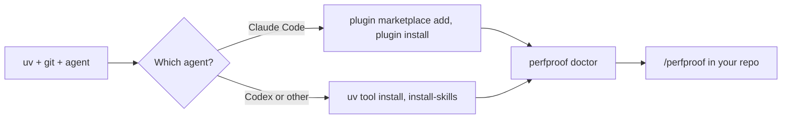

# Install and first run

perfproof is a `perfproof` command plus the `/perfproof` skill. One
line per agent installs both. It isn't on PyPI yet, so everything below
installs straight from the public GitHub repo.

Nothing is added to your project's dependencies. A run keeps its
working files in `.perfproof/`, and perfproof adds that to
`.git/info/exclude`, so no tracked file changes.

## What it touches

- **In your repo:** `.perfproof/`, the exclude line, and entries under
  `.git/worktrees/` for the baseline snapshots.
- **Branches:** the only ref it adds is a `perfproof/<name>` branch for
  kept changes, and only after you agree.
- **Outside it:** the agent's own skill or plugin directory (below), and
  uv's cache.

## Requirements

- **[uv](https://docs.astral.sh/uv/).** It fetches Python 3.12 itself,
  so you don't need a Python install. `perfproof doctor` warns on any
  other Python.
- **git**, and the repo you want faster needs at least one commit.
- **Claude Code or Codex.** Both are experimental for anything past the
  Python prove path, and Codex is the less tested of the two (see
  [targets.md](targets.md)).

## Install



*Two routes, one check. `doctor` tells you what's missing and the fix.*

### Claude Code (plugin)

```bash
claude plugin marketplace add siddiquifaras/perfproof && claude plugin install perfproof@perfproof
```

Inside a session it's `/plugin marketplace add siddiquifaras/perfproof`
then `/plugin install perfproof@perfproof`. Then say `/perfproof`, or
in plain words "make this faster".

The shorthand clones over SSH, so it needs a GitHub SSH key. Without
one, use the full URL:

```bash
claude plugin marketplace add https://github.com/siddiquifaras/perfproof.git
```

What it writes:

- **Plugin files** in Claude Code's own directory (`~/.claude/plugins/`).
- **Two settings entries** in `~/.claude/settings.json`:
  `extraKnownMarketplaces` and `enabledPlugins`.
- **Nothing else.** The plugin ships the skill and `bin/perfproof`,
  which Claude Code puts on the agent's PATH.

That wrapper runs the CLI through `uvx --python 3.12 --from <plugin
directory> perfproof`. So the CLI lives in uv's cache, not in your
project or your Python environment, and it's always the version the
plugin ships. The first call builds it, and later calls reuse the cache.
I measured both with the plugin installed into a scratch `HOME`:
`perfproof doctor` took about 10 s on the first call on this Mac and
about 1 s afterwards.

### Codex

```bash
uv tool install --python 3.12 git+https://github.com/siddiquifaras/perfproof && perfproof install-skills --client codex
```

The `uv tool install` step took 22 s on this Mac with a cold cache.
What it writes:

- **`perfproof` on your PATH**, in its own uv environment.
- **The skill** copied to `~/.agents/skills/perfproof/`, the Codex
  personal skills directory. `codex debug prompt-input` lists it under
  its skill roots.

Start `codex` in the repo and ask it to make the code faster.
`perfproof install-skills` with no `--client` installs for both agents.
Run it again after `uv tool upgrade perfproof` to update the copy.

The skill directory carries a marker file. A directory of that name that
perfproof didn't create is never replaced or removed unless you pass
`--force`.

### Any other agent that can run shell commands

Install the CLI as for Codex, then point the agent at
`skills/perfproof/SKILL.md`. No other client has been tried.

## Check it

```bash
perfproof doctor
```

The last section, **Install**, says whether `perfproof` is on PATH,
whether Claude Code and Codex are found (with versions), and whether the
skill is installed and current for each, with a fix for every gap. A
client that isn't on PATH is shown, not flagged: it may live on another
machine.

A few rules `doctor` follows:

- **Plugin installs:** it reads the plugin records under
  `~/.claude/plugins/` and reports "skill installed through the plugin
  perfproof@perfproof 0.1.0". It doesn't ask for `perfproof` on PATH,
  because the wrapper provides it.
- **Two copies:** if a plugin and an `install-skills` copy both exist,
  it says so (it can't tell which one Claude Code uses) and offers to
  remove the copy.
- **Disabled plugin:** it's reported with
  `claude plugin enable perfproof@perfproof`.

`claude plugin list` is the other check.

## First run

Start your agent in the repo and say `/perfproof`. With no arguments,
perfproof works out the project and asks only what it can't find out.
Usually that's how deep to go (`light`, `medium` or `full`) and whether
to use the workload it proposes.

It needs a clean tree to look for speedups. It never commits, stashes
or edits your branches. Kept changes go on a `perfproof/<name>` branch
you choose whether to merge.

## Uninstall

Claude Code:

```bash
claude plugin uninstall perfproof@perfproof && claude plugin marketplace remove perfproof
```

Codex:

```bash
perfproof install-skills --client codex --uninstall && uv tool uninstall perfproof
```

Delete `.perfproof/` in a repo to forget what perfproof learned there.
`uv cache clean perfproof` drops the plugin's cached CLI.

## Known rough edges

- **PyPI:** not published yet. When it is, the Codex line becomes
  `uv tool install --python 3.12 perfproof`, and the plugin wrapper
  switches from `--from "$root"` to a pinned `perfproof==<version>`.
- **Plugin size:** the plugin cache holds the whole repo, about 70 MB
  at last count, mostly `reference/` and `studies/`. A smaller
  marketplace source would fix it.

I ran the install, `doctor` and uninstall commands above against the
public repo in a scratch `HOME`. `perfproof --version` isn't a flag, so
use `doctor`.
