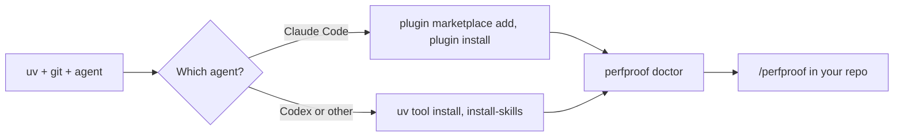

# Install and first run

perfproof is a `perfproof` command plus the `/perfproof` skill. One
line per agent installs both. It isn't on PyPI yet, so everything below
installs straight from the public GitHub repo.

Nothing is added to your project's dependencies. Working files live in
`.perfproof/`, which perfproof adds to `.git/info/exclude`, so no tracked
file changes. It also adds entries under `.git/worktrees/` for baseline
snapshots, and a `perfproof/<name>` branch for kept changes, only after you
agree.

## Requirements

- **[uv](https://docs.astral.sh/uv/).** It fetches Python 3.12 itself,
  so you don't need a Python install. `perfproof doctor` warns on any
  other Python.
- **git**, and the repo you want faster needs at least one commit.
- **Claude Code or Codex.** Both are experimental for anything past the
  Python prove path, and Codex is the less tested of the two (see
  [targets.md](targets.md)).

## Install



*Two routes, one check. `doctor` tells you what's missing and the fix.*

### Claude Code (plugin)

```bash
claude plugin marketplace add https://github.com/siddiquifaras/perfproof.git && claude plugin install perfproof@perfproof
```

Inside a session it's `/plugin marketplace add
https://github.com/siddiquifaras/perfproof.git` then `/plugin install
perfproof@perfproof`. Then say `/perfproof`, or in plain words "make
this faster".

I use the HTTPS URL on purpose. The `siddiquifaras/perfproof` shorthand
clones over SSH, which needs a GitHub SSH key.

It writes the plugin to `~/.claude/plugins/` and two entries in
`~/.claude/settings.json` (`extraKnownMarketplaces`, `enabledPlugins`).
The plugin ships the skill and `bin/perfproof`, which Claude Code puts on
the agent's PATH.

That wrapper runs the CLI through `uvx --python 3.12 --from <plugin
directory> perfproof`. So the CLI lives in uv's cache, not in your
project or your Python environment, and it's always the version the
plugin ships. The first call builds it, and later calls reuse the cache.
Two cold-cache checks in a scratch `HOME` took about 10 s (`perfproof
doctor` through the plugin wrapper, on this Mac) and about 43 s (a cold
`uvx` run, another check). Warm calls took about 1 s.

### Codex

```bash
uv tool install --python 3.12 git+https://github.com/siddiquifaras/perfproof && perfproof install-skills --client codex
```

The `uv tool install` step took 22 s on this Mac with a cold cache. It puts
`perfproof` on your PATH in its own uv environment. `install-skills` copies
the skill to `~/.agents/skills/perfproof/` (`codex debug prompt-input` lists
it under its skill roots).

Start `codex` in the repo and ask it to make the code faster. With no
`--client`, `install-skills` installs for both agents. Rerun it after `uv
tool upgrade perfproof` to update the copy.

The skill directory carries a marker file. A directory of that name that
perfproof didn't create is never replaced or removed without `--force`.

### Any other agent that can run shell commands

Install the CLI as for Codex, then point the agent at `skills/perfproof/SKILL.md`.
No other client has been tried.

## Check it

```bash
perfproof doctor
```

The last section, **Install**, says whether `perfproof` is on PATH,
whether Claude Code and Codex are found (with versions), and whether the
skill is installed and current for each, with a fix for every gap. A
client that isn't on PATH is shown, not flagged: it may live on another
machine.

Two rules it follows. With a plugin install it doesn't ask for `perfproof`
on PATH, because the wrapper provides it. If a plugin and an `install-skills`
copy both exist, it says so and offers to remove the copy. A disabled plugin
is reported with `claude plugin enable perfproof@perfproof`.
`claude plugin list` is the other check.

## First run

Start your agent in the repo and say `/perfproof`. With no arguments,
perfproof works out the project and asks only what it can't find out.
Usually that's how deep to go (`light`, `medium` or `full`) and whether
to use the workload it proposes.

It needs a clean tree to look for speedups. It never commits, stashes
or edits your branches. Kept changes go on a `perfproof/<name>` branch
you choose whether to merge.

## Uninstall

Claude Code:

```bash
claude plugin uninstall perfproof@perfproof && claude plugin marketplace remove perfproof
```

Codex:

```bash
perfproof install-skills --client codex --uninstall && uv tool uninstall perfproof
```

Delete `.perfproof/` in a repo to forget what perfproof learned there.
`uv cache clean perfproof` drops the plugin's cached CLI.

## Known rough edges

- **PyPI:** not published yet. When it is, the Codex line becomes
  `uv tool install --python 3.12 perfproof` and the wrapper pins
  `perfproof==<version>`.
- **Plugin size:** I measured the plugin cache at 78 MB, plus a 115 MB
  clone of the marketplace, in a scratch `HOME`. Most of it is
  `reference/` and `studies/`, so a smaller marketplace source would fix it.

I ran the install, `doctor` and uninstall commands above against the public
repo in a scratch `HOME`. There's no `perfproof --version`, so use `doctor`.
