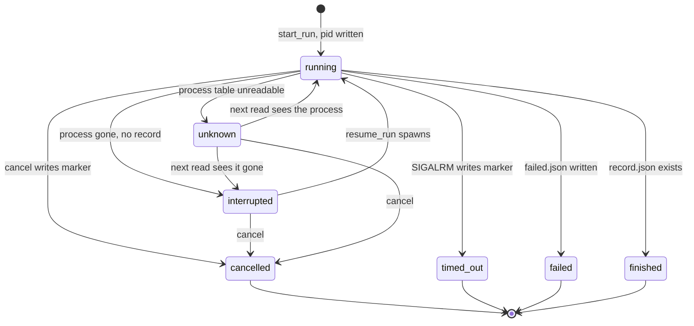
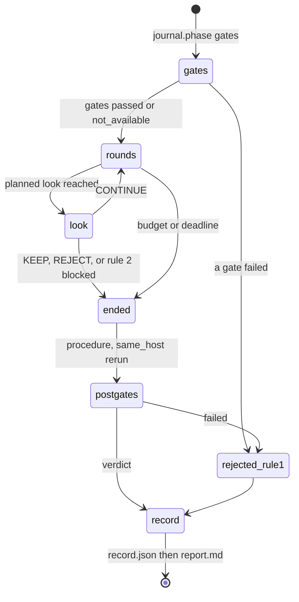
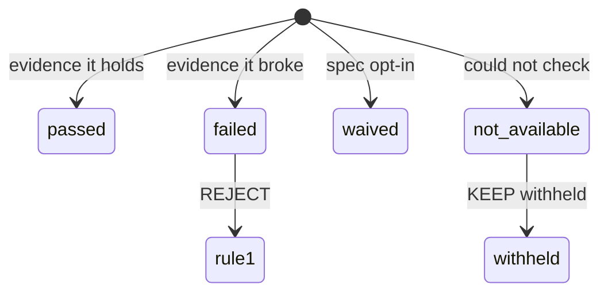
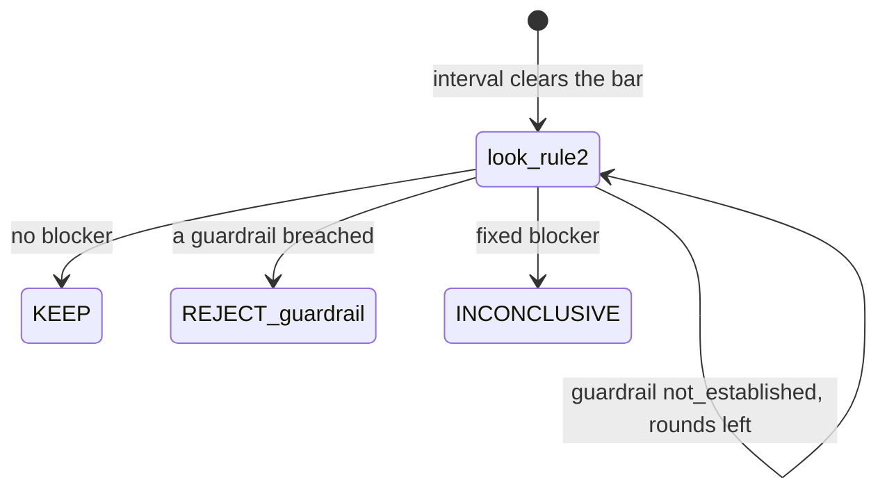
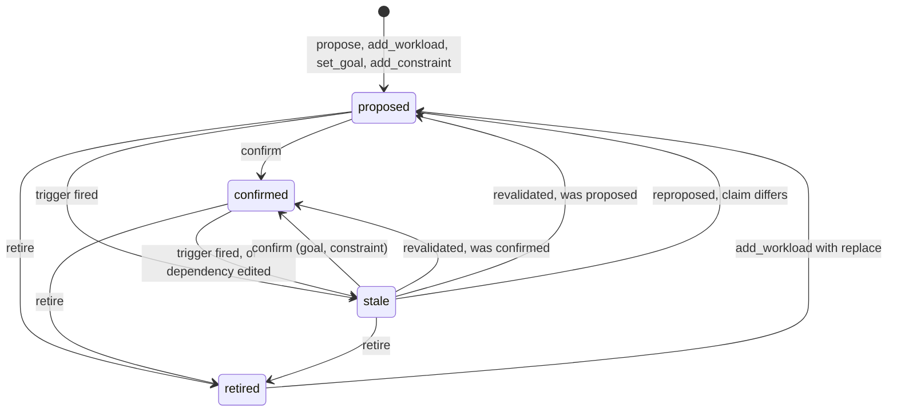
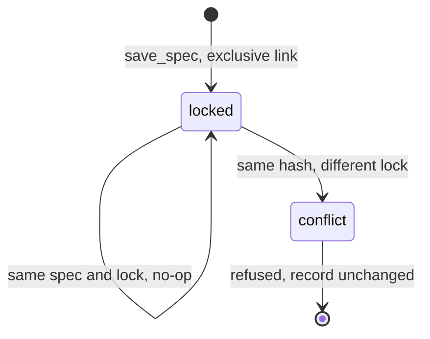
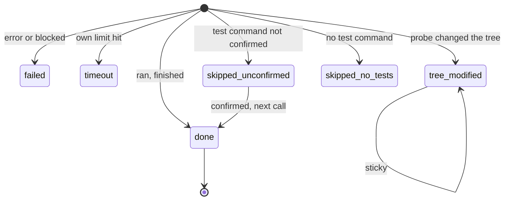
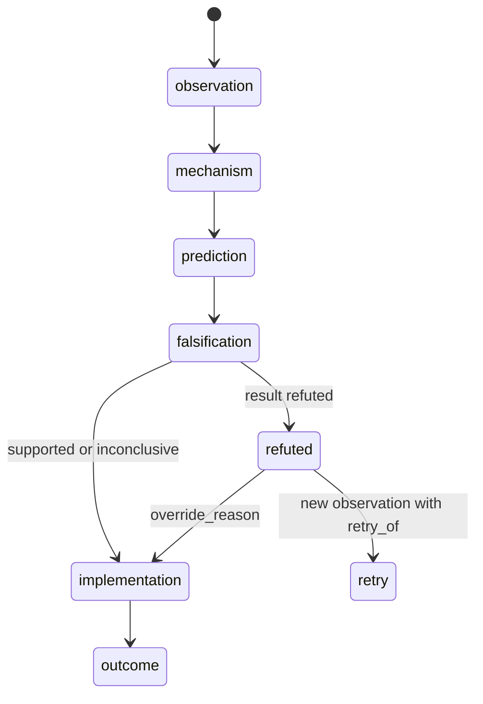
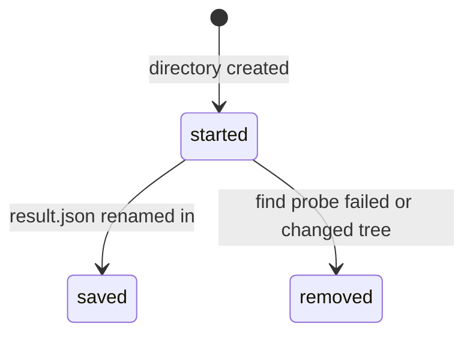
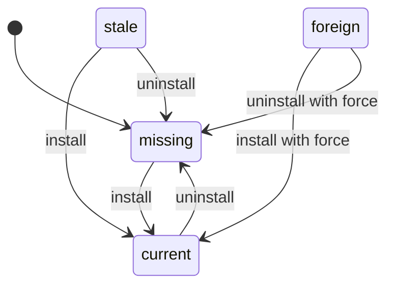

# State machines

perfproof has no daemon and no database. Its state is files, and most of
what looks like control flow is a status field read back later. This page
lists every state machine in `src/perfproof/`, explicit or implied by
files and flags: where it lives, its states, what stores it, what guards
each move, and what looks wrong.

Findings are marked **CODE FACT** (with `path:line`) or **INFERENCE** (my
reading of the code, not run). Nothing here was fixed; the findings are
for a decision. Line numbers are as of the commit this page was written
on and will drift.

| # | Machine | Persisted in |
|---|---|---|
| 1 | Detached run | `.perfproof/runs/<id>/` marker files |
| 2 | Compare body: gates, rounds, looks, verdict | `progress.json`, `samples.jsonl`, `record.json` |
| 3 | Gate status | `RunRecord.gates` |
| 4 | Withholding KEEP | `RunRecord.warnings`, gates, guardrails |
| 5 | Project model entry | `.perfproof/project.json` and history |
| 6 | Benchmark spec record | `.perfproof/benchmarks/<name>/<hash>.json` |
| 7 | Find state and probes | `.perfproof/find/state.json` |
| 8 | Hypothesis chain | `.perfproof/hypotheses/<workload>.jsonl` |
| 9 | Profile run directory | `.perfproof/profiles/<name>/<id>/` |
| 10 | Skill install | `~/.claude/skills/perfproof`, `~/.agents/skills/perfproof` |

## 1. Detached run

`perfproof compare --detach` starts one process in its own session; the
run directory is the only state. `run_status` derives the state from
files and the process table each time (`src/perfproof/bench/detach.py:974`,
precedence at `:998` to `:1012`). Nothing stores a state field.

Caption: states are derived on every call, so `unknown` can move to `running` or `interrupted`, and `finished` beats every marker.

**Persisted by.** `job.json`, `pid`, `cancelled`, `timed_out`,
`failed.json`, `record.json` (`detach.py:139` and the module docstring),
plus `progress.json` and `samples.jsonl` from
`src/perfproof/bench/journal.py`. `write_json` replaces atomically
(`journal.py:124`).

**Guards.**

- Resume: `resume_run` holds an exclusive `flock` on `run.lock`
  (`detach.py:1218`), then `check_resumable` (`:1243`) requires state
  `interrupted`, an unexpired deadline, the same machine, intact trees
  and a whole journal.
- Start: `run_dir.mkdir(parents=True)` without `exist_ok` (`:1074`).
- A reused PID is never signalled: identity is pid plus start time.
- Journal: `round_done` refuses an index that is not the next one
  (`journal.py:236`).
- Time limit: the run ends as a budget end before a round that cannot
  finish, so only a run inside a round when the deadline lands is killed
  (`compare.py:1277`).

**Findings.**

- CODE FACT, `cancel` does not take `run.lock` (`detach.py:1126` to
  `:1180`), and the worker never reads `cancelled`: `run_detached` and
  `_run` (`:1416`, `:1479`) have no read of `CANCELLED_NAME`. INFERENCE:
  a `cancel` that lands after `check_resumable` passes and before the
  new process starts, or inside the gap between `Popen` and the `pid`
  write (`:1080` to `:1112`, where the state reads `interrupted`), kills
  nothing and leaves a live worker beside a `cancelled` marker. Status
  would then say `cancelled` while rounds continue.
- CODE FACT, a foreground compare writes no `job.json` or `pid`
  (`compare.py:568`, `commands/compare.py` foreground branch). If
  someone runs `status` on it, the missing `pid` reads as `interrupted`
  (`detach.py:1008` to `:1012`, `_read_identity` at `:933`), and
  `compare --resume` then fails with `invalid_job` (`:943`). The only
  exit is `cancel`.
- CODE FACT, `read_json` returns `None` for a missing and for a corrupt
  file (`journal.py:151`). INFERENCE: a corrupt `pid` makes a live run
  look `interrupted`, and `resume_run` skips the kill when identity is
  `None` (`detach.py:1221`), so a second worker could start. Atomic
  writes make this unlikely.
- CODE FACT, `RunStatus.state` is a plain `str` (`detach.py:320`), its
  docstring omits `unknown` (`:304` to `:310`), and the `cancel` module
  docstring says the result state is `cancelled` while `cancel_run`
  keeps `timed_out` and `failed` (`:1126` onward, `docs/cli.md:462`
  agrees with the code).
- CODE FACT, `failed` is final and no resume helps it by design
  (module docstring). An `internal_fault` also lands there
  (`detach.py:1457`), and if the `failed.json` write itself fails, the
  error is swallowed (`:1572`) and the run reads `interrupted` and
  resumable.

## 2. Compare body

One comparison is a fixed pipeline, then a loop of rounds with
sequential looks, then one verdict. The class is `_Run` in
`src/perfproof/bench/compare.py`; `execute` is at `:669`.

Caption: `rounds` and `look` repeat; `record.json` is the commit point.

**Verdict states.** `Outcome` is `KEEP`, `REJECT`, `INCONCLUSIVE`
(`schema.py:228`). The decision rule adds `CONTINUE`, which never ends a
comparison (`stats/decision.py:103`). Rules 1, 2, 3 and 5 can end a run;
rule 4 is the continue (`schema.py:327` to `:344`, the allowed
outcome per rule).

**Persisted by.** `progress.json` holds `phase` (`gates` or `rounds`),
rounds and looks (`journal.py:292`). `samples.jsonl` holds one line per
round. `record.json` is published before `report.md`, never deleted
(`report/files.py:76`, `:160`).

**Guards.**

- A look is taken only when the planned count rises, or at the final
  look (`compare.py:1236` to `:1312`).
- The metric kind is journaled so a resume cannot mix units
  (`compare.py:962`).
- `RunRecord` refuses a record that breaks the rules: KEEP with a
  blocker, a rule 2 INCONCLUSIVE with none, a gate named that did not
  fail (`schema.py:2766`, `:2680`).
- Replay on resume: restored rounds are re-fed through the same looks
  (`compare.py:1245`), so the stop is deterministic.

**Findings.**

- CODE FACT, `journal.looks` is called only for new rounds
  (`compare.py:1300`), and a new `Journal` starts with `_looks = 0`
  (`journal.py:199`). INFERENCE: after a resume, `progress.json` and so
  `status` report `looks` as 0 until the next look, even though the
  replay has re-taken earlier ones.
- CODE FACT, `execute` sets phase `gates` again on a resume
  (`compare.py:672`), so `phase` goes `rounds` to `gates`. This matches
  "checks every gate again" in the `resume_run` docstring, but it is a
  backwards step no doc lists.
- CODE FACT, no `_failed()` check sits between `_coverage()` and
  `_rounds` (`compare.py:742`, `:743`; checks at `:687` to `:748`).
  Today the coverage gate never produces `failed` (see machine 3), so
  nothing is lost, but a future failing coverage gate would burn the
  whole round budget before rejecting.
- CODE FACT, `_class_problem` and `_workload_problem` are computed once
  per process (`compare.py:598`, `:599`). INFERENCE: a resumed run reads
  the project model again, so a confirmation made or lost between
  attempts changes whether the final verdict may be KEEP. The record
  keeps only the last attempt's warnings.
- CODE FACT, `record.json` lands before `report.md`; a failed report
  write leaves state `finished` with no report and the compare process
  failing (`report/files.py:160`). The write is idempotent so a retry
  completes it; nothing retries automatically. INFERENCE.

## 3. Gate status

Seven gates, each with one of four statuses (`schema.py:256`, `:265`).
A gate is set once per run, except `procedure` and `same_host`, which are
set before the rounds and again after them (`compare.py:725`, `:726`,
`:746`, `:747`).

Caption: a gate never moves once set; the post-round rerun replaces it.

What each gate can produce, from where it is built:

| Gate | passed | failed | waived | not_available |
|---|---|---|---|---|
| `side_effects` | `side_effects.py:1312` | `:1327`, `:1498` (reset) | `:1324` | none |
| `lock` | `lock.py:585` | `:588`, via `:631`, `:651` | cannot | none |
| `procedure` | `lock.py:585` | `:588`, via `:791` only | cannot | none |
| `runtime` | `lock.py:585` (`:1597`) | `:588` (`lock.py:1587`), `compare.py:2173` | `lock.py:1582` | `lock.py:1591`, `compare.py:941` |
| `same_host` | `compare.py:2084`, `:2109` | `:2101` | none built, cross host is refused (`compare.py:853`) | `:2075`, `:2091` |
| `correctness` | `correctness.py:1484` | `:1464`, `compare.py:834`, `:2145` | cannot | `correctness.py:1414`, `:1475`, `compare.py:1114` |
| `coverage` | `coverage_gate.py:1530` | never | `:1537` | `:1519`, `:1544`, `:1705`, `:1734`, `:1794` |

**Persisted by.** `RunRecord.gates`, validated in `GateResult._check_status`
(`schema.py:1581`): a non-passed gate needs a detail; only
`side_effects`, `runtime`, `same_host` and `coverage` may be waived
(`:323`); a waiver needs the spec's opt-in (`:2698`).

**Guards.** `decide` picks the deciding failed gate by a fixed
precedence (`stats/decision.py:109`, `GATE_PRECEDENCE`). The run order never
matters.

**Findings.**

- CODE FACT, no `coverage_gate.py` return builds `status="failed"`
  (statuses at the lines above), yet `GATE_REASON` maps `coverage` to a
  reject reason (`schema.py:309`) and the precedence lists it. INFERENCE:
  a state the schema allows that no code reaches. Intended, per
  `coverage_gate.py:8` ("never failed"), but the reject path is dead
  code until that changes.
- CODE FACT, the schema accepts `same_host` as `waived` with `allow_cross_host`
  (`schema.py:2701`), but compare refuses that spec (`compare.py:853`,
  docstring at `:176`) and no code builds the status. A state the schema
  allows that nothing reaches yet.
- CODE FACT, `same_host` is `passed` before the first round on a
  fingerprint alone (`compare.py:2084`) and may flip to `failed` after
  the last (`:2098`). A host change mid-run is caught only at the end;
  all rounds are spent first. INFERENCE, by design ("a reboot changes
  it").

## 4. Withholding KEEP

A KEEP needs every gate checked and every guardrail shown. Four
conditions block it, and they are held in four places.

Caption: only rule 2 looks are held; rules 3 and 5 stand as they are.

| Blocker | Where it is decided |
|---|---|
| a gate `not_available` | `stats/decision.py:252` (`decide`, `blocked_by`), and `compare.py:1365` (`_fixed_blocker`) |
| a guardrail `unmeasurable`, `not_declared`, `not_established` | `stats/decision.py:441`, `compare.py:1385` |
| a warning in `KEEP_BLOCKING_WARNINGS` | `schema.py:359`, `compare.py:2226`, `:2430` |
| an unconfirmed workload | `compare.py:1732`, relabels a final KEEP only |

Guardrail status (`schema.py:272`) is `passed`, `breached`,
`not_established`, `unmeasurable`, `not_declared`, `not_applicable`.
`not_established` is the only one more rounds can lift.

**Persisted by.** The record's `warnings`, `gates`, `guardrails`.
`not_verified` in `commands/_runs.py` rebuilds the list for the skill
from the same three.

**Findings.**

- CODE FACT, the same rule is written in `decide`, in `_fixed_blocker`,
  in `KEEP_BLOCKING_WARNINGS` and in `_check_keep_blockers`
  (`schema.py:2766`), and `_runs.not_verified` reads the schema copy. The
  workload blocker is outside `_keep_blocked` on purpose
  (`compare.py:1732`, comment at `:1733`). INFERENCE: a new blocker added
  to the compare code but not the schema list makes `RunRecord` refuse
  the record after all rounds have run, and the run lands in `failed`
  with `internal_fault`, with no verdict. Duplicated source of truth.
- CODE FACT, `schedule_uncalibrated` is also raised from a second site
  (`compare.py:866`, `_refuse_unsupported`) besides
  `_calibration_blocker` (`:2430`), with a guard to avoid double warning
  (`:890`). The two must stay in step.

## 5. Project model entry

Five kinds (`schema.py:2986`) share one lifecycle (`schema.py:2985`).
Functions that change it are pure and return the new model plus history
lines (`src/perfproof/project/lifecycle.py`).

Caption: `stale` remembers where it came from in `previous_status`.

**Where each move lives.**

- propose and merge: `lifecycle.py:116`; confirm: `:489` through
  `_confirmed` `:390`; retire (with cascade): `:810`; propagate to
  dependents: `:351`; bind a spec: `:300`.
- stale: `entries.py:230` (`mark_stale`); triggers evaluated in
  `staleness.py:320` (`find_stale`); settled in `:428` (`_settle`),
  `revalidated` at `:499`, `reproposed` at `:520`.
- Seven triggers (`schema.py:2987`); `dependency_edited` is raised at the
  edit by `propagate`, the other six by `find_stale`.

**Persisted by.** `.perfproof/project.json` and an append-only
`project.history.jsonl` with the events of `HistoryEvent`
(`schema.py:3013`). `_Entry._check_status` enforces the field rules per
status (`schema.py:3132`).

**Guards.**

- Every change is one transaction under `project.lock`: re-read inside
  the lock, history appended, then `project.json` renamed over
  (`project/store.py:298`, `:149`, `:263`).
- A derived entry (target, workload, how-to-run) cannot be confirmed from
  `stale`; it is re-derived first (`lifecycle.py:411`).
- A goal needs its workload confirmed, a workload its target
  (`lifecycle.py:424`, `:479`). Goal unknowns refuse confirmation
  (`:461`).
- A stale goal bound to another machine cannot be confirmed
  (`:443`).
- `require_confirmed` is the read-side gate compare uses
  (`project/guard.py:101`): not confirmed, changed on disk since, wrong
  spec hash, wrong machine, or machine unknown all refuse.

### Spec binding

A workload has `spec_hash` or `None`. `bind_spec` sets it on a confirmed
unbound workload and writes a new `confirmed` revision
(`lifecycle.py:300`); `project confirm` calls it
(`commands/project.py:585`). It is never rebound: a different spec needs
`add-workload --spec-hash ... --replace` then a new confirmation
(`commands/project.py:616`, `lifecycle.py:263`). Replacing
marks the confirmed goal stale through `propagate`.

**Findings.**

- CODE FACT, `retired` is not terminal: `add_workload` with `replace`
  turns a retired workload back into `proposed` at the next version
  (`lifecycle.py:258` to `:279`). By design in the docstring, but a
  retirement reason is then lost from the live entry (history keeps it).
- CODE FACT, a stale entry that detection no longer produces stays
  stale and is only reported, "retire it?" (`staleness.py:452`). A stale
  goal or constraint has no automatic exit either (`staleness.py:441`).
  Intended ("never retired silently"), but these are states whose only
  exit is a human command.
- CODE FACT, a crash between the history append and the rename leaves
  history for a revision the model does not hold (`store.py` module
  docstring). Documented; the model and history can disagree.
- CODE FACT, `_class_problem` runs `find_stale` with `host_id=None`
  (`compare.py:2263` onward), while `require_confirmed` passes a real
  host id when an entry is bound (`guard.py:224`). INFERENCE:
  the two checks of "is the model current" are not the same check for a
  machine-bound entry.

## 6. Benchmark spec record

`bench define` freezes a spec with its lock manifest at
`.perfproof/benchmarks/<name>/<hash>.json`. A new spec is a new file
beside the old one (`src/perfproof/bench/spec.py:109`).

Caption: a record is never edited; the hash is the version.

**Guards.** `os.link` fails if the file exists, so a record is never
overwritten (`spec.py:166`); `load_spec` recomputes the hash and
refuses an edited record (`:195`); the lock's `spec_hash` must match
(`:70`). `compare` re-checks the lock gate against the trees when it
runs.

**Findings.**

- INFERENCE, the lock manifest is taken at define time and used at
  compare time; the `lock` gate compares the trees to it, so a changed
  input after define fails the gate rather than the record. This is the
  intended split, not a defect.
- No states with no exit found. A record cannot be deleted by the CLI;
  old versions stay selectable (`commands/_spec.py`, `select_spec`).

## 7. Find state and probes

`perfproof find` is stateless between calls except for
`.perfproof/find/state.json` (`src/perfproof/find/state.py`). There is no
phase field: `done`, `question` and `next_steps` are recomputed each call
from probes, confirmations, size knobs and waivers (`find/plan.py:259`).

Probe status (`schema.py:3917`):

Caption: `done`, `failed` and `timeout` stay current only while spec hash and
tree id are unchanged; skips are re-decided every call.

The next-step codes (`schema.py:3926`) are `install_or_confirm`,
`define_workloads`, `add_size_knob`, `reach_lead`, `continue_find`. Three
can be waived (`find/plan.py:34`); two cannot (`schema.py:3951`).

**Where each move lives.** `_attempt` reuses or runs a probe
(`find/engine.py:674`); `current_record` decides what is current
(`find/state.py:125`); `run_probe` sets the outcome
(`find/probes.py:201`); `mechanical_waiver` turns a failed, timed-out,
skipped-for-no-tests or tree-modified probe into a waiver
(`find/plan.py:227`); `_record_inputs` folds in confirmations, knobs and
waivers (`find/engine.py:284`).

**Persisted by.** `FindState` (`schema.py:4147`): `parts_hash`, `probes`,
`size_knobs`, `confirmed_tests`, `waivers`, `calls`. Written with temp
file, `fsync` and rename (`state.py:208`).

**Guards.** The rename makes a write whole or absent. A probe checks
the git tree before and after and records `tree_modified` if it grew
(`probes.py:260` to `:293`). The budget stops probes
without a record, so they stay pending (`probes.py:262`).

**Findings.**

- CODE FACT, no lock anywhere in `find/` (the only `flock` calls are in
  `bench/detach.py`, `project/store.py` and `hypotheses.py`). `run_find`
  loads the state (`engine.py:161`), saves it (`:162`), then re-saves it
  per probe and at the end (`:224`), and `save_state` uses one shared
  temp name, `.state.json.tmp` (`state.py:224`). INFERENCE: two find
  calls on one checkout lose updates and can collide on the temp file.
- CODE FACT, waivers are only added (`engine.py:313`); no code removes
  one, and the schema has no per-waiver expiry. A waiver given for a
  condition that later changes keeps holding.
- CODE FACT, `tree_modified` is sticky for the spec hash
  (`state.py:44`, `:151`) and is never re-run. The only exits are a new
  spec hash or deleting `state.json`. A corrupt `state.json` is
  never repaired (`state.py:170`, `state_read_failed`), so that
  is also a manual exit.
- INFERENCE, a probe blocked at the start (`profiler unavailable`,
  `recorder_unavailable`) is stored as `failed` (`probes.py:260`,
  `engine.py:428`) and `failed` is terminal for an unchanged tree
  (`state.py:41`, `:125`). Installing the profiler changes nothing in the
  git tree, so the probe is not retried even though the `install_or_confirm`
  step told the agent to fix exactly that.
- CODE FACT, `ProbeStatus` has `pending` (`schema.py:3918`) and no code
  writes it; a pending probe is a view with `record=None`
  (`find/plan.py`, `pending`). The status is unreachable.
- CODE FACT, `parts_hash` is written on every call (`engine.py:316`)
  and read nowhere. Parts that change under saved confirmations do not
  invalidate anything except through the confirmed argv comparison
  (`engine.py:479`).

## 8. Hypothesis chain

A hypothesis is the events sharing a `hypothesis_id` in an append-only
log (`src/perfproof/hypotheses.py`). The chain is
`observation`, `mechanism`, `prediction`, `falsification`,
`implementation`, `outcome` (`hypotheses.py:109`, `STEPS`). Each
step is `done`, `skipped` or `missing` (`:456`).

Caption: any step can be passed with a `skipped` event that gives a
reason.

**Guards.** `check_event` (`:553`) runs under an exclusive `flock` in
`record_event` (`:993`, `log_lock` `:941`): no step before its
predecessors (`:701`), no implementation of a refuted hypothesis without
an override (`:742`), no second cheap test after a refutation without
`corrects` (`:716`), no unmarked retry of unchanged refuted code
(`:672`).

**Persisted by.** Each line of the JSONL. Staleness is derived on read
(`assess_staleness`, `:868`), and a recorded `stale` event is a second
source (`_build`, `:474`).

**Findings.**

- CODE FACT, no terminal state: `check_event` has no check on events
  after `outcome` (`:553` to `:617`). INFERENCE: a second implementation
  or outcome is accepted. This may be wanted (corrections), but nothing
  says a closed hypothesis is closed.
- CODE FACT, "stale" has two sources: derived from anchors, spec hash
  and project entries on read, and a recorded `stale` event cleared only
  by `revalidated` (`:474` to `:495`). The project model persists
  staleness; this machine derives it. INFERENCE: two conventions for one
  idea.
- CODE FACT, writers that bypass `record_event` can race; replay
  reports a violation on the view instead of refusing (module docstring,
  `HypothesisView.violations`). A detected, not prevented, race.

## 9. Profile run directory

`profile NAME` creates `.perfproof/profiles/<name>/<id>/`, runs, then
writes `result.json` by temp file and rename (`commands/profile.py:717`).
A directory with `result.json` is a finished run; without it, an
unfinished or failed one.

Caption: only `find` removes a profile directory, and only its own.

**Persisted by.** The presence of `result.json` (`commands/_profile_show.py`
`RESULT_FILE`); `find` counts runs by it (`find/probes.py:304`).

**Findings.**

- CODE FACT, a plain `profile` that dies after creating its directory
  leaves a directory with no `result.json` and nothing cleans it
  (`find/probes.py:126` removes only what a `find` probe created).
  INFERENCE: harmless to `find`, which lists by `result.json`.

## 10. Skill install

`check` returns `missing`, `foreign`, `current` or `stale`
(`commands/_skills.py:197`). `install` and `uninstall` act on that.

Caption: the marker file `.perfproof-install.json` decides ownership.

**Guards.** A directory without the marker is `foreign` and refused
without `--force` (`_skills.py:215`, `:252`, `:294`). Content is compared by
hash (`:186`). Install copies to a staging directory first
(`:222`).

**Findings.**

- CODE FACT, install removes the target and then renames the staging
  directory in (`_skills.py:263`, `:264`). INFERENCE: a crash between
  the two leaves the skill missing; the next install repairs it.
- CODE FACT, `check` reports `stale` when the shipped source is unknown
  (`_skills.py:197`), so `doctor` cannot tell a stale install from an
  unknown source.

`doctor` itself holds no state; it reads the machine, tools and skill
states fresh each call.

## Findings, ranked

| Rank | Finding | Basis | Section |
|---|---|---|---|
| 1 | `cancel` is unlocked and the worker ignores the `cancelled` marker; a racing resume or start leaves a live worker under a `cancelled` status | CODE FACT for the missing reads, INFERENCE for the race | 1 |
| 2 | KEEP blockers live in four places; a miss surfaces as a refused record after all rounds | CODE FACT, INFERENCE for the consequence | 4 |
| 3 | Find state has no lock and one shared temp name | CODE FACT, INFERENCE for the race | 7 |
| 4 | Foreground compare reads `interrupted` and cannot be resumed | CODE FACT | 1 |
| 5 | Resume re-reads the project model, so KEEP eligibility can change between attempts | INFERENCE | 2 |
| 6 | Sticky find states: waivers, `tree_modified`, blocked probes with no retry | CODE FACT, INFERENCE for the blocked case | 7 |
| 7 | Unreachable or unused: `pending` probe status, coverage `failed`, `parts_hash` | CODE FACT | 3, 7 |
| 8 | `looks` in `progress.json` resets to 0 after a resume | CODE FACT, INFERENCE for the effect | 2 |
| 9 | `RunStatus.state` is a `str`, docstrings disagree on the set | CODE FACT | 1 |
| 10 | Corrupt `pid` or `failed.json` reads as missing | CODE FACT, INFERENCE for the effect | 1 |
