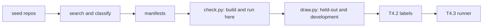
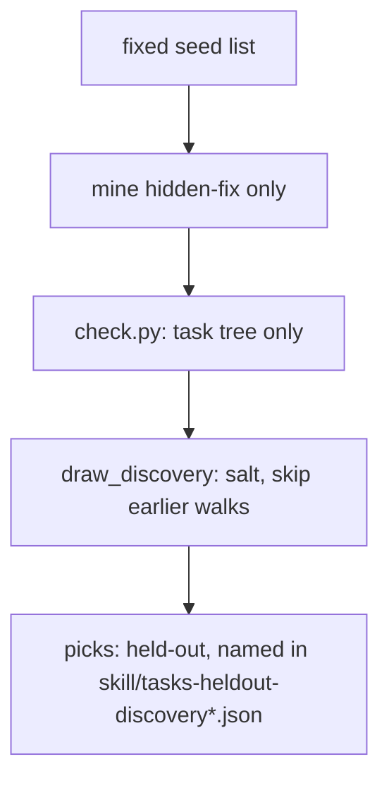

# Evaluation tasks

This is the task set for the external evaluation in
[docs/evaluation.md](../docs/evaluation.md). The directory holds the
miner that finds candidates (`mine/`) and one manifest per task
(`tasks/<family>/<id>.json`).



*Nothing downstream of the manifests has happened yet: no label, no perfproof run, no agent run on a held-out task.*

The splits come from the selection rule in docs/evaluation.md. The
inputs are in `tasks/selection.json`. The draw, with every candidate it
looked at, is in [tasks/SPLITS.md](tasks/SPLITS.md). Each picked task's
manifest says `held-out` or `development` in `split`. Every other task
is a `development-candidate`, and a task used for development never
moves to the held-out set.

Nothing in a manifest is a performance label. Labels come from the
independent procedure in T4.2. The miner's classifications (family,
change kind, revert reason) are keyword rules over GitHub text, kept
with the text they matched so each one can be checked by hand.

## Counts

Mined on 16 October 2026 (`uv run python eval/mine/mine.py counts`):
382 candidates from 106 repositories, after the review fixes under
"Removed after review".

**This is a candidate pool, not a reviewed task set.** The rules are
keyword and pattern rules, so the pool has known noise: changes that
aren't runtime optimisations, revert reasons the text doesn't support,
and evidence that isn't about speed. Four review rounds sampled it
against GitHub and fixed what they found by rule, but more noise
remains. Step 1 of the selection rule guards any task that gets drawn:
before the hash-order draw, each candidate's change is read, and
misclassified ones are removed with the reason recorded.

| Family | python | native | web | serving | gpu | agentic | java | Total |
|---|---:|---:|---:|---:|---:|---:|---:|---:|
| hidden-fix | 7 | 6 | 3 | 2 | 12 | 0 | 1 | 31 |
| known-change | 79 | 64 | 37 | 32 | 29 | 30 | 3 | 274 |
| nothing-to-keep | 13 | 11 | 7 | 3 | 6 | 1 | 2 | 43 |
| published-benchmark | 34 | 0 | 0 | 0 | 0 | 0 | 0 | 34 |
| **Total** | 133 | 81 | 47 | 37 | 47 | 31 | 6 | 382 |

| Change kind | Tasks | | Status | Tasks |
|---|---:|---|---|---:|
| after-landed | 43 | | builds | 11 |
| benchmark-instance | 34 | | candidate | 325 |
| improvement | 250 | | reference-fails | 1 |
| kernel-version | 12 | | runs | 45 |
| regression | 8 | | | |
| reverted-breaking | 7 | | | |
| reverted-unknown-reason | 28 | | | |

Read the counts with these caveats:

- **Missing commands.** 136 of the 382 have a workload command and 167
  have an oracle command (a `command` that isn't `null`, counted from
  the manifests). The rest are `null` and need completing by hand.
- **Workload commands.** A workload quoted over several lines with
  backslash continuations is joined into one command, and is `null` if
  it can't be recovered whole. A `vllm bench` line counts only with a
  `serve`, `latency` or `throughput` subcommand.
- **No no-gain reverts.** No revert was classified `reverted-no-gain`,
  so nothing-to-keep is all `after-landed` for now. Reverts with no
  stated reason, or reverted for a build or CI failure, are known-change
  `reverted-unknown-reason`.
- **Dropped and skipped pull requests.** 4 selected pull requests were
  dropped because `mine.pr_base` found no base whose diff touches exactly
  their files: tqdm#955, flashinfer#6506, agno#9694 and agno#7708. A
  reviewer checked tqdm#955 and agno#9694 and they are genuine drops (a
  merge commit, and a squash whose diff doesn't match the pull request's
  file list). The other 2 weren't investigated. 2 more were skipped
  because they are also SWE-fficiency instances: xarray#5661 and
  dask#11625.
- **GPU and agentic.** All 12 GPU hidden-fix tasks are from llm.c
  `dev/cuda`. No agentic hidden-fix candidate passed the rules.
- **Published benchmarks** are Python only: GSO 7, SWE-Perf 9,
  SWE-fficiency 18.

### Removed after review

Each round fixed the rules and regenerated the manifests, rather than
editing single files.

**Round 2** (after 77130ae). The rule changes:

1. **Kernel versions.** An llm.c commit that renames a kernel into a
   numbered slot no longer counts as a new version. The parent must not
   already define or call that version's launcher (`<name><N>(`).
2. **Kernel file lists.** An llm.c task's `reference_change.files` lists
   every file the commit touched, read from the API.
3. **Workload commands.** Backslash continuations are joined. Nine
   manifests had stored a first-line fragment, such as matplotlib's
   `python3 -m timeit \`, which timed `pass`.
4. **Source files.** An improvement or a reverted change must touch a
   source file. CI configuration and build or packaging scripts no
   longer count as source.
5. **Build and CI reverts.** A revert whose text puts a failure word
   next to a build word ("breaks the AMD CI image build", "wheel
   creation to fail", "breaks tutorials") is `reverted-unknown-reason`,
   not `reverted-breaking`.
6. **Names in titles.** `optimize` or `vectorize` used as a name (after a
   dot, or before a dot, slash or colon) is not a performance word. This
   excludes SciPy's `optimize.` module and `numpy.vectorize`.

39 candidates were removed:

| Reason | Tasks |
|---|---|
| No source file (only tests, docs, CI or build files; the per-task file lists are not kept here) | `agno-agi-agno-pr9706`, `aio-libs-aiohttp-pr12606`, `astral-sh-uv-pr21055`, `berriai-litellm-pr45551-landed`, `berriai-litellm-pr46713`, `deepset-ai-haystack-pr5828`, `fastapi-fastapi-pr13583`, `ggml-org-llama-cpp-pr23869`, `huggingface-diffusers-pr12366`, `huggingface-smolagents-pr907`, `hypothesisworks-hypothesis-pr456-landed`, `lz4-lz4-pr1330`, `ollama-ollama-pr8643`, `openai-openai-agents-python-pr4197-landed`, `openai-openai-agents-python-pr4200`, `openai-openai-agents-python-pr4874`, `openhands-openhands-pr12256`, `openhands-openhands-pr13590`, `pyca-cryptography-pr6511`, `pydantic-pydantic-ai-pr5389`, `pytest-dev-pytest-pr15151`, `pytorch-ao-pr2973`, `pytorch-ao-pr4807`, `saleor-saleor-pr18686`, `sanic-org-sanic-pr63`, `sgl-project-sglang-pr43762`, `simdjson-simdjson-pr2819`, `tile-ai-tilelang-pr3191-landed`, `tile-ai-tilelang-pr3315`, `triton-inference-server-server-pr5032`, `valkey-io-valkey-pr3157-landed`, `valkey-io-valkey-pr3463`, `vllm-project-vllm-pr60511`, `wagtail-wagtail-pr6158` |
| `agno-agi-agno-pr7708-landed` | Moved to known-change when caps freed a slot, then `pr_base` found no base whose diff matches its files |
| `karpathy-llm-c-layernorm-forward-f28613e0b9` | A rename, not a new kernel: the parent already defines and calls the launcher `layernorm_forward3(` |
| `numpy-numpy-pr23061` | Title matched only a name (`optimize` module, `numpy.vectorize`): 'Revert "ENH: Enabled the use of numpy.vectorize as a decorator"' |
| `scipy-scipy-pr10083` | Title matched only a name (`optimize` module, `numpy.vectorize`): 'Revert "Clean ``_clean_inputs`` in optimize.linprog"' |
| `scipy-scipy-pr127` | Title matched only a name (`optimize` module, `numpy.vectorize`): 'Revert "ENH: optimize/minimize: combine hess and hessp parameters" (#161...' |

8 more kept their pull request but changed family when the caps were
re-filled, so they lost the `-landed` suffix from their id:
`ggml-org-llama-cpp-pr30119`, `ollama-ollama-pr11863`,
`openhands-openhands-pr12105`, `pytest-dev-pytest-pr851`,
`pytorch-ao-pr4310`, `saleor-saleor-pr11900`,
`sgl-project-sglang-pr43570` and `vllm-project-vllm-pr58584`.

14 candidates are new. They fill cap slots the removals freed, by the
same rules: `agno-agi-agno-pr3013-landed`, `berriai-litellm-pr45228-landed`,
`berriai-litellm-pr45252`, `ggml-org-llama-cpp-pr29857-landed`,
`karpathy-llm-c-layernorm-forward-cb791c4ef5`,
`ollama-ollama-pr10678-landed`, `openai-openai-agents-python-pr2563`,
`openhands-openhands-pr9925`, `pytorch-ao-pr4113-landed`,
`saleor-saleor-pr11874-landed`, `sgl-project-sglang-pr43551-landed`,
`tile-ai-tilelang-pr2659`, `valkey-io-valkey-pr3033` and
`vllm-project-vllm-pr58194-landed`.

**Round 3** (after 96c0a42). The rule changes:

1. **llm.c versions** come from the dispatch switch (`case N:` calling
   `<name><N>(`), not from kernel function names.
2. **Source files** exclude lockfiles, docs trees and `.md`/`.mdx`,
   `scripts/`, examples and cookbooks, and JSON data. A title about
   speeding up tests, CI or docs doesn't qualify.
3. **A multiplier counts as a speedup** only with performance context: a
   speed, time or benchmark word within a few words, on its line, or in
   its table's header. It must also have no device, memory unit or
   further number right after it, so `1x GPU`, `4x GiB` and `64 x 4096`
   don't count.
4. **`vllm bench`** must be followed by `serve`, `latency` or
   `throughput` to count as a workload. That moves vllm#48223 from the
   PR's typo `vllm bench deepseek-ai/...` to its next quoted block,
   `vllm bench serve ...`.

20 candidates were removed:

| Reason | Tasks |
|---|---|
| No source file (only tests, docs, CI or build files; the per-task file lists are not kept here) | `agno-agi-agno-pr9705`, `cline-cline-pr12568`, `openai-codex-pr42638`, `scikit-learn-scikit-learn-pr34982-landed`, `tile-ai-tilelang-pr3419` |
| Title is about tests, CI, docs or examples | `astral-sh-uv-pr21634`, `deepset-ai-haystack-pr9451`, `duckdb-duckdb-pr26837`, `openai-openai-agents-python-pr2563`, `saleor-saleor-pr19294`, `sgl-project-sglang-pr43551-landed`, `tile-ai-tilelang-pr2659` |
| `internlm-lmdeploy-pr4830-landed` | Its multipliers (`0.55x`, `0.57x`, ...) sit in a table whose header reads `\| M \| Triton µs \| Gluon µs \| ... \| Gluon TFLOP/s \|` under a paragraph ending "Values are median p50 latency". The round-3 rule read neither. Restored in round 4 |
| `karpathy-llm-c-attention-backward-e278112c19` | Its kernel3 is a softmax helper dispatched as `case 3: attention_backward1(...)`, not a new numbered launcher. The file no longer has a task |
| `karpathy-llm-c-attention-forward-5f99fb30d2` | Its workload ran `./attention_forward 5`, but the dispatch switch only has cases 1 to 4 (`softmax_forward_kernel5` is a helper). The file's task is now `bb4f04bdf8`, which adds `attention_forward2` |
| `karpathy-llm-c-layernorm-forward-cb791c4ef5` | Not the earliest commit that adds a dispatched version. `466723bb06` adds `case 3: layernorm_forward3` and is now the file's task |
| `karpathy-llm-c-matmul-forward-bb89efdcb1` | Its kernel4 isn't dispatched by `case 4: matmul_forward4`. The file's task is now `8822e7803e`, which adds `matmul_forward3` |
| `ollama-ollama-pr10678-landed` | `1x GPU: 5.7 GiB`, `2x GPU: 7.8 GiB`, ... count GPUs in a VRAM list. Nothing else in the description counts as evidence |
| `simdjson-simdjson-pr2876` | `3 ×` is the repeat count in "best of 3 × 300 iterations". Nothing else in the description counts as evidence |
| `unslothai-unsloth-pr13404-landed` | Its one multiplier is in "prefill 1997 to 2121 tok/s (1.062x)", on a line beginning "measured in the Zoo PR". The round-3 rule counted neither `tok/s` nor "measured". Restored in round 4 as `unslothai-unsloth-pr13404` (known-change) |

6 lost the `-landed` suffix from their id when the caps were
re-filled: `agno-agi-agno-pr3013`, `astral-sh-uv-pr20118`,
`cline-cline-pr4676`, `duckdb-duckdb-pr25547`, `openai-codex-pr17039`
and `saleor-saleor-pr11874`.

10 are new: `astral-sh-uv-pr18311-landed`,
`duckdb-duckdb-pr25527-landed`, `internlm-lmdeploy-pr4827-landed`,
`karpathy-llm-c-attention-forward-bb4f04bdf8`,
`karpathy-llm-c-gelu-forward-45252d434c`,
`karpathy-llm-c-layernorm-forward-466723bb06`,
`karpathy-llm-c-matmul-forward-8822e7803e`,
`karpathy-llm-c-residual-forward-4ffcf5b90a`,
`saleor-saleor-pr11175-landed` and `unslothai-unsloth-pr13255-landed`.
Five are llm.c tasks the dispatch rule now selects. The rest fill freed
cap slots by the same rules.

**Round 4** (after eb54fd1). The rule changes:

1. **Speed context** also accepts unit words without a leading digit
   (`ns`, `ms`, `µs`, `us` as a column or in parentheses, `tok/s`,
   `tokens/s`, `TFLOP/s`, `GB/s`, `req/s`, `it/s`) and "measured". For a
   multiplier in a table, the four lines above the table (its heading or
   lead paragraph) are read too. lmdeploy#4830 and unsloth#13404 come
   back, with tests on their captured text in `mine/fixtures/`.
2. **File lists** for pull requests with 100 or more changed files are
   paged from `gh api repos/<r>/pulls/<n>/files`, because `gh pr view`
   stops at 100. `reference_change.files_truncated` is true only when
   GitHub's own 3000-file listing limit is reached, or paging failed. No
   current manifest is truncated, and flashinfer#6543-landed now lists
   all 118 files.
3. **Test paths.** `spec` counts as a test path only as a `spec/`
   directory or a `*_spec.rb` / `*.spec.js` file, and a pytest oracle
   names only `test_*.py` or `*_test.py` files. lmdeploy's `spec_decode/`
   (speculative decoding) is no longer passed to pytest.
4. **Class fit.** A change whose source files are all browser frontend
   code (a `frontend/`, `web/` or `ui/` tree, TypeScript, JavaScript,
   CSS, HTML) is outside the python, native, serving and GPU classes and
   is dropped there.

3 candidates were removed:

| Task | Removed because |
|---|---|
| `internlm-lmdeploy-pr4827-landed` | lmdeploy's one after-landed slot went back to the restored `internlm-lmdeploy-pr4830-landed`. Its oracle had also passed `spec_decode/` source files to pytest, which rule 3 now prevents |
| `unslothai-unsloth-pr13255-landed` | All its source files are in `studio/frontend/` (`low-device-scale.ts` and others, 195 files listed in full). A frontend change in a GPU-class repository |
| `unslothai-unsloth-pr13602` | All its source files are in `studio/frontend/src/features/browser/agent/` (`executor.ts`, `page-agent.ts`, `page-wait.ts`). A frontend change in a GPU-class repository |

3 are new or restored: `internlm-lmdeploy-pr4830-landed` and
`unslothai-unsloth-pr13404` (restored), and
`unslothai-unsloth-pr13236-landed` ("Studio: faster image LoRA
training", in `studio/backend/core/training/`), which fills the freed
after-landed slot. The family and class counts are unchanged, because
each removal was replaced in the same cell.

## Splits

The held-out list is committed here, with the pool, before any label,
perfproof run or agent run touches a held-out task. It lives in
`tasks/` rather than `eval/label/` because the split is a property of
the task set. T4.1 owns splitting the pool, each manifest carries its
`split`, and T4.2's labelling has to start from a list that is already
fixed.

```bash
uv run python eval/mine/draw.py          # print the draw
uv run python eval/mine/draw.py --write  # set manifests' split, rewrite tasks/SPLITS.md
```

`mine/draw.py` applies the rule in docs/evaluation.md to the manifests
and to `tasks/selection.json`, which holds:

- **Salts.** Held-out `perfproof-heldout-2026-10-16`, from
  docs/evaluation.md. Development `perfproof-development-2026-10-16`,
  chosen here and written into `selection.json` before the development
  order was first computed.
- **Step-1 reviews.** One entry per candidate the draw reached: keep or
  remove, what the reading found, and what was read.
- **Classes not buildable here.** Serving and GPU: "needs a GPU host".
  Paid GPU runs wait for approval.

`mine/test_draw.py` checks each step of the rule on synthetic pools, and
that the committed manifests and `tasks/SPLITS.md` are what the rule
gives for the committed reviews and statuses.
[tasks/SPLITS.md](tasks/SPLITS.md) lists every candidate each draw
looked at, in order, with what it did and why.

### The held-out set

Slot order is the rule's: two known-change, then hidden-fix,
nothing-to-keep and published-benchmark. "(KC)" marks a slot a
known-change task took because the class had no candidate of that family
left. CPU tasks reached `runs` here. Serving and GPU tasks are drawn but
unbuilt.

| Class | Known-change | Known-change | Hidden-fix | Nothing-to-keep | Published-benchmark |
|---|---|---|---|---|---|
| python | `psf-black-pr3467` | `python-mypy-pr20802` | `networkx-networkx-pr7810` | `pydata-xarray-pr10921-landed` | `swe-perf-sympy-sympy-26546` |
| native | `libuv-libuv-pr2064` | `astral-sh-uv-pr20879` | `tokio-rs-tokio-pr5829` | `scipy-scipy-pr24913-landed` | (KC) `nlohmann-json-pr5836` |
| web | `gin-gonic-gin-pr4466` | `django-django-pr20911` | `gin-gonic-gin-pr2365` | `honojs-hono-pr5118-landed` | (KC) `nestjs-nest-pr18136` |
| agentic | `crewaiinc-crewai-pr5584` | `crewaiinc-crewai-pr5187` | (KC) `agno-agi-agno-pr3013` | `crewaiinc-crewai-pr2382-landed` | (KC) `run-llama-llama-index-pr21755` |
| serving (unbuilt) | `vllm-project-vllm-pr58634` | `mlc-ai-mlc-llm-pr1033` | `sgl-project-sglang-pr41223` | `internlm-lmdeploy-pr4830-landed` | (KC) `huggingface-text-embeddings-inference-pr35` |
| gpu (unbuilt) | `flashinfer-ai-flashinfer-pr3761` | `triton-lang-triton-pr11565` | `karpathy-llm-c-matmul-backward-bias-55fbd7e6ad` | `triton-lang-triton-pr11138-landed` | (KC) `dao-ailab-flash-attention-pr2819` |

One task was passed over on the way for not reaching `runs` here:
`sanic-org-sanic-pr412` in web. Its tests hang until the 30-minute
timeout under the oldest Python and current dependencies.

The held-out section of `tasks/SPLITS.md` differs from the list as first
committed (`b758bec1`, the squash commit that added it) in one line only: the wording of sanic#412's
pass-over reason, rewritten when the status rule was corrected. The
picks are identical. Step 1 read 111 candidates and removed 25 (reasons
in `tasks/selection.json`; those a draw reached are also in
`tasks/SPLITS.md`).

### The development set

Drawn the same way with salt `perfproof-development-2026-10-16`, from
the candidates the held-out draw did not take. All 20 CPU tasks build
and run here. Serving and GPU are not drawn yet (see "How the rule was
applied", point 6).

One is `reference-fails`: `gso-huggingface-transformers-d51b589`. Its
reference commit fails two of the tree's XLNet tests
(`test_attention_outputs`, `test_headmasking`) under current torch while
the task tree passes them. Whether that is the change or the newer torch
is for labelling to settle. It took the published-benchmark slot that
`swe-fficiency-pydata-xarray-7382` held while reference-tree failures
were wrongly passed over.

| Class | Known-change | Known-change | Hidden-fix | Nothing-to-keep | Published-benchmark |
|---|---|---|---|---|---|
| python | `scikit-learn-scikit-learn-pr19328` | `astropy-astropy-pr18455` | `pydata-xarray-pr6107` | `textualize-rich-pr2217-landed` | `gso-huggingface-transformers-d51b589` |
| native | `duckdb-duckdb-pr25547` | `apache-arrow-pr48898` | `sharkdp-fd-pr853` | `pola-rs-polars-pr29813-landed` | (KC) `tokio-rs-tokio-pr5513` |
| web | `saleor-saleor-pr15725` | `labstack-echo-pr3023` | `django-django-pr21460` | `rails-rails-pr58751-landed` | (KC) `rails-rails-pr58964` |
| agentic | `openhands-openhands-pr12105` | `deepset-ai-haystack-pr12997` | (KC) `langchain-ai-langchain-pr38073` | (KC) `run-llama-llama-index-pr18289` | (KC) `mem0ai-mem0-pr1260` |

### How the rule was applied

The rule leaves some choices open. These were made before the draws and
apply to every class.

1. **Step 1 is read in hash order, as far as the draw reaches.** The
   rule removes misclassified candidates first, then orders the rest.
   Reading each candidate when the draw reaches it gives the same
   result, because a removal depends only on the change. What was read:
   the pull request's or commit's description and file list, the
   revert's description where there is one, and for llm.c the kernel
   file's header at the commit. Nothing was run for step 1.
2. **"Class wrong" means outside the class as docs/targets.md defines
   it.** Agentic is Python apps calling model and tool APIs, so Rust TUI
   and TypeScript frontend or extension changes in agentic repositories
   were removed. Serving is LLM inference servers, with AMD GPUs outside.
   GPU is NVIDIA, with AMD and Apple GPUs outside.
3. **A published-benchmark instance's family is right by construction.**
   Its change is the dataset's reference. All reached were kept, with
   what the patch does.
4. **"No candidate of a family"** covers a family with no candidate left
   that builds and runs, as well as an empty family. Either way the next
   known-change task takes the slot.
5. **"Builds and runs here" is `check.py` status `runs` or
   `reference-fails`.** Buildability is judged on the task tree alone.
   Only these pass a candidate over:
   - `failed`: the task tree's setup failed.
   - `builds`: the task tree's workload, or its oracle where required,
     timed out, could not start or failed. Also a workload run only in an
     earlier form that must be re-run, as for the Java tasks. A failure
     on both trees, such as sanic#412's hang, is one of these.

   Anything that happens only on the reference tree is `reference-fails`:
   a failed oracle or workload, a hang, a missing entry point, a setup
   that doesn't build. Whether the change breaks behaviour or its own
   build is an outcome for labelling, and docs/evaluation.md step 4 lets
   only buildability decide, so the task is drawn. A clone or fetch that
   fails for the network isn't recorded, and the candidate is tried
   again. A failure caused by a mistake in the spec written here (a wrong
   flag, a wrong output path) was fixed and the task re-run. A failure of
   the tree or its environment (tests that hang, dependencies that won't
   build) stands.
6. **Classes not buildable here are drawn unbuilt.** Their held-out picks
   are provisional: a pick that later fails on the GPU host is passed
   over and the next candidate is drawn. Their development draw waits
   until then, since the held-out draw may still need candidates further
   down the order.
7. **What was seen.** Building prints and records each command's exit
   code, wall time and output tail, including test output. These are
   single runs, not measurements, and no decision used them. No label,
   perfproof run or agent run of any held-out candidate exists. The 20
   CPU held-out tasks were built before `check.py` stopped recording it,
   so their reference workloads' wall times and output are in their
   manifests. From now on a held-out task's reference workload is
   recorded by exit status only (wall time `null`, output not kept), so
   the serving and GPU held-out builds, still to come, show no effect
   size while their workloads are being written.

## Manifest schema

One JSON file per task, `tasks/<family>/<id>.json`. The schema is the
`Task` model in [mine/task.py](mine/task.py). The root `uv run pytest`
validates every committed manifest against it (its `testpaths` include
`eval/mine`, whose tests are offline), and the root `uv run pyright`
type-checks `eval/mine` in strict mode.

| Field | Meaning | Source |
|---|---|---|
| `id` | Unique id, also the file name | Built from repository and pull request, commit or instance |
| `repository` | `owner/name` on GitHub | Search or dataset row |
| `stars`, `pushed_at` | Popularity and last push at mining time | `gh repo view` |
| `task_commit` | The commit an agent starts from | See `task_commit_basis` |
| `task_commit_basis` | How `task_commit` was found | For pull requests, the base found with `gh api` commits and compare (see "Base of a pull request" below) |
| `reference_change` | The known change: `kind` (`pull-request`, `commit`, `benchmark-instance`), `url`, `title`, `commit`, `merged_at`, `files`, `files_truncated` (true only if GitHub's listing limit may have cut `files` short) | `gh pr view`, `gh api`, or the dataset row |
| `revert` | The pull request that reverted the change, same shape, or `null` | `gh pr view` |
| `family` | `known-change`, `published-benchmark`, `hidden-fix`, `nothing-to-keep` | Rules below |
| `change_kind` | `improvement`, `after-landed`, `reverted-no-gain`, `reverted-breaking`, `reverted-unknown-reason`, `regression`, `kernel-version`, `benchmark-instance` | Rules below |
| `target_class` | `python`, `native`, `web`, `serving`, `gpu`, `agentic`, `java`, `rust` | The seed list's class for the repository |
| `workload` | `command`, `source` (where it came from, or `unknown`), `verified` (the command ran here and exited 0; it does not say the change showed a gain) | Quoted in the pull request, a dataset field, a file header, or a command run here |
| `oracle` | Same shape: the independent correctness check | Test files the change touched, a dataset field, or a command run here |
| `evidence` | Links with notes, one per source used above | |
| `audit` | For published-benchmark tasks: the 2026 cross-machine audit's per-task row | Audit data repository, pinned commit |
| `status` | `candidate` (not built here), `runs`, `reference-fails`, `builds`, `failed` | `mine/check.py` (see its docstring and `classify`) |
| `status_reason` | What was and wasn't checked | |
| `runs` | Every command run here: step, tree (`task` or `reference`), command, exit code, wall time, date, machine, output tail | `mine/check.py` |
| `split` | `held-out` or `development` for a task `mine/draw.py` picked, else `development-candidate` | `mine/draw.py --write` |
| `mined_at`, `miner` | When and by which command the manifest was written | |

An unknown stays unknown. A workload or oracle the miner couldn't
identify has `command: null` and `source: "unknown"`, and a revert whose
reason the text doesn't state is `reverted-unknown-reason`.

## How candidates were found

All GitHub data comes through `gh` and is cached by argv under
`mine/cache/gh/` (gitignored), with 2.5 s between search calls (the
search API allows 30 a minute) and 0.5 s between other calls.

```bash
uv run python eval/mine/mine.py repos       # gh repo view each seed
uv run python eval/mine/mine.py search      # gh search prs per repository
uv run python eval/mine/mine.py view        # gh pr view / gh api for hits
uv run python eval/mine/mine.py llmc        # llm.c dev/cuda kernel versions
uv run python eval/mine/mine.py benchmarks  # GSO, SWE-Perf, SWE-fficiency
uv run python eval/mine/mine.py manifests   # write tasks/
uv run python eval/mine/mine.py counts      # the tables above
uv run python eval/mine/check.py <id> ...   # build and run here
```

1. **Repositories.** [mine/seeds.json](mine/seeds.json) is a hand-picked
   list of repositories per target class. Each is checked with `gh repo
   view` and kept only with at least 2000 stars, a push in the last 365
   days and not archived. The `repos` stage prints rejected seeds with
   the reason.
2. **Search.** In each kept repository, merged pull requests matching
   `perf OR performance OR faster OR speedup OR optimize in:title`,
   `speed OR optimization OR optimized OR throughput OR latency
   in:title`, `revert in:title` and `regression in:title`, filtered to
   titles with a performance word.
3. **Evidence.** An improvement needs numbers in its description (a
   speedup or percentage claim, or two timings next to benchmarking
   words) or a benchmark file in its diff. Rules and tests are in
   [mine/classify.py](mine/classify.py) and
   [mine/test_mine.py](mine/test_mine.py).
4. **Reverts.** The reverted pull request is found from "Reverts
   owner/repo#N", a pull request link, "This reverts commit <sha>"
   (resolved with `gh api repos/<r>/commits/<sha>/pulls`) or the `(#N)`
   in a GitHub revert title. The revert's text decides the kind:
   - **No gain:** the text says slower or no gain only.
   - **Breaking:** it says breaking behaviour only.
   - **Unknown:** it says neither or both, or names a build, CI or lint
     failure (a failure word within a few words of a build word in one
     sentence).
5. **Regressions.** Some regression fixes name the cause in their
   description: "regression introduced in #N", "slowdown caused by #N",
   "regressed by #N". Each gives its culprit pull request as a
   regression task. A bare "introduced in #N" is not enough, because it
   also describes features and optimisations.

### For the runner (T4.3)

- **Hidden-fix oracle.** It names the test files the pull request
  touched, which points at where the fix is. The agent must not see the
  oracle command.
- **Leakage.** Task ids and file names contain pull request numbers
  (`...-pr7810`), and the leakage check searches transcripts for them.
  Keep ids out of checkout paths and prompts.

### Families and kinds

| Family | Kind | Task commit | Reference change | Right outcome |
|---|---|---|---|---|
| known-change | improvement | base of the pull request | the merged pull request | Set by T4.2's measurement |
| known-change | reverted-breaking, reverted-unknown-reason | base of the pull request | the reverted pull request | Set by T4.2; the oracle should catch a breaking change |
| known-change | regression | base of the culprit | the culprit pull request | Set by T4.2; expected not a KEEP |
| hidden-fix | improvement, kernel-version | base of the change | the change, never shown to the agent | Set by T4.2 |
| nothing-to-keep | after-landed | the merge commit itself | the optimisation that already landed | No KEEP |
| nothing-to-keep | reverted-no-gain | base of the pull request | the pull request reverted for not helping | No KEEP |
| published-benchmark | benchmark-instance | the dataset's base commit | GSO: `opt_commit`; SWE-Perf and SWE-fficiency: the base commit plus the row's `patch` (`commit` is `null`) | Set by T4.2; the audit flags stability |

**Base of a pull request.** For a merge commit (two parents) or a
squash, the base is the first parent. A rebase merge replays the pull
request's `k` commits, so there the first parent is the pull request's
own second-to-last commit, which already holds most of the change.

`mine.pr_base` reads the pull request's commit headlines (`gh pr view
--json commits`). When a single-parent merge commit and the `k - 1`
commits before it carry those headlines in order, it takes the base as
`k` first parents back. Otherwise it treats the merge as a squash.
GitHub shortens long headlines and ends them with "…", so a shortened
headline is matched as a prefix.

The base is kept only if `gh api repos/<r>/compare/<base>...<merge>`
touches exactly the pull request's files. A pull request that fails this
is dropped and printed by the `manifests` stage. SWE-Perf's
`head_commit` is the pull request's branch tip, which can sit behind the
base and touch other files, so it is kept as evidence only.

**Caps.** Each pull request backs at most one task, so no reference
change can sit in both splits. This holds across the mined tasks, the
SWE-Perf and SWE-fficiency instances (whose ids end in the pull request
number) and GSO's (by the `(#N)` in the commit title), and a test checks
it. A change landed twice and reverted twice under the same title is
kept once.

Per repository, at most one hidden-fix is kept, apart from llm.c's
kernel files (below). A hidden-fix needs an improvement with numbers, a
quoted benchmark command and at most three non-test source files
changed. Also per repository: at most three known-change improvements,
one after-landed task, three reverts and two regressions. That keeps any
single repository from dominating a class.

A hidden-fix task's commit is the base of the change, exported without
later history, as docs/evaluation.md specifies. A later commit with the
change reverted is used only where the base no longer builds. No such
case has come up yet.

**What counts as a source file.** An improvement, or a reverted change,
must touch at least one. None of these count:

- tests and benchmarks;
- docs: `docs/` trees, `.md` and `.mdx` files;
- changelogs;
- CI configuration: `.github/` and the like;
- build or packaging files: `Dockerfile`, `Makefile`, `*.sh`, `*.yml`,
  `pyproject.toml` and similar;
- lockfiles: `uv.lock`, `*.lock`, `package-lock.json`;
- `scripts/`, examples and cookbooks;
- JSON data files.

A change whose title is about making tests, CI or docs faster ("Speed up
prepare CI job", "perf: speed up make tests", "[Docs] ...") doesn't
count either. Neither does a change whose source files are all browser
frontend code, in a python, native, serving or GPU repository. Titles
are checked again against the current rules when candidates are
selected.

### GPU: llm.c `dev/cuda`

[karpathy/llm.c](https://github.com/karpathy/llm.c) fails the activity
threshold (last push 2025-06-26). It is kept because the plan names its
kernels for GPU tasks, and each manifest says so.

- **What counts as a new version.** A version is a label in the file's
  dispatch switch, `case N:`, that calls the launcher `<name><N>(`.
  Kernel function names are not used, because helpers such as
  `softmax_forward_kernel5` carry numbers of their own. The `llmc` stage
  reads the history of every `dev/cuda/*.cu` file. For each file it
  keeps the earliest non-merge commit after which the file dispatches a
  version `N` above every version of that launcher in the parent, where
  the parent dispatches at least one. That gives 12 files.
- **Dispatch that never qualifies.** In `attention_backward.cu`, cases 2
  and 3 call `attention_backward1` with different softmax launchers, so
  the rule never sees a new numbered launcher there, and it has no task.
- **Files touched.** `reference_change.files` lists every file the
  commit touched, from the API. Most of the 12 touch only their own
  `.cu` file. The exceptions: global_norm also touches
  `dev/cuda/common.h`; layernorm_backward and matmul_backward_bias also
  touch `train_gpt2.cu`; matmul_forward also touches `Makefile`,
  `test_gpt2.cu` and `train_gpt2.cu`.
- **Workload and oracle.** The workload compiles with the `nvcc` line
  from the file's header, then runs the new version, a `case N:` that
  exists at the reference commit. At the reference commit, 8 of the 12
  files call `validate_result`, which checks the GPU result against the
  file's CPU reference, and that run is the oracle. The other 4
  (attention_forward, layernorm_forward, matmul_forward,
  softmax_forward) have no `validate_result` call at that commit, so
  their oracle is `null`.
- **Still candidates.** A fixed command that runs the newest kernel on
  both trees still has to be set up, so all 12 stay candidates. Their
  workload lines (`cd dev/cuda && nvcc ... && ./<kernel> <N>`) are shell
  lines, and `mine/check.py` runs commands without a shell, so it can't
  run them as written.

## Held-out discovery sets



*Both sets follow this path. Each seed list was fixed before its candidates were mined or built.*

**First set.** The discovery supplement of docs/evaluation.md is drawn
by `mine/draw_discovery.py` into `mine/heldout-discovery-draw.json`
(pool, removals, order, build results, picks). The script re-derives it
and exits 1 on a difference.

The pool was too small for eight picks under the two-per-language cap,
so the miner was run on the repositories in
`mine/seeds-heldout-discovery.json` (hidden-fix rule only). That list
was fixed before the candidates were mined and before any build. The
first part of it was searched before the second part was added.

Those manifests are listed in the record's `mined` and kept out of the
per-class draw, which was fixed earlier. The picks are `held-out` and
named in `skill/tasks-heldout-discovery.json`, which
`draw.development_named` does not read. The harness refuses held-out
tasks unless `skill_eval.py run --held-out` is given, and with that flag
it takes only held-out tasks that built.

**Second set.** The first was spent, so "Discovery supplement 2" of
docs/evaluation.md draws another with `mine/draw_discovery2.py` into
`mine/heldout-discovery-2-draw.json` (same shape, same re-derive check).
It reuses `draw_discovery.derive` with the salt
`perfproof-heldout-discovery-2026-10-29` and one more skip: every task
in the first record's walk.

The pool left only one unexamined candidate, so the miner was run on the
repositories in `mine/seeds-heldout-discovery-2.json`, none of them a
seed of the other two lists. The seed list was fixed in two parts before
any candidate of its part was mined or built:

- **Part one.** 346 hand-picked repositories gave 12 hidden-fix
  candidates in three languages, too few for eight picks under the
  two-per-language cap.
- **The extension.** 400 repositories: for each of seven languages, the
  most-starred repositories not yet seeds, found by a GitHub repository
  search whose query the file's note records.

The miner kept only its hidden-fix manifests. Its known-change and
nothing-to-keep output was deleted, and the manifests it would have
removed were restored, so the per-class draw is unchanged. The 21 mined
ids are the record's `mined`. They are kept out of the per-class draws,
which also read this record through `draw.discovery_record`.
`mine/draw_discovery.py` leaves them out of its own derivation, as it
was fixed before they existed.

The walk was judged by `mine/check.py` on the task tree alone, as for
the first set. Those runs are in the manifests, with the reference
tree's workload recorded by exit status only. The picks are `held-out`
and named in `skill/tasks-heldout-discovery-2.json`.

A task whose setup fetches a Rust toolchain was retried once. Its first
attempt timed out at 1800 s on a stalled download of that toolchain, and
the second found the half-installed toolchain, which was removed and
installed again before the third.

## Published benchmarks

| | GSO | SWE-Perf | SWE-fficiency |
|---|---|---|---|
| Paper | [arXiv 2505.23671](https://arxiv.org/abs/2505.23671) | [arXiv 2507.12415](https://arxiv.org/abs/2507.12415) | [arXiv 2511.06090](https://arxiv.org/abs/2511.06090) |
| Code | [gso-bench/gso](https://github.com/gso-bench/gso) | [SWE-Perf/SWE-Perf](https://github.com/SWE-Perf/SWE-Perf) | [swefficiency/swefficiency](https://github.com/swefficiency/swefficiency) |
| Dataset | `gso-bench/gso`, split `test`, 102 rows | `SWE-Perf/SWE-Perf`, split `test`, 140 rows | `swefficiency/swefficiency`, split `test`, 498 rows |
| Workload field | `prob_script` | `efficiency_test` (pytest ids) | `workload` |
| Test command field | none | none | `test_cmd`, `rebuild_cmd` |
| Environments | linux/amd64 images (`slimshetty/gso`) | linux/amd64 images (`betty1202/sweb.eval.x86_64.*`) | linux/amd64 images (`ghcr.io/swefficiency/swefficiency-images`) |

**Fetching the task lists.** The Hugging Face datasets-server rows API,
paginated:

```
https://datasets-server.huggingface.co/rows?dataset=<id>&config=default&split=test&offset=<o>&length=<n>
```

- **Page size.** `n = 100` works for GSO and SWE-Perf. SWE-fficiency's
  rows carry full workload scripts and patches (2.88 GB of JSON pages in
  all), so it needs `n = 10`. At 100 a page timed out and others
  returned HTTP 502, and two pages at 10 returned 502 once before
  succeeding on retry.
- **Retries.** `mine/benchmarks.py` fetches any page not cached, with
  retries. The Parquet export (`/parquet?dataset=<id>`) is an
  alternative that wasn't used.
- **Revisions.** The rows API serves a dataset's current revision and
  takes no revision argument. The revisions below were read from
  `https://huggingface.co/api/datasets/<id>` on the day the pages were
  fetched. Each was last modified months earlier, so the cached pages
  are probably from these revisions, but that wasn't checked.

| Dataset | Revision | Last modified |
|---|---|---|
| `gso-bench/gso` | `c2e4f1a58427cccd15e0e542f136bd204fb19284` | 2026-03-23 |
| `SWE-Perf/SWE-Perf` | `6298f128c550e92ac25af17653cf092224046516` | 2025-08-05 |
| `swefficiency/swefficiency` | `7fbfe6c2f1f409afb17acc4c3f737991ec6e1c27` | 2026-03-30 |

The workload scripts (`prob_script`, `workload`) and the reference
patches live only in the rows, which are cached under the gitignored
`mine/cache/`. A benchmark task can be rebuilt by fetching the rows
again, not from what is committed here.

**The cross-machine audit.** "Are Performance-Optimization Benchmarks
Reliably Measuring Coding Agents?" ([arXiv
2607.01211](https://arxiv.org/abs/2607.01211)) replays each reference
patch on four GCP machine profiles, three rounds each. Its per-task data
is public at
[chenzhi-cz/performance-optimization-benchmark-reliability](https://github.com/chenzhi-cz/performance-optimization-benchmark-reliability),
read here at commit `44a1cb86a9f7`. From
`data/cross_machine_task_summary.csv` (counted here, matching the
paper's 39/102, 11/140 and 411/498):

| `final_status` | GSO | SWE-Perf | SWE-fficiency |
|---|---:|---:|---:|
| cross-machine-construction-valid | 39 | 11 | 411 |
| has-hard-flip | 43 | 101 | 28 |
| below-construction-threshold | 16 | 5 | 59 |
| has-no-significant-gain | 0 | 21 | 0 |
| not-fully-evaluable | 4 | 0 | 0 |
| not in the summary | 0 | 2 | 0 |

The audit's raw replay logs are not public. Only these summaries and the
per-observation table are.

**Selection.** Instances with `final_status` of
`cross-machine-construction-valid`, in repositories whose environments
plausibly build on macOS arm64 with uv (pure Python, or Python with
prebuilt wheels for compiled dependencies), at most six per benchmark
and repository, in instance-id order. "Plausibly builds" is an inference
from the repository, not a build: none has been built here. Each
manifest's `audit` field carries the audit's row. All of the benchmarks'
own images are linux/amd64, so a native environment has to be built for
each. The benchmarks' reported speedups were measured on x86_64 and may
not carry over to arm64.

Two things in the datasets look wrong and are not used: SWE-fficiency's
`speedup` column is 0.0 for all 498 rows, and every GSO `setup_commands`
list contains `sudo upt upgrade -y`.

## Built and run here

`mine/check.py` builds a task from `mine/checks.json`. For each of the
two trees, the task commit and the reference change, it:

1. extracts that commit with `git archive`, so no later history is
   present, with its submodules at their pinned commits;
2. for a SWE-Perf or SWE-fficiency task, applies the row's patch to the
   reference tree, and for a GSO or SWE-fficiency task writes the row's
   script as `workload.py`;
3. runs the setup lines, which create the environment (a uv virtualenv,
   a cargo build, a container);
4. runs the oracle, then the workload.

Commands run through `shlex.split`, never a shell. The results go into
the manifest's `runs`. All of this happens under `mine/work/`, which is
gitignored. A `pytest.ini` there stops pytest from climbing up to
perfproof's own `pyproject.toml`. The first attempt without it picked up
perfproof's warnings-as-errors setting and failed two more-itertools
tests.

Machine: M4 MacBook Pro, `macOS-15.7.7-arm64-arm-64bit`, CPython 3.12.12
from uv.

`check.py` fetches each commit at depth 1 (the network here ran at about
20 to 30 KB/s during this work). A GSO script only defines `setup`,
`experiment` and `run_test`. GSO's harness calls `run_test` after
changing `timeit`'s template, so `benchmarks.GSO_FOOTER` appends that
call and `python workload.py` runs the workload for every GSO task. A
clone or fetch that fails after three tries is a network failure: the
manifest is left unchanged and the task stays a candidate, never
`failed`.

### Build recipe

Every task drawn for a split was built the same way, so the draw doesn't
depend on how hard each one was pushed.

| Stack | Recipe |
|---|---|
| **Python** | The newest CPython minor released at least six months before the reference change merged (3.8 is the oldest uv has for macOS arm64), and dependencies limited to releases before the day after the merge (`uv pip install --exclude-newer <date>`). A tree with its own `uv.lock` uses it instead (`uv sync --frozen`). One with a `poetry.lock` has it exported with poetry (`uvx --from poetry`) and installed as pinned requirements |
| **Fallback** | When no era build of a dependency exists for this platform and Python (an old C extension that doesn't compile against the oldest Python here), the dependencies are current releases instead, and the manifest's `status_reason` says so. Build tooling (setuptools and the like) isn't held to the era where the era's version can't build the tree |
| **Rust** | Current stable from rustup, the tree's `Cargo.lock` where it has one |
| **C and C++** | Apple clang; CMake and Ninja from PyPI through uv |
| **Go** | The official `golang:1.25` image under Docker (no Go is installed here), with `GOTOOLCHAIN=local` and a shared module cache volume. It runs in Docker's linux/arm64 VM, not on macOS itself |
| **Node** | Node 24 from nvm; `npm --before <date>`, or `npm ci` from the tree's lockfile |
| **Ruby** | The official `ruby:4.0` image plus Debian's `tzdata-legacy` (`tasks/workloads/_images/ruby-4.0-tzdata-legacy/`, built by the setup), gems from the tree's `Gemfile.lock` |
| **Python in a container** | Where a Python project needs a system library this Mac lacks (Saleor needs libmagic), the official `python:<version>-bookworm` image under Docker, with the venv on the tree |
| **Services** | Databases in local Docker containers (PostgreSQL 16 for Django and Saleor), started by the task's setup and removed by its `teardown` lines after every check |

Other rules:

- **Docker runs are bounded.** Every foreground `docker run` has `--rm
  --init --stop-timeout 10 --name perfproof-<task>-<step>`. When
  `check.py` times a command out, it kills that container by name with
  `docker kill`, not just the CLI. The Go and Django held-out tasks were
  run before this, so their recorded commands lack these flags. Their
  specs have them.
- **Workload files** written here (benchmarks, generators, settings) are
  in `tasks/workloads/<task-id>/` and are copied into or run against the
  tree by the setup lines. Shared images are in
  `tasks/workloads/_images/`.
- **Captured output** has this checkout's work directory and the home
  directory rewritten (`eval/mine/work`, `~`).

Every task built so far, with its split. Workload and oracle commands,
where each came from, and the runs are in the manifest. The six built
before the splits were drawn (networkx#7810, more-itertools#773 and
#699, attrs#1463, jsonschema#1482, pygments#3187) keep their earlier
runs and specs.

| Split | Class | Tasks (all `runs` unless noted) |
|---|---|---|
| held-out | agentic | `known-change/agno-agi-agno-pr3013`, `nothing-to-keep/crewaiinc-crewai-pr2382-landed`, `known-change/crewaiinc-crewai-pr5187`, `known-change/crewaiinc-crewai-pr5584`, `known-change/run-llama-llama-index-pr21755` |
| held-out | native | `known-change/astral-sh-uv-pr20879`, `known-change/libuv-libuv-pr2064`, `known-change/nlohmann-json-pr5836`, `nothing-to-keep/scipy-scipy-pr24913-landed`, `hidden-fix/tokio-rs-tokio-pr5829` |
| held-out | python | `hidden-fix/networkx-networkx-pr7810`, `known-change/psf-black-pr3467`, `nothing-to-keep/pydata-xarray-pr10921-landed`, `known-change/python-mypy-pr20802`, `published-benchmark/swe-perf-sympy-sympy-26546` |
| held-out | web | `known-change/django-django-pr20911`, `hidden-fix/gin-gonic-gin-pr2365`, `known-change/gin-gonic-gin-pr4466`, `nothing-to-keep/honojs-hono-pr5118-landed`, `known-change/nestjs-nest-pr18136` |
| development | agentic | `known-change/deepset-ai-haystack-pr12997`, `known-change/langchain-ai-langchain-pr38073`, `known-change/mem0ai-mem0-pr1260`, `known-change/openhands-openhands-pr12105`, `known-change/run-llama-llama-index-pr18289` |
| development | native | `known-change/apache-arrow-pr48898`, `known-change/duckdb-duckdb-pr25547`, `nothing-to-keep/pola-rs-polars-pr29813-landed`, `hidden-fix/sharkdp-fd-pr853`, `known-change/tokio-rs-tokio-pr5513` |
| development | python | `known-change/astropy-astropy-pr18455`, `published-benchmark/gso-huggingface-transformers-d51b589` (reference-fails), `hidden-fix/pydata-xarray-pr6107`, `known-change/scikit-learn-scikit-learn-pr19328`, `nothing-to-keep/textualize-rich-pr2217-landed` |
| development | web | `hidden-fix/django-django-pr21460`, `known-change/labstack-echo-pr3023`, `nothing-to-keep/rails-rails-pr58751-landed`, `known-change/rails-rails-pr58964`, `known-change/saleor-saleor-pr15725` |
| development-candidate | python | `known-change/more-itertools-more-itertools-pr699`, `hidden-fix/more-itertools-more-itertools-pr773`, `known-change/pygments-pygments-pr3187` (builds), `known-change/python-attrs-attrs-pr1463`, `known-change/python-jsonschema-jsonschema-pr1482`, `published-benchmark/swe-fficiency-pydata-xarray-7382`, `known-change/sympy-sympy-pr30321` |
| development-candidate | web | `known-change/sanic-org-sanic-pr412` (builds) |
| development-candidate | rust | `known-change/sharkdp-fd-pr1422`, `nothing-to-keep/sharkdp-fd-pr1914-landed` |

### Rust tasks (T5.13)

Two manifests are in the `rust` class, which was added so they don't
change the draws of the existing classes (as for `java`):
`known-change/sharkdp-fd-pr1422` and
`nothing-to-keep/sharkdp-fd-pr1914-landed`. The Rust find task is
`hidden-fix/sharkdp-fd-pr853`, which was in the pool already (class
`native`, split `development`).

All three are fd, built with `cargo build --release --locked` and run as
the built binary (`target/release/fd`), never through `cargo run`. The
two new ones search the 200,000-file tree of
`tasks/workloads/rust/make_tree.py`. They were written by hand, then
built and run with `mine/check.py` on this Mac (rustc 1.94.1, macOS
arm64): status `runs`, and their `runs` hold every command.

Both are `development-candidate`: the draw stops at them for their
step-1 review (`tasks/SPLITS.md`), so `skill/realrepo.py` won't load
them until that review is done, and `skill/tasks-rust.json` can't run
the two new tasks before then.

The exact commands, exit codes, wall times and output tails are in each
manifest's `runs`. The workload runs took 0.12 to 0.21 s each, one run
each. They are not measurements and say nothing about whether a change
is faster. That is T4.2's job.

## Not verified

- **Nothing has a label.** No performance or correctness label has been
  produced for any task.
- **325 of 382 tasks are unbuilt.** Their workload and oracle fields come
  from text and dataset fields, not from runs. That includes every
  serving and GPU task: the ten held-out picks in those classes are drawn
  but unbuilt, and any that fails on the GPU host moves its draw on.
- **Serving and GPU have no development tasks yet.** Their draw waits for
  the held-out picks to be built on a GPU host.
- **Some workloads are much smaller than the change's own setting.**
  Saleor's runs against `populatedb` sample data, not the million
  categories its pull request measured. OpenHands's and the agentic fakes
  stand in for remote services with a fixed latency. A label may find no
  effect at this size.
- **The 46 tasks that run were checked against targeted tests only.**
  These are tests the change touched, or the module's own test file, not
  the full test suite (the evaluation's oracle). Their workloads were
  adapted or written here, as each manifest's `workload.source` says.
  Whether a written workload exercises the change was judged by reading
  the code it calls, not measured.
- **One machine.** Every build ran on this Mac. Go tasks ran in Docker's
  linux/arm64 VM. Nothing ran on Linux x86-64.
- **Step-1 judgment calls.** Class boundaries were taken from
  docs/targets.md (see "How the rule was applied"). That removed Rust and
  TypeScript changes from agentic and an AMD, an Apple and some
  non-serving changes from serving and GPU. A lead who reads the classes
  by repository instead would restore them and redraw.
- **Most of the miner's classifications have not been checked by hand.**
  Family, change kind and revert reason all come from keyword rules, and
  evidence detection is a regular expression. Two reviews sampled
  manifests against GitHub, and the false matches they found are fixed by
  rule ("Ryzen 7 5800X" read as a speedup, and the fixes under "Removed
  after review"). Others will remain. The 10 candidates that are new in
  round 3 have not been checked by a reviewer. That includes 5 llm.c
  tasks the dispatch rule selects (attention_forward bb4f04bd,
  gelu_forward 45252d43, layernorm_forward 466723bb, matmul_forward
  8822e780, residual_forward 4ffcf5b9).
- **Repository activity is GitHub's `pushedAt`.** A push to any branch
  counts, so it isn't a check of maintainer activity.
- **The search was not exhaustive.** It returned the top 60 hits per
  query (100 for the revert query), best match first. At most 6
  improvement hits, 6 reverts and 4 named culprits per repository were
  viewed. Some searches came back empty and were not investigated:
  `Kludex/starlette`, `pallets/flask`, `expressjs/express`,
  `ijl/orjson`, `microsoft/mimalloc`.
- **Known gaps in the tooling:**
  - A failure inside the checkout step that isn't a network failure (a
    patch that doesn't apply, a gitlink with no `.gitmodules` entry)
    still writes `failed` with no `runs`, which the manifest consistency
    test rejects. None has happened yet.
  - The one-task-per-PR check finds a GSO instance's pull request only
    through a `(#N)` in its commit title. Two instances, transformers
    `d51b589` and tornado `ac13ee5`, have none. No mined task comes from
    those repositories today.
  - A pull request that is dropped or skipped still counts against its
    repository's caps, so that repository ends up one task short.
- **"Plausibly builds here" for benchmark instances is an inference.** It
  comes from the repository's languages, not from a build. Each
  benchmark's own environments are linux/amd64 images. Of SWE-fficiency's
  498 images, only 9 were checked for architecture (all amd64).
