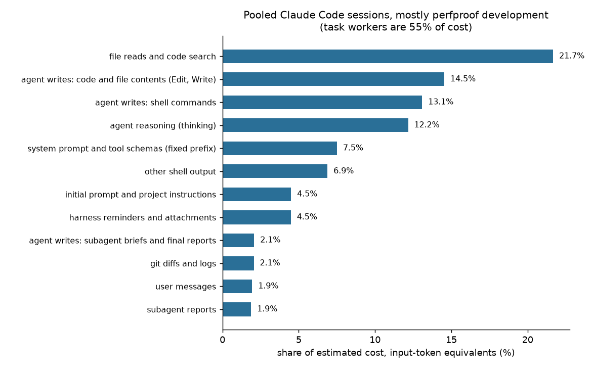

# Where the tokens go

Attribution of the tokens in real agent sessions to their causes, so
that the depth tiers (T3.14) and output trimming (T3.15) go after what
costs most. Snapshot: log records up to 2026-10-18 22:45 UTC. Everything here is
computed by [`analyze.py`](analyze.py) from the session logs, read in
place. No transcript text, prompt or file content is stored in this
directory; only category names and numbers.

## What was measured

| set | what | size |
|---|---|---|
| Claude Code, top-level | the lead sessions, the T3.10 hand-runs (NetBox, frames2py/picolm), the T3.11 PR study and its C1 to C4 runs, two task-worker sessions | 17 sessions |
| Claude Code, subagents | every transcript under the lead session's `subagents/`: task workers (general-purpose), reviewers, stats-auditors | 156 transcripts |
| `codex exec` | rollouts from 2026-10-14 on whose working directory is inside the perfproof tree (the T3.11 X1 to X3 runs and a few probes) | 6 rollouts |

All Claude Code projects whose directory name contains `perfproof` are
included, not a sample. Left out: projects outside perfproof (frames2py
zero-context runs and others), and subagent transcripts or rollouts
last written after the snapshot time, which includes the agent that did
this analysis. Records stamped after the snapshot are ignored in
top-level sessions (the lead session is still being written), so the
script gives the same numbers on every run with the same `--until`.

## Method

**Exact numbers.** Each API call logs `usage`: uncached input tokens,
cache-creation tokens (by 5-minute and 1-hour TTL), cache-read tokens
and output tokens. Input fields are exact for every call. Streaming
writes one log record per content block and repeats the usage, so
records are merged by message id before counting.

**One flaw in the logs, handled.** Subagent transcripts keep the
`output_tokens` value from the start of the stream, a handful of tokens
for a call that wrote thousands. Top-level sessions carry the final
count. 7,982 of 10,714 calls (all but one in subagent transcripts) have a
partial logged output (the logged output of all calls sums to 2.66M
tokens; with the derived values it is 12.53M). For those calls
the output is derived: the next call's input contains this call's whole
output, so output is the exact growth of input minus the estimated size
of what else was appended, never less than the logged value, and
estimated from characters where the next call can't be used (last
call, a new user turn, a rebuilt cache). Derived output is an estimate,
not usage. The derivation was tested on the 2,388 calls with a final
count: mean absolute error 23% of true output per call, and the derived
total came out 1.13 times the true total, so derived output is probably
overstated by around a tenth. All calibration below uses only calls
with a final count.

**Attribution.** The context before call *n* is everything appended so
far, in order. Each appended item gets a cause: tool results by tool
and, for shell, by command (test, lint and type-check runs; profilers;
`perfproof` invocations; git diff, log and show; curl and gh; cat, sed,
grep and friends; other); subagent reports; user messages; harness
reminders, hook feedback and attachments; the initial prompt and
project instructions; what the agent wrote (thinking, messages, and
tool-call inputs split into code written by Edit and Write, shell
commands, briefs and final reports, read requests, other); and the
fixed prefix (system prompt and tool schemas), which is whatever the
first call's input holds beyond the items above.

The prompt cache covers a prefix of the context. For each call the
first `cache_read` tokens of the ordered context are the cached part
and the rest was written or sent uncached, so cost is split by position
and each item pays for what it actually was. Item sizes are estimates:
characters times a fitted ratio, rescaled per call so the items sum to
the exact input (mean rescale 0.996, mean absolute log 0.131, so
typically within 14% of the exact figure per call).

**Calibration.** No Anthropic API key is configured in the environment,
so `count_tokens` was not used. Instead the characters-per-token ratios
are fitted to the exact growth of input between consecutive calls: the
growth is the earlier call's output plus whatever was appended, and
the appended characters are known. A non-negative least-squares fit over
2,388 such gaps gives the ratios in `tables.md`, 2.1 to 2.9 characters
per token for tool output and code (11.5 for the very short edit
acknowledgements, where the 38-token framing per item dominates). The
fit is not perfect: the error on the growth of input is 9.9% in
sample and 10.6% on sessions held out of the fit (5 folds), and
predicted over observed total growth is 1.007. Thinking turned out to
stay in context within a turn (fitted share 1.00) and to leave it when
a new user turn starts; the attribution follows that.

**Cost.** One unit is one uncached input token. Cache read is 0.1,
cache write 1.25 (5-minute TTL) or 2 (1-hour), output 5. These are the
API price ratios and an assumption of this study; the logs don't
contain prices, and subscription plans meter usage in ways not
modelled here. Units pool sessions that ran on different models (sessions that used each model, counts overlapping: 148 Opus 5.5, 19
Sonnet 5.5, 9 Fable 5.1, 2 Haiku 4.5), so a
unit is an input-token equivalent, not a dollar.

**Exact versus estimated.**

| number | status |
|---|---|
| calls, input tokens, cache reads and writes, uncached input | exact (`usage`) |
| output tokens, top-level sessions and codex | exact (`usage`) |
| output tokens, subagent transcripts | derived, see above |
| cost units in the first table | exact given the price ratios, with derived output for subagents |
| every split by cause: shares, ingested, re-read | estimated; calibrated error about 10% on input growth, about 13% per call after rescale |
| thinking tokens in subagent transcripts | estimated (output beyond the visible reply) |
| the classification of shell commands | heuristic: by the command that runs first, with a sensitivity range against a match-anywhere rule (below) |

## Results, pooled

**Corpus caveat.** The pooled mix is mostly perfproof's own development,
review and audit, not perfproof-driven optimisation runs: task workers
are 55.4% of the cost, stats-auditors 14.9%, the lead sessions 14.3%,
reviewers 7.0%, the two T3.10 hand-runs 4.2%. The hand-runs are the
nearest to real use; their mix is shown next to the pooled one.

### Cost share by group

| group | share of pooled cost |
|---|---:|
| task workers (general-purpose subagents) | 55.4% |
| stats-auditor subagents | 14.9% |
| lead sessions | 14.3% |
| reviewer subagents | 7.0% |
| T3.10 hand-runs | 4.2% |
| T3.11 PR study | 2.3% |
| task worker sessions | 1.9% |

### Pooled mix beside the hand-runs

| sessions | calls | cache read | cache write | output | fixed prefix | initial prompt | file reads and search | shell commands written | thinking | perfproof CLI | test output | profiler | git |
|---|---:|---:|---:|---:|---:|---:|---:|---:|---:|---:|---:|---:|---:|
| pooled, all Claude Code sessions | 10714 | 54.2% | 32.3% | 13.6% | 7.5% | 4.5% | 21.7% | 13.1% | 12.2% | 0.2% | 0.6% | 0.0% | 2.1% |
| T3.10 hand-runs together | 507 | 70.6% | 19.1% | 10.3% | 15.2% | 6.2% | 21.9% | 20.4% | 7.6% | 3.2% | 0.0% | 0.0% | 0.6% |
| t3-10-hand-runs-netbox-e8755a/023af39a (T3.10 hand-run) | 250 | 70.6% | 19.2% | 10.2% | 16.2% | 6.7% | 20.8% | 21.2% | 7.1% | 2.6% | 0.0% | 0.0% | 0.2% |
| t3-10-hand-runs-py-native-cd9978/e93ee6ec (T3.10 hand-run) | 257 | 70.6% | 19.1% | 10.3% | 14.4% | 5.8% | 22.8% | 19.8% | 7.9% | 3.7% | 0.0% | 0.0% | 1.0% |

The hand-runs lean harder on cache reads (70.6% of cost against 54.2%
pooled) and on the fixed prefix (15.2% against 7.5%).


### Exact usage by group

| group | sessions | calls | input | cache read share of input | output logged | output used | cost units | cost: cache read / write / uncached / output |
|---|---:|---:|---:|---:|---:|---:|---:|---|
| task workers (general-purpose subagents) | 32 | 4641 | 1.44B | 94.8% | 345k | 5.21M | 255.71M | 53.4% / 36.4% / 0.0% / 10.2% |
| stats-auditor subagents | 24 | 1716 | 322.41M | 94.5% | 120k | 3.27M | 68.80M | 44.3% / 32.0% / 0.0% / 23.7% |
| lead sessions | 5 | 1084 | 477.28M | 98.6% | 1.15M | 1.15M | 66.14M | 71.2% / 20.1% / 0.0% / 8.7% |
| reviewer subagents | 100 | 2198 | 123.20M | 92.6% | 80k | 1.94M | 32.48M | 35.1% / 35.0% / 0.0% / 29.8% |
| T3.10 hand-runs | 2 | 507 | 138.24M | 98.7% | 396k | 396k | 19.32M | 70.6% / 19.1% / 0.0% / 10.3% |
| T3.11 PR study | 8 | 343 | 59.28M | 97.3% | 325k | 325k | 10.61M | 54.4% / 30.3% / 0.0% / 15.3% |
| task worker sessions | 2 | 225 | 54.70M | 97.9% | 244k | 244k | 8.89M | 60.3% / 26.0% / 0.0% / 13.7% |
| pooled | 173 | 10714 | 2.62B | 95.7% | 2.66M | 12.53M | 461.94M | 54.2% / 32.3% / 0.0% / 13.6% |

Cost units are fresh-input-token equivalents under the price ratios above; usage columns are exact except `output used` for subagents.

### Pooled causes, largest cost first

"Ingested" counts a token once when it enters the context; "re-read" counts it again on every later call that served it from the cache.

| cause | share of cost | ingested | re-read from cache |
|---|---:|---:|---:|
| file reads and code search | 21.7% | 7.57M | 599.85M |
| agent writes: code and file contents (Edit, Write) | 14.5% | 2.47M | 320.10M |
| agent writes: shell commands | 13.1% | 3.46M | 255.84M |
| agent reasoning (thinking) | 12.2% | 5.51M | 175.22M |
| system prompt and tool schemas (fixed prefix) | 7.5% | 2.32M | 305.02M |
| other shell output | 6.9% | 2.38M | 183.57M |
| initial prompt and project instructions | 4.5% | 1.56M | 136.22M |
| harness reminders and attachments | 4.5% | 1.26M | 128.24M |
| agent writes: subagent briefs and final reports | 2.1% | 343k | 32.24M |
| git diffs and logs | 2.1% | 1.32M | 50.68M |
| user messages | 1.9% | 337k | 62.52M |
| subagent reports | 1.9% | 372k | 54.81M |
| web and gh fetches | 1.8% | 373k | 55.69M |
| hook feedback | 1.8% | 376k | 44.87M |
| agent messages | 1.1% | 180k | 28.65M |
| agent writes: other tool calls | 0.7% | 86k | 18.84M |
| test, lint and type-check output | 0.6% | 152k | 14.22M |
| edit and write acknowledgements | 0.5% | 97k | 12.35M |
| agent writes: read, search and fetch requests | 0.4% | 80k | 9.75M |
| other tool results | 0.2% | 45k | 7.37M |
| perfproof CLI output | 0.2% | 62k | 6.19M |
| profiler output | 0.0% | 7k | 502k |

Ingested once: 30.35M tokens in total, 15.91M of them tool results, messages, reminders and prompts. Re-read from the cache: 2.50B tokens.



Cache reads and cache writes are 86% of the cost; output is 14%; uncached
input is nothing. The cost of a token in the context is mostly paid again
on every later call: the pooled run ingested 15.9M tokens of tool results,
messages, reminders and prompts (30.3M counting what the agents wrote
and the fixed prefix) and re-read 2.5B tokens of context from
the cache. What matters for a cause is therefore its size times how long
it stays in the context, not its size alone.

The other tables:

- [`tables.md`](tables.md): the same tables for every group, drill-down by
  tool and command, result-size buckets, what the agent wrote, the
  classifier sensitivity, calibration ratios, the codex table.
- [`per-session.md`](per-session.md): one table for each of the 17
  top-level sessions and 6 codex rollouts (top ten causes each).
- [`sessions.csv`](sessions.csv): one line per session, subagent
  transcripts included, with the exact usage and the cost share of every
  cause.

## Sessions, largest cost first

Top-level sessions; the three top causes of each. Subagent transcripts
are summed by agent type in `tables.md`.

| session | calls | input | output used | cost units | top three causes (share of cost) |
|---|---:|---:|---:|---:|---|
| main/0b43a194 | 955 | 442.73M | 970k | 60.34M | agent writes: shell commands 15.1%; user messages 12.4%; agent writes: code and file contents (Edit, Write) 9.1% |
| t3-10-hand-runs-py-native-cd9978/e93ee6ec | 257 | 74.88M | 215k | 10.46M | file reads and code search 22.8%; agent writes: shell commands 19.8%; system prompt and tool schemas (fixed prefix) 14.4% |
| t3-10-hand-runs-netbox-e8755a/023af39a | 250 | 63.35M | 181k | 8.86M | agent writes: shell commands 21.2%; file reads and code search 20.8%; system prompt and tool schemas (fixed prefix) 16.2% |
| t3-11-pr-study-0f488d/eb9ef3ba | 191 | 46.68M | 155k | 7.71M | agent writes: shell commands 19.7%; file reads and code search 17.7%; system prompt and tool schemas (fixed prefix) 16.9% |
| t1-3-decision-rule-abaccd/218043c3 | 163 | 46.85M | 186k | 7.46M | file reads and code search 22.4%; system prompt and tool schemas (fixed prefix) 15.6%; agent writes: shell commands 15.0% |
| main/1851917c | 124 | 34.35M | 180k | 5.64M | agent writes: code and file contents (Edit, Write) 17.5%; system prompt and tool schemas (fixed prefix) 15.7%; web and gh fetches 12.3% |
| t0-2-ci-56fd31/e6e541c6 | 62 | 7.84M | 58k | 1.42M | system prompt and tool schemas (fixed prefix) 27.8%; agent writes: shell commands 15.4%; initial prompt and project instructions 12.4% |
| t3-11-pr-study-0f488d/runs-C2-pico/801de4af | 43 | 4.69M | 67k | 1.05M | agent writes: shell commands 28.4%; agent reasoning (thinking) 24.8%; file reads and code search 19.1% |
| t3-11-pr-study-0f488d/runs-C3-nb/1e4bdca6 | 55 | 4.26M | 41k | 829k | system prompt and tool schemas (fixed prefix) 20.7%; agent reasoning (thinking) 17.0%; agent writes: shell commands 16.4% |
| t3-11-pr-study-0f488d/runs-C1-f2p/1eb903fd | 37 | 2.89M | 53k | 740k | agent reasoning (thinking) 32.5%; agent writes: shell commands 25.2%; file reads and code search 16.9% |
| t3-11-pr-study-0f488d/runs-C4-f2p/1035262f | 13 | 674k | 9k | 195k | file reads and code search 34.9%; agent writes: shell commands 20.5%; system prompt and tool schemas (fixed prefix) 15.8% |
| main/914436a8 | 1 | 36k | 1k | 80k | system prompt and tool schemas (fixed prefix) 61.0%; initial prompt and project instructions 30.0%; agent reasoning (thinking) 7.6% |
| main/f3595707 | 3 | 129k | 2k | 58k | initial prompt and project instructions 56.0%; system prompt and tool schemas (fixed prefix) 27.4%; agent reasoning (thinking) 8.1% |
| t3-11-pr-study-0f488d/frames2py-base/779eba19 | 1 | 26k | 753 | 55k | system prompt and tool schemas (fixed prefix) 67.6%; initial prompt and project instructions 25.6%; agent messages 3.5% |
| main/507824b6 | 1 | 36k | 453 | 24k | initial prompt and project instructions 80.3%; system prompt and tool schemas (fixed prefix) 10.2%; agent reasoning (thinking) 6.1% |
| t3-11-pr-study-0f488d/frames2py-base/7c69f80f | 2 | 56k | 193 | 18k | initial prompt and project instructions 60.1%; system prompt and tool schemas (fixed prefix) 33.0%; agent writes: shell commands 3.0% |
| t3-11-pr-study-0f488d/frames2py-base/7a7c5f8a | 1 | 2k | 48 | 4k | initial prompt and project instructions 65.1%; system prompt and tool schemas (fixed prefix) 28.8%; agent reasoning (thinking) 4.2% |

## Sensitivity to how shell commands are classified

Shell output is classified by the command that runs first in the line,
after leading `cd`, variable assignments, `time` and `uv run`. A
`perfproof` invocation counts as CLI output wherever it sits, since runs
wrap it in logging scripts. The older rule, the first pattern that
matches anywhere in the text, is kept as a comparison. Only shell
commands differ. The range is the sensitivity of each share to that
choice.

| cause | first command | match anywhere | range |
|---|---:|---:|---:|
| file reads and code search | 21.7% | 24.0% | 21.7% to 24.0% |
| git diffs and logs | 2.1% | 3.4% | 2.1% to 3.4% |
| test, lint and type-check output | 0.6% | 2.7% | 0.6% to 2.7% |
| web and gh fetches | 1.8% | 1.9% | 1.8% to 1.9% |
| perfproof CLI output | 0.2% | 0.2% | 0.2% to 0.2% |
| profiler output | 0.0% | 0.2% | 0.0% to 0.2% |
| other shell output | 6.9% | 0.9% | 0.9% to 6.9% |

The test-output share moves most (0.6% to 2.7%): `uv run pytest` is
found by the first rule, while test logs read afterwards with `cat` or
`sed` count as file reads there and as test output under the other
rule. Other shell output absorbs the difference: setup commands (`git
fetch`, `git worktree`, `mkdir`), `python -` scripts and `for` loops.

## The five costliest items and what would cut each

**Corpus caveat.** These shares come from the pooled mix, which is mostly
perfproof's own development, review and audit: task workers are 55.4% of
the cost, stats-auditors 14.9%, the lead sessions 14.3%, reviewers 7.0%,
and the two T3.10 hand-runs, the nearest thing to an optimisation run,
only 4.2%. What a perfproof user's session costs will differ; the
hand-run mix is in the table above for comparison. Shares are of
estimated cost in the pooled Claude Code sessions. The "change" is a
proposal grounded in the numbers shown. None of the savings has been
measured; T3.15 and T3.14 each have to measure theirs against these
baselines.

1. **File reads and code search, 21.7%** (24.0% under the other
   classifier). The Read tool is 40.2% of the category, then `sed`
   24.7%, `cat` 16.4% and `grep` 13.3% in the shell. By size, 52.7% of
   the ingested tokens sit in results over 10,000 characters (437
   results of 10k to 40k and 40 over 40k); 9.8% in results under 2,000.
   285 reads (691k tokens of the 7.57M ingested) were of a path already
   read in the same session.
   *Change:* these are the agent's own reads of source and logs, so an
   output cap on perfproof's `--brief` forms cannot reach them (CLI
   output is 0.2% of cost here). What can: the skill sends the agent to
   ranged reads (Read offset and limit, `sed -n` ranges) around the
   profile's hot spots instead of whole files, and not to re-read a file
   already in the context; and the CLI returns the file-and-line
   locations the agent needs, so it opens a range rather than a file.
   T3.13 should count tokens in file reads per session with and without
   that guidance.

2. **What the agent writes into files, 14.5%.** Write calls are 69.9% of
   the characters written (522 calls) and Edit 30.1% (1,269 calls). The
   logs cannot say how much of the Write volume is new files and how much
   is whole-file rewrites. Each written token is re-read about 130 times
   (2.47M ingested, 320M re-read), so the cost grows with how long the
   worker keeps going after writing.
   *Change:* the attempt cap and round budget of T3.14, and a worker per
   hypothesis that ends when its attempt ends instead of one long
   context (the task workers made 4,641 calls over 32 transcripts). In
   the skill: Edit for existing files.

3. **Shell commands the agent writes, 13.1%.** 64.7% of the characters
   are heredoc or `python -c` scripts (1,955 calls), 4.6% other long
   commands, 30.7% short commands. The long ones are ad hoc analysis and
   file-generation scripts.
   *Change:* put the aggregation the scripts do into CLI subcommands
   (T3.8, T3.15) so the agent calls one command instead of writing a
   script. Measure by the count and size of heredoc calls per session in
   T3.13 runs before and after.

4. **Reasoning (thinking), 12.2%.** It varies by role: 32.3% of the
   stats-auditor transcripts, 24.8% of reviewers, 7.8% of task workers.
   Thinking stays in context for the rest of the turn, so a long thought
   early is re-read on every later call. The subagent figures are
   derived (see Method), probably high by around a tenth.
   *Change:* reasoning effort belongs in the depth tiers (T3.14): `light`
   runs the reviewer and auditor roles at a lower effort. Whether that
   costs quality is not answered here; T3.14 measures it on held-out
   tasks.

5. **The fixed prefix, 7.5%, and the initial prompt and project
   instructions, 4.5%.** Both are set on the first call and re-read on
   every later one: 305.02M and 136.22M tokens re-read. Most of the
   prefix is the harness, which perfproof does not control; what it
   controls is `AGENTS.md`, `CLAUDE.md`, the skill text and the briefs
   it gives subagents. Harness reminders and attachments (4.5%) and hook
   feedback (1.8%) are separate: they are appended all through a
   session, not set once, so cutting them means fewer or shorter
   appended notes (for example capping the lint hook's feedback), not a
   shorter prefix.
   *Change:* keep the always-loaded text short and move detail into files
   the agent opens on demand, as `AGENTS.md` already does for specs. T3.16
   should record the size in tokens of what `/perfproof` adds to the
   prefix on install.

## What the data does not support

T3.15 starts from the premise that most of a session's tokens go to the
agent reading test logs, profiles and diffs. In these sessions, test,
lint and type-check output, git diffs and logs, profiler output and
`perfproof` CLI output together are 2.9% of cost by the first-command
classifier and 6.5% by the match-anywhere one (the sensitivity table has
each). File reads and code search alone are 21.7% to 24.0%.

The T3.10 hand-runs are the nearest to the intended use. Together: the
`perfproof` CLI is 3.2% of cost (2.6% in the NetBox run, 3.7% in the
picolm/frames2py run), tests and profilers 0.0%, git 0.6%, file reads and
code search 21.9% (20.8% and 22.8% per run) and agent-written shell
commands 20.4%. Those runs hand-drove an early CLI, many of whose
commands were already wrapped to log to a file and print a short tail,
which lowers the CLI's share; so this is a measurement of the sessions as
they ran, not of a finished perfproof loop. The numbers should be taken
again from T3.13's harness runs once they exist.

## Codex

Six rollouts, 71 calls, 2.98M input tokens (94.3% cached) and 22k output.
Usage is exact; the split is estimated from a fit on 65 gaps (error 11%
in sample, 21% held out), roughly 3.8 characters per token for tool
output, against 1.9 to 2.9 for Claude Code, so the two tokenizers differ
and are not pooled. By tokens, file reads and code search are 40%, the
fixed prefix 37%, git output 11% and agent-written shell commands 6%. The
sample is too small to rank anything below the top two.

## Not verified

- `count_tokens` was not run (no API key in the environment, and keys are
  not requested). The character ratios are calibrated against exact usage
  growth instead; they are not checked against the real tokenizer.
- Output tokens for 7,982 calls (75% of all calls, all but one in
  subagent transcripts) are derived; the check on calls with a final count
  says the derivation runs about 13% high in total and 23% off per call.
  That population differs from the one it was checked on.
- The split by cause rests on the fitted ratios and on rescaling each
  call to its exact input; per-call error is about 13%, and the pooled
  shares are better than that only if the errors are unbiased, which was
  not tested.
- Cost units use API price ratios and pool different models; they are not
  dollars and not subscription quota. T3.14's cost unit (a share of a
  5-hour window, from `get_usage`) is a separate measurement.
- Command classification is heuristic; its sensitivity is given above for
  the two rules tried, not for every possible rule.
- Context cleared or compacted by the harness would break the context
  model; 2 calls show input shrinking by over 20%, so it is rare here.
- Savings from the proposed changes are not measured.

## Reproduce

```bash
uv run --with numpy --with scipy --with matplotlib \
    studies/tokens/analyze.py ~/.claude/projects \
    --codex ~/.codex/sessions --out studies/tokens
```

The script takes the Claude Code projects directory as its path argument
(and optionally the Codex sessions directory), reads the logs in place,
and writes `tables.md`, `per-session.md`, `overview.md`, `sessions.csv`
and `cost_split.png`. It selects projects whose directory name contains
`perfproof`. numpy, scipy and matplotlib come in through `uv run --with`;
nothing is added to `pyproject.toml`. Every number quoted in this README
is in `tables.md`, produced by the script.
